# State machines

AppyTappy has few `enum State` types, but much of its behavior is still a set of
state machines. This page names each one, draws it, and says which events move
it. It also says where a machine can reach a state it never leaves, or a state
that does the wrong thing. Each of those has an issue, linked under
**Open problems** at the end of its section.

Read [Architecture](Architecture.md) first: it describes the threads that these
machines run on.

## How to read this page

An _implicit_ state machine is state that is spread over a few fields, flags,
or `Option`s, plus the code that changes them. No type lists its states, so
this page does. For example, the runtime has no type for an application's run
state; whether it runs follows from three maps and a flag on the owner thread.

The diagrams are [Mermaid](https://mermaid.js.org/) state diagrams. GitHub
draws them. A box is a state, and an arrow is a transition labeled with the
event that causes it. `[*]` is where the machine starts or ends.

Many messages travel between threads, so a message can arrive after the state
it was about has gone. Five guards drop such stale messages:

- **Session IDs.** The runtime gives each reader session a new `SessionId`
  (`apps/runtime/src/model.rs`). The owner drops a reading whose session no
  longer runs.
- **Generations.** The setup app's owner thread adds 1 to `generation` each
  time it starts or stops a capture. A frame or a failure from an older
  generation is dropped.
- **Recording IDs.** Each recording gets a new `id`, so text that the text
  reader sends back for a discarded recording is dropped.
- **Overlay numbers.** Each overlay capture gets its own number from
  `Overlays::next`, and a reading from an older capture is dropped.
- **Check numbers.** The capture screen gives each check it tries on the
  live window a number, which is in force from when the owner took the check
  until the draft changes. An answer to a read asked under another number,
  or under none, is dropped (`afterRead` in
  `apps/setup/src/lib/liveCheck.ts`).

Source files are named as code text rather than linked, so a file that moves
leaves no broken link.

## Runtime

### Owner thread start and stop

`owner::watch` in `apps/runtime/src/owner.rs` starts every thread, runs the
event loop, and stops every thread in a fixed order.

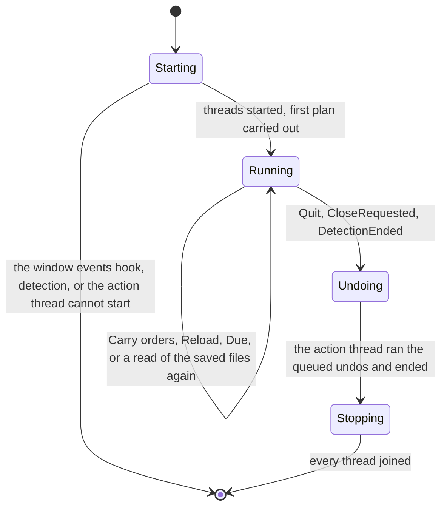

- **Starting.** The window events hook starts first, and the runtime exits if
  it cannot. Then the tray and the reload watch start, and the saved files are
  read. The tray gets a fresh menu after that read, so its check mark shows
  whether automations start enabled. The reload watch and the tray are
  optional: the runtime logs why it cannot make one and runs without it. A
  pick from the tray during the first read waits for the owner and applies
  after it. Then the lifecycle and action threads start. If either cannot
  start, the runtime stops what it started and exits with the error. A first
  read that fails starts with an empty plan and reads again, as
  [Reload watch](#reload-watch) describes.
- **Running.** Each event becomes a `Step`: `Carry` some orders, `Picked`
  when the user picked Enable or Disable from the tray, which carries its
  orders too and sets `picked` (see [Reload watch](#reload-watch)), `Reload`
  the saved files, `TraceFailed`, or `Stop`. The owner waits for its next
  event only until the first of two times (`wake`): when a rule that its
  cooldown held back is due, and when it reads the saved files again after a
  read failed. Either time sends it `Due`, whose step rechecks the held rules
  and, once the retry is due, reads the saved files again. With neither, it
  waits with no limit. After each step the tray gets a fresh menu if it
  changed.
- **Undoing.** `model.set_enabled(false)` stops every running application and
  queues the undo of what its automations changed. The owner then drops the
  job sender and joins the action thread, which runs the queued undos before
  it ends.
- **Stopping.** The tray stops only after the undo, because at the end of the
  session it holds Windows back until `Tray::stop` (see
  [Tray thread](#tray-thread)). Then the reload watch and the window watch
  stop, and dropping the inputs ends detection. Each reader is stopped, and
  every thread is joined.

### Runtime state

`model::State` is the runtime's one named state, which the log and the tray
show. It is derived each time from the model rather than stored:

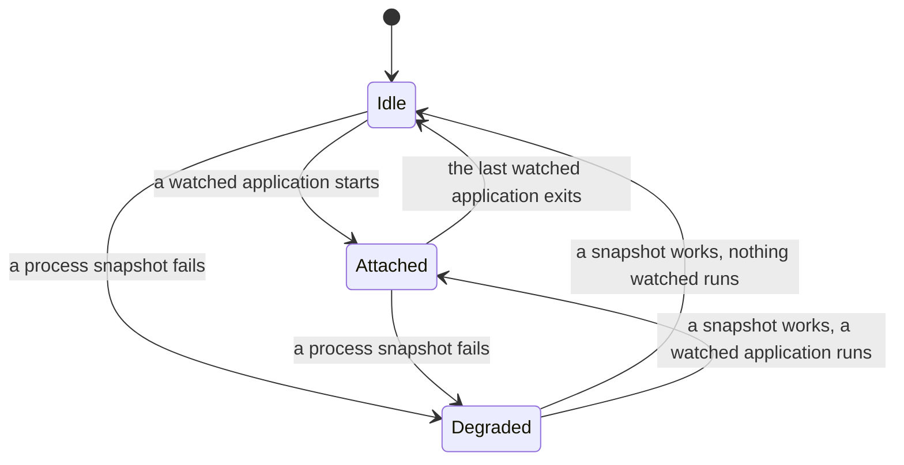

Degraded wins over the other two while `problem` is set.
[Lifecycle](Architecture.md#lifecycle) explains each state.

### Detection timers

The lifecycle thread (`apps/runtime/src/lifecycle.rs`) decides when to take a
process snapshot. Its state is two optional deadlines, `scan_at` and
`rescan_at`, plus whether any watched application runs and whether the last
snapshot failed.

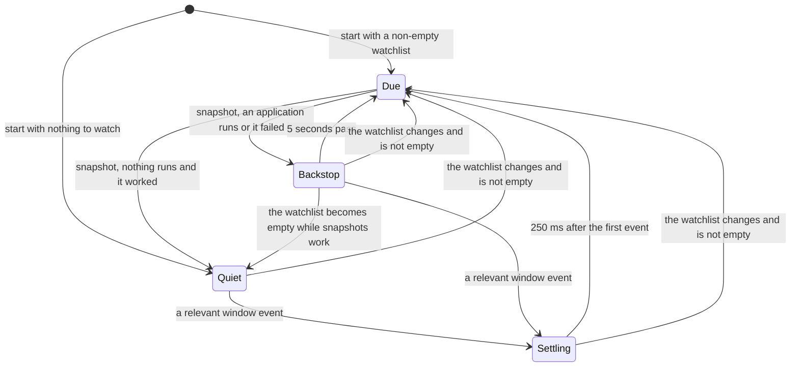

A created top-level window is relevant while anything is watched. A destroyed
window is relevant only while a watched application runs. More events while
**Settling** do not move the deadline, so a burst becomes one snapshot. The
two delays are `SETTLE` and `RESCAN`.

Each snapshot ends the session of an application whose process is gone, and
starts one for an application that runs without one. When several processes
fit one application, the session follows the process that owns the window its
reader reads, and a process that owned one keeps the session for
`OWNER_GRACE` after it owns none; [Lifecycle](Architecture.md#lifecycle) gives
the rule. Each start is followed by an `Identified` change with the build of
the executable that runs, which changes no state: the owner only logs it, as
[Build detection](Architecture.md#build-detection) describes. A new watchlist
ends the session of each application it drops or whose executable pattern it
changes, and forgets which process owned its window.

### Per-application run state

The model (`apps/runtime/src/model.rs`) has no run state type. An application's
automations run while all of these hold:

- It is in `attached`: detection found its process.
- `enabled` is true: automations are on in the tray. It starts true, or as
  the tray last left it when the settings remember that, as
  [Files and handoff](Architecture.md#files-and-handoff) describes.
- The plan has automations for it.

When they all hold, the application has an entry in `running`, keyed by its
reader's `SessionId`, with its engine session and its newest plan. The model
holds no channel and no trace: each change returns `Order`s, the model's own
type, and the owner turns each into a message for a reader or the action
thread.

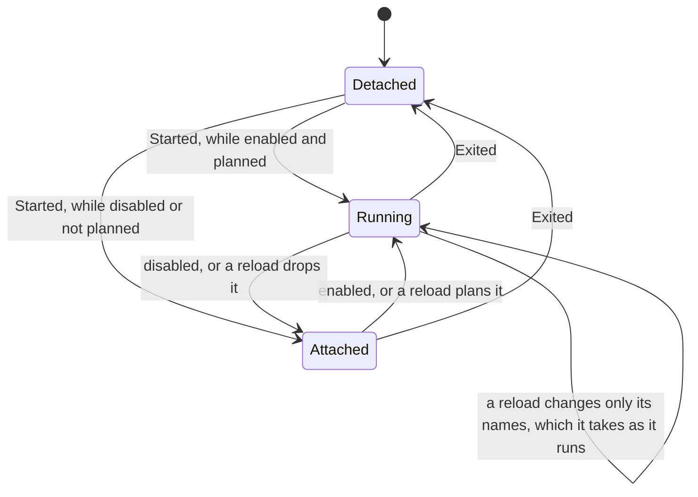

- **Running to Attached or Detached.** The engine session is stopped,
  which releases every rule that restores. The reader is stopped.
- **A reload that changes what it runs.** `replan` compares each plan's
  `Runs`: its window match, its values' checks and its rules, but not the
  automations' names that each rule's entry carries. When they differ, the
  application stops, which undoes what its automations changed, and starts
  again in a new session.
- **A reload that changes only names.** When only the plan's names differ, or
  the build its values were checked against, the session keeps running and
  takes the new plan, so the log and the tray use the new names. The reader
  sends each value and each value's problem by its position, and the owner
  logs a problem with the value's newest name.
- **Unseen.** When the reader says the values can no longer be seen, the owner
  calls `forget_values`. The rules keep their state, so a rule that fired stays
  fired until new readings decide its condition.
- **A new read interval.** `restart_readers` stops each running
  application's reader that reads at another interval and starts it again in
  the same session, and calls `forget_values` first, as for `Unseen`, because
  the new reader sends its first readings whether or not they changed. A
  reading the old reader sent just before it stopped can still arrive after
  that, a few milliseconds old. A new trace restarts nothing: it reaches each
  reader as a message, as [Runtime trace](#runtime-trace) describes.

### Reader thread

Each running application has a reader thread (`read` in
`apps/runtime/src/workers/reader.rs`). The thread's position in its loop is its
state, along with `Recovery`: why the last capture ended and how long to wait
before the next one, and the trace it records to.

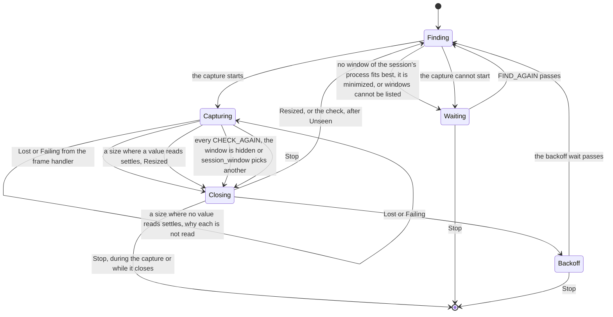

- **Finding.** `find_window` lists the processes and windows and takes the one
  `session_window` picks among the session's process's (`Job::watched`), as
  detection does: of its windows that fit best, the one the last capture
  read while it shows, such as after a resize, then the first that shows.
  When the process owns none of the windows that fit best, such as while
  another process's window fits better, it waits, and detection follows the
  other process or keeps this one for its grace. Before the capture starts,
  `framed_at` asks `System::frame_size` for the size the window's frames will
  have, the window's bounds without its shadow (`DWMWA_EXTENDED_FRAME_BOUNDS`),
  and places the values there when some value reads there, so a window that
  is not at the first value's drawn size is not captured twice at each start.
  The size is a guess: frames of another size are followed as below, and
  after a capture ended with `Resized`, the next one starts at the size its
  frames settled at, without guessing again. The first capture otherwise
  starts at the first value's drawn size.
- **Capturing.** `watch` waits on `control` until the next `CHECK_AGAIN` or
  until a new size settles, whichever comes first. The capture's frame handler
  runs on another thread and sends `Lost`, `Resizing`, `Failing`, or
  `Recovered` back to this one. A `Trace` from the owner goes on to the frame
  handler over its own channel, and the capture goes on. Each `CHECK_AGAIN`,
  `moved_on` checks that the window still shows and that `session_window`
  still picks it, which it does while the window shows and fits as well as
  any, because a hidden window sends no frames and no close.
- **Settling.** `Resizing` names the size frames show now, and a `Settle`
  (`crates/sources/src/screen/settle.rs`) waits for it to hold for `SETTLE`,
  250 ms, starting again at each other size. The wait runs on this thread's
  timer, so a window that stops drawing once it is dragged still settles.
  The settled size is resolved once with `Placed::new`. When a value reads
  there, the capture ends with `Resized`, which carries where each value reads,
  and starts again at those regions, once for each settled size. When none
  does, the capture goes on and this thread says why each value is not read
  there (`say_unread`), at once, even when the window draws no more frames.
  The problems said for each value since it was last read move between the
  two threads over channels: the handler keeps them while frames show the
  capture's size, hands them to this thread in its first `Resizing` for
  another size, and takes them back, with what this thread said, on the
  first frame of its own size again. Nothing moves for
  each frame. A capture started for a new size starts from those problems,
  and one started after a capture ended any other way starts from none. A
  size that settles back at the capture's own size changes nothing. Windows
  can recreate the frame pool at a new size in place, and `capture.rs`
  already does, but the capture's crop and packing are fixed when it starts,
  so a new layout needs a new capture.
- **Closing.** The thread closes the capture first, then drops what the closed
  capture sent after the message that ended it, still counting a `Stop` and a
  `Recovered`. When the 2 second check ended the capture, it then sends
  `Unseen`, so no reading from the old capture can follow it.
- **Backoff.** After `Lost` or `Failing`, the thread waits before it looks
  again: `FIND_AGAIN` at first, doubling up to `RESTART_WAIT_MAX` while each new
  capture ends before it reads a frame. It logs the reason once until the reason
  changes. A restarted capture that reads a frame sends `Recovered`, which
  resets both.
- **A new trace.** `Trace` from the owner reaches the thread in any state.
  While it waits or closes a capture, the thread keeps it for its next
  capture, which starts with it; while it captures, it hands it on too. No
  state changes for it.
- Each problem, such as no window fitting yet, is sent once until a different
  problem or a working capture replaces it.

### Frame handler

`FrameReader::handle` runs once per frame and decides what each frame means.
Its state is `placed` (the window size whose values it reads, and where
each value reads at it, resolved once), `told` (the other size it last told
the reader frames show), `last` (each value's last reading), `problems`
(the problems said for each value since it was last read, handed to the reader while frames show
another size), `heard` (where the reader gives it back), `seen` (whether
it sent a reading since it last sent `Unseen`), `failures` (frames in a
row that failed), `restarted` (whether the reader started this capture
again after the last one ended), `ended` (whether it told the reader
its capture ended), and `trace` (what it records to, the newest that the
reader handed it before the frame).

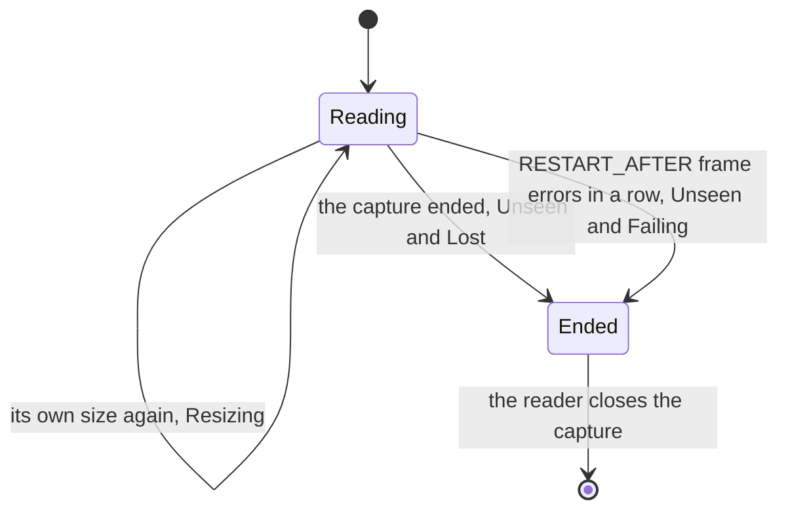

- A `Sample` goes to the owner only when a value reads differently from its
  last reading.
- A frame error is logged once until another problem or a good frame replaces
  it. A good frame starts the count again. A region that lies outside a window
  of its own drawn size does not count, because a new capture would fail the
  same way.
- The capture ends, as when the window closes, the graphics device is lost, or
  the frame pool cannot follow the window to a new size, with a
  `NotConnected` error.
- After a restart, the first good frame sends `Recovered` to the reader thread.
- **Ended.** The capture can still hand frames to the handler until the reader
  closes it. The handler reads none of them, so nothing it sends follows
  `Unseen`.
- A frame at another size sends `Unseen` and reads nothing, and the handler
  tells the reader the size with `Resizing` once, not for each frame, so
  nothing is resolved for each frame. Only the reader resolves a size, once
  it settled.
- A settled size at which no value reads keeps the capture, because a
  restart would find the same size. The reader says once why each value is
  not read there, and the handler reads nothing until frames show its own
  size again.
- A value that does not read at the capture's own size, such as one whose
  scaled region reaches outside the window, says why once and is not
  copied.
- A value whose check fails on a frame keeps its last reading and says why.
  The handler keeps every problem it said for the value since the value was
  last read, and says each once: a good read forgets them. A number's check
  fails one way for each stage of its read, such as a character its
  reference has not learned, whatever the characters are, so a counter that
  stays unreadable while it counts is said once, with what its first failed
  read showed, and a region that flickers between two stages is said twice,
  not once for each frame
  ([Why a number is not read](Screen-regions.md#why-a-number-is-not-read)).
  At a size the value was not drawn at, the problem says its region is
  scaled there and to fix the value at that size if the region is off,
  which makes it another problem than the same stage at a drawn size.
- Each value's problems leave the window size out and are carried into the
  capture started for a new size, so the log says why once for each reason,
  not once for each size or each restart.

### Read schedule

`ReadSchedule` in `crates/sources/src/schedule.rs` sets the wait before the next
frame is read. Its only state is the current wait.

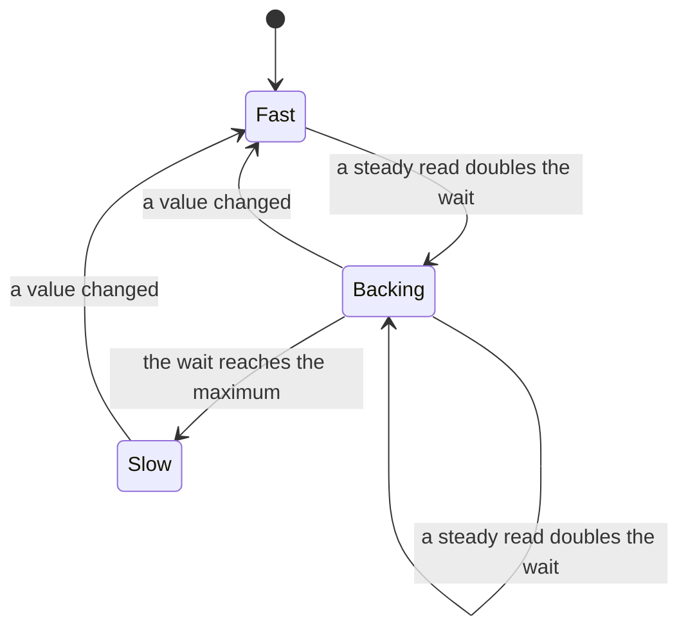

**Fast** and **Slow** are the fastest and slowest reads from the settings,
16 ms and 500 ms by default. The reader's job carries them, so a new read
interval stops the reader and starts it again in the same session, after the
owner forgets the session's values.
After a read that waits 64 ms or more, the capture asks Windows for frames no
more often than the wait, never below the minimum, so a window whose values
hold still is copied into the frame pool about twice a second rather than every
time it repaints. A shorter wait keeps the minimum.

### Number text

The number check reads characters left to right, and `NumberText::push` in
`crates/sources/src/screen/digits.rs` keeps which part of a number it is in.

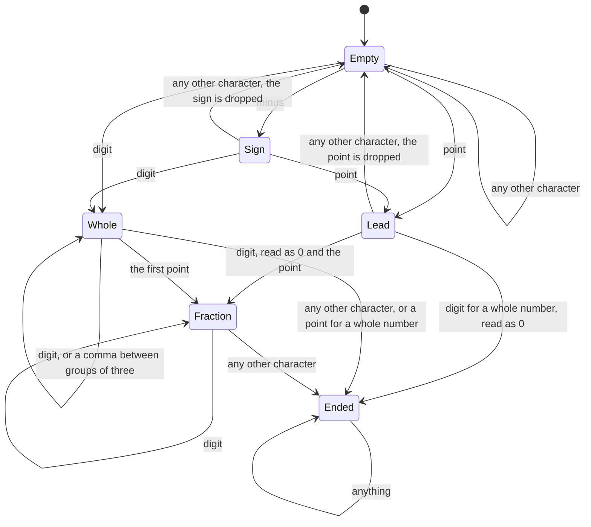

Before a digit, a character that does not fit starts the number over. After a
digit, it ends the number, and the rest of the region is ignored, so `12/50`
reads as 12 once `/` is learned. A `,` is skipped when it separates groups of
three digits before the point, so `1,234` reads as 1234. When the digits after
a `,` are not a group of three, as in `12,5`, the number ends at the `,` and
reads as 12. A `.` before any digit reads as `0.`, so `.5` reads as 0.5 (or 0 for
a whole number) and `-.5` as -0.5, unless a letter came before it, as in `Lv.5`. A value set to **Whole number only**
ends the number at its point, so `87.5%` reads as 87. A region with more than
24 characters (`MAX_CHARACTERS`) is a read error.

### Rule state

Each rule in an engine session (`crates/engine/src/lib.rs`) has a `RuleState`
of three fields: `armed`, `active`, and `last_fired`.

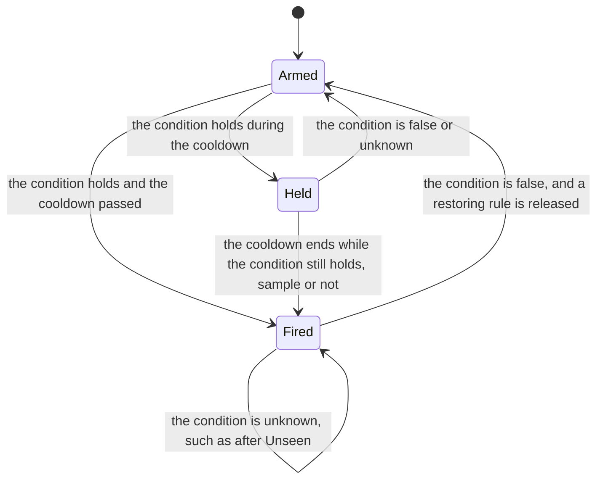

- **Fired** means `armed` is false. A rule that restores is also `active` until
  it is released.
- **Held** is not a field: it is a rule that is `armed`, whose condition holds
  on the values the session has, and whose cooldown from `last_fired` has not
  passed.
- In one sample, releases run before fires, so a restore never undoes a change
  another rule makes on the same value.
- A session that stops, because the application exited or its automations
  stop running, releases every active rule.
- The engine runs when a sample of any of the session's values arrives, and
  at the end of a held rule's cooldown. A value that holds still sends no
  sample, so `Session::next_due` gives the earliest time a held rule's
  cooldown ends. The owner wakes then if no event came first, and
  `Session::recheck` fires each held rule whose cooldown passed.

### Action thread and restore journal

The action thread (`apps/runtime/src/workers/act.rs`) makes the media and audio
controls when it starts, then runs each job in order. Its loop is a `Worker`
whose `actions` field holds the restore journal (`Actions`) once the controls
are made, or a `Missing` record with the last error and a `Backoff` while they
cannot be.

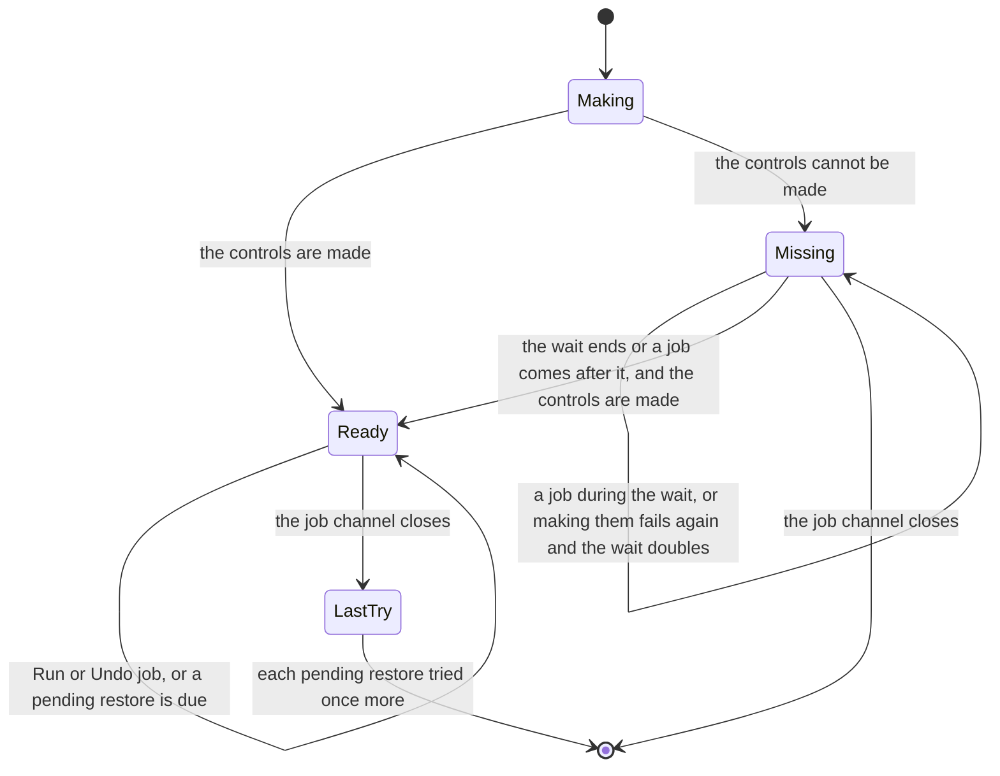

- **Missing.** A `Run` job logs that its actions did not run, and an `Undo` job
  has nothing to undo. When the wait ends, or the first job after it comes,
  the worker makes the controls again. The wait starts at 1 second and doubles
  after each failure, up to a minute. The log says when actions can run again.
- **Telling the owner.** `act::run` sends `ActionReport::CanRun(false)` when the
  worker reaches **Missing** and `CanRun(true)` when it leaves it, and only
  then; the owner takes it that actions can run until it hears otherwise. The
  owner keeps the last report in the model's `actions_can_run`, and the tray
  shows it.
- **Ready.** After each job, the worker tries the pending restores that are
  due. While any restore is pending, it waits for the next job only until the
  next one is due, or 10 seconds (`VOLUME_RETRY`) for a volume restore.
- **LastTry.** `last_try` tries every pending restore once, due or not, and
  forgets them.

The journal in `crates/actions/src/journal.rs` holds one entry per change that
a restoring rule made, in the order they were made. For each target, such as
one audio session's volume, the entries form a stack:

- **Perform, restoring.** The change is pushed with the state before it. If a
  restore of that target is pending, the change takes it over, so its own
  release puts back the state from before the first change.
- **Perform, not restoring.** Every entry for that target is removed, so no
  release undoes the permanent change. A pending restore of that target is
  dropped too.
- **Release.** The rule's entries are taken newest first. If a later entry on
  the same target exists, it inherits the older state. Otherwise the change is
  undone. A pending restore of the same target came from a newer rule, so the
  undo takes it in and puts back the older state. Each entry leaves the
  journal before its undo runs.
- **Failed undo.** The change moves to `pending` instead of being dropped. A
  volume restore is tried again until it works, and is dropped only once its
  audio session is gone. A media restore is tried once more, 2 seconds later
  (`MEDIA_RETRY`), then given up.

The journal lives only in memory, so a forced end, a crash, or an
end-of-session wait that runs out loses what it had not undone.

### Tray thread

The tray thread (`crates/platform/src/win/tray.rs`) runs a message loop. Its
state is whether the menu is open, and whether the window's procedure is
holding the end of the session.

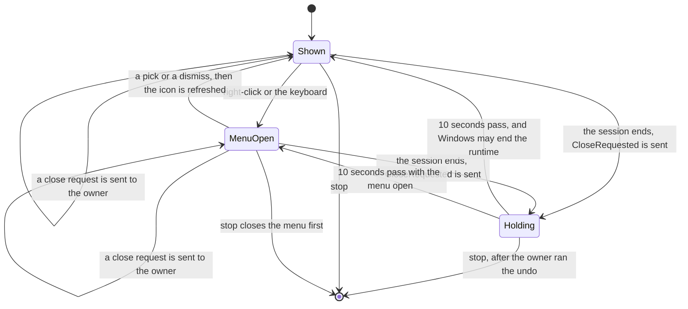

The window's procedure sends a close request and the end of the session to
the owner itself. Windows's menu loop drops what is posted to the tray loop
while the menu is open, but it still calls the procedure, so neither is lost.
[Tray](Architecture.md#tray) explains the posts.

- **Holding.** Windows asks first whether the session may end
  (`WM_QUERYENDSESSION`). The procedure gives a shutdown block reason and
  agrees. When the session really ends (`WM_ENDSESSION`), the procedure does
  not return until `Tray::stop` drops the sender it waits on, or 10 seconds
  (`END_SESSION_WAIT`) pass. Then it takes the reason back, as it also does
  when Windows calls the end off. If the wait runs out, the tray goes on as it
  was, and Windows may end the runtime. A critical shutdown, or a user who
  ends the session anyway, can also end the runtime before the wait is over.
- With no tray window, nothing hears the end of the session, and Windows ends
  the runtime without an undo.

### Reload watch

The reload watch waits on the auto-reset named event `Local\AppyTappy.Reload`
and sends `Reload` each time the setup app sets it. Several saves before the
reload watch wakes become one reload. `read_saved` reads the settings first,
gives the model their read interval, and starts, keeps, or stops the trace as
[Runtime trace](#runtime-trace) describes, so the readers that `replan` starts
read at the new interval. It then reads the saved applications and
automations; when they read, the owner sends detection the new watchlist and
`replan` switches to their plan. Then `restart_readers` starts over the
readers the plan kept running at the old interval, so no reader starts twice.
Last, the trace writer gets each running session's newest plan, for its
names. When either read fails, such as while
another program holds a file, the owner keeps what it has (the plan, or the
settings, or the defaults when they never read) and reads the files that
failed again, and only those. Its state is `Reloads`: `retry`, an optional
`Retry` with a time and the tries left; `failing`, which files the try reads;
`had` and `had_settings`, whether each read has worked yet; and `picked`,
whether the user picked Enable or Disable from the tray in this run.

The first settings read that works, even on a retry late in the run, applies
the remembered state when `rememberEnabled` is on: automations become enabled
or disabled as the tray last left them, as `enabled.txt` keeps it. That read
applies nothing once the user picked from the tray in this run, so it never
reverses a pick. Settings read after the first that worked apply no remembered
state either, whatever `rememberEnabled` says.

```mermaid
stateDiagram-v2
    [*] --> Current: the first read works and applies any remembered state
    [*] --> Retrying: the first read fails, so nothing runs, or the settings are the defaults
    Current --> Current: a save, and the read works
    Current --> Retrying: a save, and the read fails, so the plan keeps running
    Retrying --> Current: a save or a try reads; a pick beats remembered state
    Retrying --> Retrying: a try fails with tries left, or a save starts the tries over
    Retrying --> Waiting: the fifth try fails
    Waiting --> Current: a save, and the read works
    Waiting --> Retrying: a save, and the read fails
```

A try comes 2 seconds (`RETRY_WAIT`) after the read before it failed, and at
most 5 tries (`RETRIES`) follow one failed read. A try runs when the owner
wakes at its time, or with the first event after it. One automation that
cannot run, such as one that breaks a rule after a hand edit, does not fail
the read: it is logged and left out of the plan.

### Runtime trace

The owner's `Switch` in `apps/runtime/src/trace/switch.rs` holds the trace
that runs, if any: its number, its writer, the options it writes with, and
its end time. [Trace](Trace.md) describes what it records.

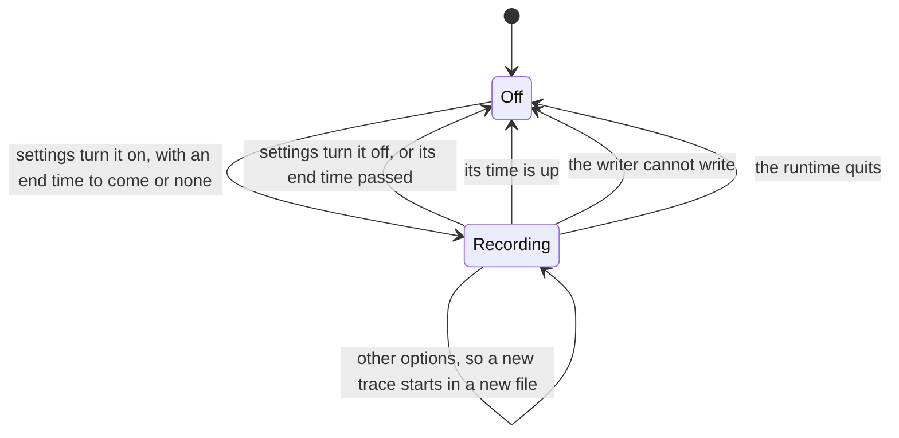

- **Starting.** Each start takes the next trace number, so a failure the old
  writer reports late (`TraceReport::Failed`) stops only the trace with its
  number. A trace whose writer cannot start, such as when the folder cannot be
  made, is logged and leaves the trace off.
- **A new trace.** Whenever the trace changes, `Crew::set_trace` sends the new
  handle to the action thread, detection, and each reader, and the owner
  starts later readers with it. A reader keeps its capture and its values,
  and hands the handle to its frame handler, which records to it from its
  next frame. Two handles are equal when they record the same categories of
  the same trace, so the same settings change nothing.
- **Its time is up.** The owner wakes at the end time (`wake`) and stops the
  trace. The settings still say `on`; the setup app shows the trace stopped,
  and turning it on again sets a new end time.
- **Stopping.** A stopped trace's writer writes what its buffer held and ends
  on its own time; the owner tells it to stop and never waits for it, and
  checks on it at its next settings read or wake (`Switch::reap`). Only
  quitting waits for every writer.
- **Writer failure.** The writer tells the owner why and ends, and the owner
  logs it and stops the trace. Each handle that sends to the writer after that
  turns itself off.
- **Quitting.** The trace stops after every other thread, so it holds what
  they did up to their end.

### Log rotation

`Log` in `apps/runtime/src/log.rs` appends to `runtime.log`. A line that would
take it past 512 KiB (`LIMIT`) first renames it to `runtime.old.log` and opens a new
file. Rotating never fails a write (`rotate`).

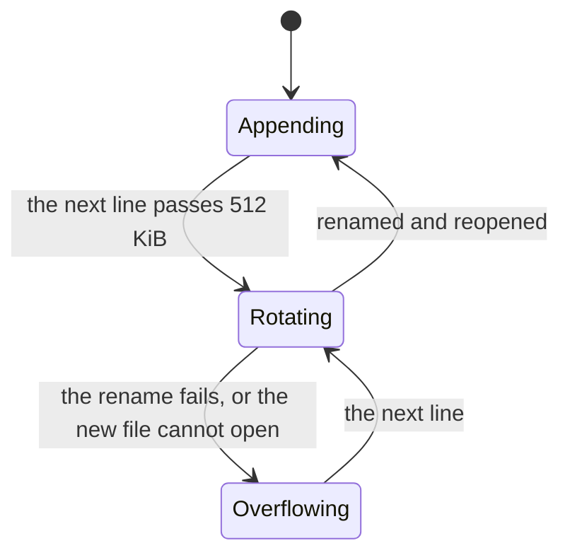

In **Overflowing** the line goes to the file the log has, past the limit, so
no line is lost. After a rename whose open failed, that file is
`runtime.old.log`. The next try finds no `runtime.log` to rename, so it only
opens one, and nothing is renamed twice. The new file replaces the old one
only once it opens.

## Setup app

### Pages and flows

The React side (`apps/setup/src/App.tsx`) has two pieces of state: `page`, the
tab shown, and `flow`, the value, reference, automation, or application being
made or edited. A flow covers the page while it is open.

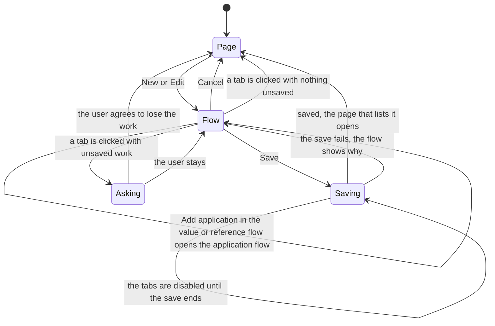

The unsaved work of a flow, such as its screenshots and recording, lives in the
flow's components and in the owner thread. Each flow reports what leaving it
would lose (`apps/setup/src/lib/unsaved.ts`), and the tabs and **Change window**
ask before they drop unsaved work. While a save runs, both are disabled. A save closes
its flow only while that flow is still open (`saved` in `App.tsx`), so a save
that finishes after the user moved on leaves the next flow alone. Leaving the
value or reference flow unmounts it and stops its capture, which clears its screenshots and
recording.

### Update notice

The update notice at the end of the tabs (`apps/setup/src/lib/update.ts`,
drawn by `apps/setup/src/components/UpdateNotice.tsx`) offers a newer release.
It checks once, when the main window mounts, and shows nothing until a check
finds one. The owner thread keeps the downloaded installer until the install
takes it.

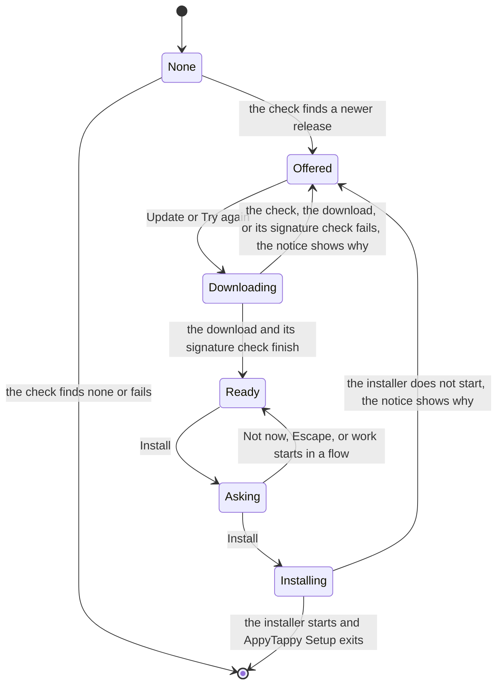

The download names the release it downloaded, so a release that came out
after the offer waits in **Ready** under its own version, and the question
names that version. A connection that sends nothing for 30 seconds fails the
check or the download. **Install** is disabled while a flow holds unsaved work
or saves, since the install closes AppyTappy Setup. Before the installer ends
the process, the owner saves where each panel is and stops the capture, as the
app's own end would. While the question to leave a flow has the nav's place,
the notice is hidden and keeps its state. An event that does not fit the
state, such as a late check during the download, changes nothing.

### Capture slot

The setup app's owner thread (`apps/setup/src-tauri/src/owner.rs`) has one
capture slot, `session`, shared by the value preview and the automation
editor's watch. Starting one stops the other. Its other state is `generation`,
`latest` (the newest frame), `failure`, `screenshots`, `check`, `recording`,
and `watched`.

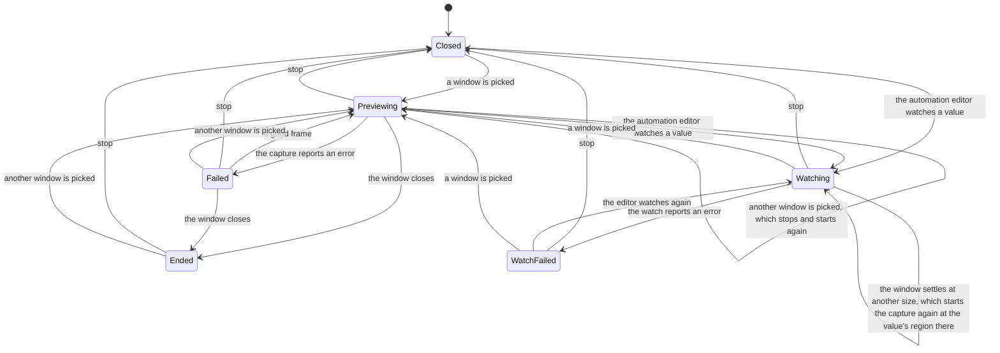

- **Stop** closes the capture, adds 1 to `generation`, and clears every field
  above.
- **Failed** sets `failure`, a `CaptureFailure`. Preview answers with its
  error, a screenshot is refused, and a recording stops with the error as its
  problem. The next good frame clears it.
- **Ended** is a failure whose `ended` flag is set, for the closed-window
  error Windows reports. Frames after it are dropped, and a screenshot, a new
  recording, and **Record more** are refused with "Change window to pick it
  again". Only a stop or another pick leaves it.
- **WatchFailed** closes the capture and keeps the watch's error for the editor
  to show.
- **Watching** at another window size waits for the size to settle, as the
  runtime's reader does: frames show it, and no other, for `SETTLE`, 250 ms.
  Until then the editor's poll answers that it waits for a reading. Each
  frame and each poll checks the wait against `Host::now`, so a window that
  stops drawing still settles at the next poll. Once the size settles, the
  watch places the value there with `SavedValue::at`, once. When its region
  there differs from the one copied, the capture starts again under the same
  watch number, so the editor's poll goes on. A size at which the value does
  not read keeps the capture and answers why with each poll.
- The screenshot shortcut is on while the capture view shows, except while the
  user is choosing a new shortcut. Choosing ends with a new shortcut, Esc, a
  second click, or when focus leaves **Change shortcut**.

### Live check

The capture screen tries the check being set up on the live window
(`useLiveCheck` in `apps/setup/src/lib/useLiveCheck.ts`). Its state is
`state`, a `CheckState`; `read`, the reading or the problem shown; `tried`,
the number of the newest check tried; and `inForce`, the number of the check
the owner reads with, or none.

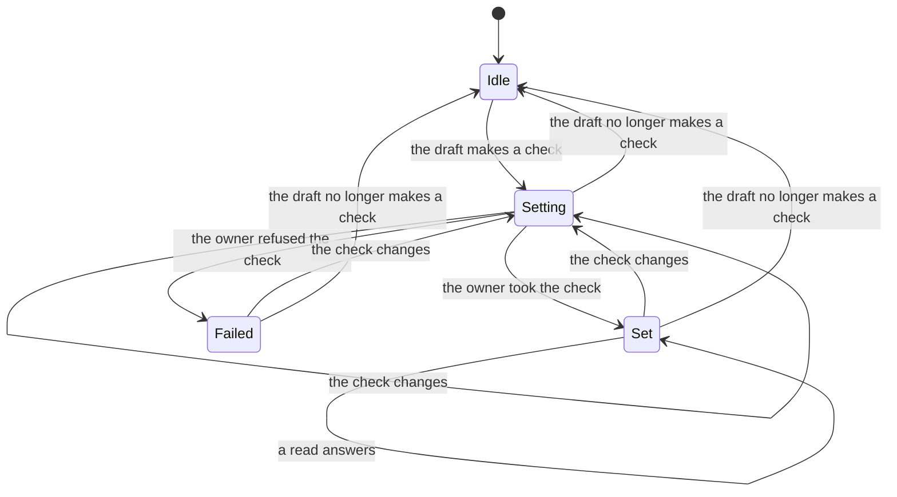

- **Idle.** The draft lacks something, and the box says what. Nothing is
  shown as read.
- **Setting** (`pending`). The check waits 250 ms for the draft to hold
  still, then goes to the owner with `set_check`. Each change of the check
  takes the next number, starts the wait again, and leaves no number in
  force, and the owner's answer for a check the draft has left is ignored.
  The box says it is trying the check. The last reading is kept, to show
  until the first read with the new check answers, and a problem is cleared.
- **Set.** The owner took the check, and its number is in force. The window
  is read every 120 ms with `read_value`, each read after the last answered.
  An answer replaces what the box shows: a reading, or why the frame cannot
  be read.
- **Failed** (`error`). The owner refused the check, such as a label its
  reference cannot learn, and the box says why. The owner keeps the check it
  had, and nothing is read until the check changes.
- A read notes the number in force when it is asked, and its answer is taken
  only while that number is still in force. So an answer under an older
  check is dropped, reading or problem, and so is one asked between a change
  of the check and the owner taking the new one, which the owner read with
  the check before (`afterRead`).

### Recording

A recording (`apps/setup/src-tauri/src/recording.rs`) keeps each reading a
region shows once, for the user to review. It is `None` or a `Recording` whose
`stopped` field says whether it still records, and whose `problem` says why
it skips frames or why it stopped by itself.

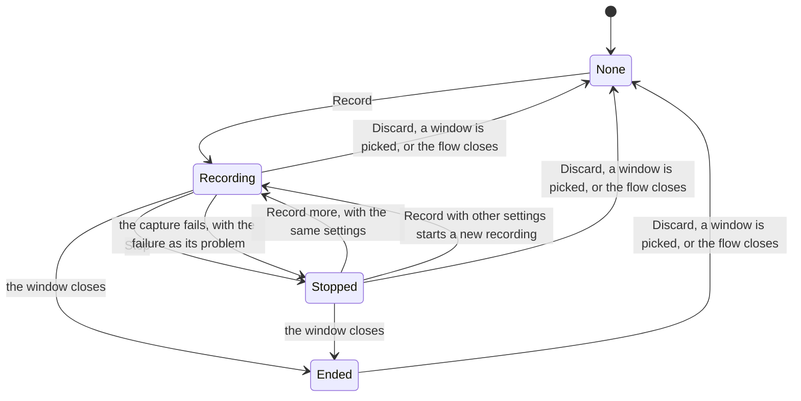

- Each frame is cropped to the region. A crop of another window size, or one
  the reader cannot read, sets the recording's `problem` and is skipped while
  it goes on recording. A crop with no ink is skipped and clears the problem,
  as does a crop that reads. A capture failure stops the recording, and its
  problem says why.
- A crop whose characters are new is kept and sent to the text reader. A
  recording keeps at most 200 readings (`MAX_READINGS`).
- **Record more** needs the same region, ink, tolerance, and window size, and
  clears the problem. When any of them differs (`settingsDiffer`), **Use its
  settings** shows and puts all of them back, with the region on a screenshot
  of the recording's size.
- **Ended** is a stopped recording whose capture slot is **Ended**
  (`Recording::end`). Its problem says to change window, and **Record more**
  and a new **Record** are refused. Its readings stay for review, so a
  reference can still be saved from them.
- A value saves the window size of the screenshot its region was drawn on
  (`drawnOn` in the UI). A number value reads with one of the application's
  references, and saving a reference teaches it from its labeled screenshots
  and the recording. A save or a try whose labeled screenshots, recording, or
  compared screenshot has another window size is refused, and the error names
  which one (`check_spec::drawn_size`).

### Text reader

The text reader (`apps/setup/src-tauri/src/recording/ocr.rs`) runs on its own thread. It
loads its model on the first reading it gets, then reads each reading and sends
the text back with the recording's ID and the reading's index. The owner drops
text for a recording that is gone. If the thread has stopped, the owner marks
the reading as failed and asks the user to type it.

### Overlays

Each application whose overlay is on has an entry on the owner thread
(`apps/setup/src-tauri/src/overlay.rs`) and a window of the setup app's own
(`apps/setup/src-tauri/src/overlay/window.rs`). The window shows as an overlay
over the application or as a panel.

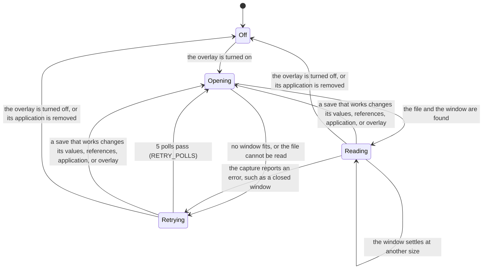

The Values page keeps a second set of entries, `live`, one for each running
application whose values it shows, whether its overlay is on or not. They
move through the same states but have no window: the page's poll opens one,
and leaving the page turns them all off. Each value's reading carries the
value's ID, so the page matches a reading to its row by ID.

At another window size, an entry reads nothing until the size settles for
`SETTLE`, which the poll checks against `Host::now`, so a window that stops
drawing still settles. Until then each value shows no reading. Once the size
settles, the entry places its values there with `SavedValue::at`, once. When
some value reads there, the capture starts again at their regions, and the
state pictures are drawn again, once for each settled size. When none does,
the capture goes on and each value shows why it is not read there, such as
that its region is too small, as `NotRead`.

`overlay::window::sync` opens a window for each overlay that is on and closes
each that is not. The owner thread runs it through its host: when the main
window mounts, and from `Owner::write_app` after each overlay change and after
an application is removed, so a removed application's overlay or panel
closes. It tries every window, and a window that cannot open or close does not
stop the others. `set_overlay` and `remove_app` then answer with a message
that names each such window, and the change they saved stays saved.

### Saved files and copies

Only one copy of the setup app runs. `tauri-plugin-single-instance` hands a
second copy over to the first, which brings its window forward
(`bring_forward`), and the second copy exits before it shows a window.

Every write in `crates/config/src/store.rs` goes to a temporary file, is synced,
and is renamed over the saved file, so a reader sees the old file or the new
one. Each save reads the file, changes it, and writes it back. A save of an
application's file goes through `Owner::update_app`, which loads the file,
changes it and hands it to `Owner::write_app`, and a save of the automations
or the settings goes through `Owner::update_runtime`. After a save that works,
they tell who reads what it changed, as its `Changed` kind says:

- **The runtime and the overlays:** an application, its values, or the
  references they read with.
- **The runtime only:** the automations, the settings, an application's
  anti-cheat class, and the build its values were checked against.
- **The overlays and their windows:** turning an overlay on or off and
  changing its mode.
- **The runtime, the overlays and their windows:** removing an application.

A save that failed before it wrote anything changed nothing, so it tells
neither, and an overlay that was reading goes on reading. A delete tells them
once it has written the application's file, and removing an application tells
them even when the removal fails partway. After each save of an application's
file, the setup app removes the pictures the file no longer names. That
removal is best effort: one that fails does not fail the save, and the next
save tries again. Deleting a reference that is already gone saves nothing and
tells no one, but still removes the pictures an earlier delete left behind.
Moving a panel writes the application's file without telling anyone.

A temporary file is named `<file>.<process ID>-<time>.tmp`. After a save,
`remove_leftovers` deletes the temporary files in the same folder that another
run left and that have not changed for ten minutes, such as one a crash left
between the write and the rename. A failed delete does not fail the save, and
the next save tries again.
