# State machines

AppyTappy has few `enum State` types, but much of its behavior is still a set of
state machines. This page names each one, draws it, and says which events move
it. It also says where a machine can reach a state it never leaves, or a state
that does the wrong thing. Each of those has an issue, linked under
**Open problems** at the end of its section.

Read [Architecture](Architecture.md) first: it describes the threads that these
machines run on.

## How to read this page

An _implicit_ state machine is state that is spread over a few fields, flags,
or `Option`s, plus the code that changes them. No type lists its states, so
this page does. For example, the runtime has no type for an application's run
state; whether it runs follows from three maps and a flag on the owner thread.

The diagrams are [Mermaid](https://mermaid.js.org/) state diagrams. GitHub
draws them. A box is a state, and an arrow is a transition labeled with the
event that causes it. `[*]` is where the machine starts or ends.

Many messages travel between threads, so a message can arrive after the state
it was about has gone. Sixteen guards drop such stale messages:

- **Session IDs.** The runtime gives each reader session a new `SessionId`
  (`apps/runtime/src/model.rs`). The owner drops a reading whose session no
  longer runs.
- **Reader numbers.** A session numbers its readers with a `ReaderNumber`,
  which each reader sends with every value it reads, when its values can no
  longer be seen, and when it ends. The owner drops each of those unless it
  carries the number of the session's newest reader and that reader has not
  ended (`Model::read_by`): what a reader that the session replaced still
  sent, and what the capture of a reader that panicked still read.
- **Generations.** The setup app's owner thread adds 1 to `generation` each
  time it starts or stops a capture. A frame or a failure from an older
  generation is dropped. A picked window's capture is numbered by its
  generation, and a stop that carries the number of an older capture is
  dropped too.
- **Recording IDs.** Each recording, of readings or of looks, gets a new `id`
  from one counter, so text that the text reader sends back for a recording
  that was discarded, or replaced by one of either kind, is dropped, and so
  is what a [window look](#window-look) found for one. A reading's picture
  is asked for with its recording's ID: the owner answers nothing for a
  recording that was discarded or replaced (`recorded_pixels` in
  `apps/setup/src-tauri/src/owner/recording.rs`), and the page drops a
  picture that arrives for another recording than the newest it asked for
  (`withCrop` in `apps/setup/src/lib/review.ts`). Within one recording,
  the look's gate drops the answer to a look from before **Record more** or
  from before a frame showed the window at another size than the recording
  is placed at (`Gate::Abandoned`). The
  [character check](#character-check) remembers the readings it left out
  under their recording's ID, and keeps none again for another recording
  (`leftOutOf` in `apps/setup/src/lib/useCharacterCheck.ts`).
- **Search IDs.** Each search for text like a reference's box gets a new
  `id` from the owner's `search_id`. The owner drops the text reader's text
  for a search that was replaced or forgotten, answers nothing for a picture
  asked of one, and rereads nothing for one
  (`apps/setup/src-tauri/src/owner/found.rs`).
- **Overlay numbers.** Each overlay capture gets its own number from
  `Overlays::next`, and a reading from an older capture is dropped.
- **Detection keys.** The capture screen keys a bar detection by its region,
  the screenshot the region was drawn on, and the indexes of the screenshots
  there are. An answer for any other key than the request under way is dropped. What two
  colors read is kept under those and the colors, and shows only while they
  are the same.
- **Box character keys.** The [character check](#character-check) asks
  which characters each box of the reference shows under a key made of the
  box's screenshot and region and the characters' color and tolerance
  (`boxCharactersKey` in `apps/setup/src/lib/useBoxCharacters.ts`). An
  answer for a key that no box has anymore, such as where a box was before
  it moved, is dropped (`arrived`).
- **Pointer IDs.** A region drag keeps the ID of the pointer that started it
  (`apps/setup/src/lib/drag.ts`). A move, a release, a cancel, or a failed
  capture of any other pointer is dropped, and so is every event but a press
  once the drag is over.
- **Press numbers.** A drag over the live window numbers each press, which
  starts taking a screenshot (`apps/setup/src/lib/liveDraw.ts`). A screenshot
  that arrives with another press's number is dropped.
- **Check numbers.** The capture screen gives each check or saved value's
  edit it tries on the live window a number, which is in force from when the
  owner took it until the draft changes or it is tried again. An answer to a
  read asked under another number, or under none, is dropped (`afterRead`
  in `apps/setup/src/lib/liveCheck.ts`).
- **Request numbers.** The capture screen numbers each request of its
  matching pixels preview (`apps/setup/src/lib/matchPreview.ts`). An answer
  or a failure that carries another number than the request in flight's, such
  as one sent before the preview was turned off, is dropped.
- **Attempt numbers.** The click target screen numbers each **Find it now**
  and **Click it now**, and drops an answer whose number is not that of the
  try under way.
- **The open flow.** A save's answer closes the setup app's flow only while
  the flow that saved is still the one open (`afterFlow` in
  `apps/setup/src/lib/flow.ts`), so a save that finishes after the user moved
  on leaves the next flow alone. The draft saves of leaving with
  **Save as draft** carry the flow they are for in the same way, and
  `keepStep` drops an answer for any other flow than the open one.
- **List reads.** The setup app numbers each read of the saved applications,
  automations, and drafts as it starts. An answer older than the newest one taken is
  dropped (`supersedes` in `apps/setup/src/lib/reads.ts`), so a read that
  started before a save and answers late never puts older lists back.
- **Newest asks.** Every other answer the setup app's screens wait for goes
  through `apps/setup/src/lib/request.ts`. `ask` is what an effect returns:
  it sends a request, after a delay where a run of changes should ask once,
  and drops the answer once what it asked about changed or its component
  went. `useNewest` is for asks an event starts: each `begin` makes the
  asks before it stale, and a poll that `join`s the newest ask is dropped
  once any command begins another, as a recording's or a search's state
  read before a start, stop, discard, or reread is. `drop` makes them stale
  without asking: the click target drops a selection still asked for when
  the user draws a box by hand or shows another screenshot.

Source files are named as code text rather than linked, so a file that moves
leaves no broken link.

## Runtime

### Owner thread start and stop

`owner::watch` in `apps/runtime/src/owner.rs` starts every thread, runs the
event loop, and stops every thread in a fixed order.

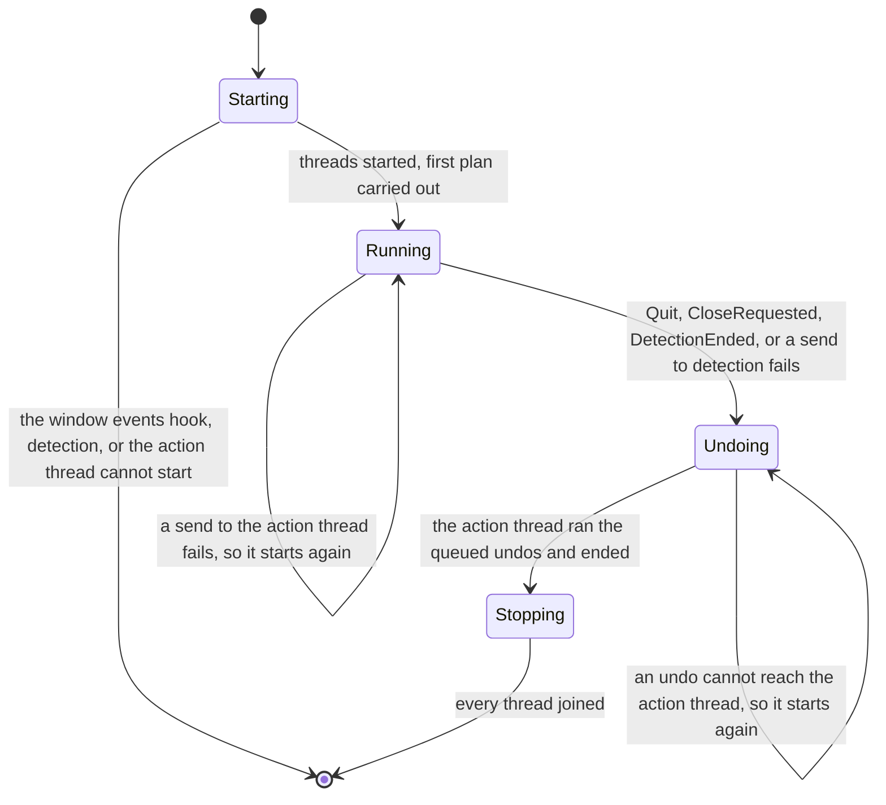

- **Starting.** The window events hook starts first, and the runtime exits if
  it cannot. Then the tray and the reload watch start, and the saved files are
  read. The tray gets a fresh menu after that read, so its check mark shows
  whether automations start enabled. The reload watch and the tray are
  optional: the runtime logs why it cannot make one and runs without it. A
  pick from the tray during the first read waits for the owner and applies
  after it. Then the lifecycle and action threads start. If either cannot
  start, the runtime stops what it started and exits with the error. A first
  read that fails starts with an empty plan and reads again, as
  [Reload watch](#reload-watch) describes.
- **Running.** Each event becomes a `Step`: `Carry` some orders, `Picked`
  when the user picked Enable or Disable from the tray, which carries its
  orders too and sets `picked` (see [Reload watch](#reload-watch)), `Reload`
  the saved files, `TraceFailed`, or `Stop`. The owner waits for its next
  event only until the first of two times (`wake`): when a rule that its
  cooldown held back is due, and when it reads the saved files again after a
  read failed. Either time sends it `Due`, whose step rechecks the held rules
  and, once the retry is due, reads the saved files again. With neither, it
  waits with no limit. After each step the tray gets a fresh menu if it
  changed.
- **A worker that ended.** Every send to the action thread and to detection
  goes through `Crew::act` and `Crew::detect`. Each of those threads ends
  only after the owner, or when it panics, so a send that fails means it
  panicked. For the action thread, the owner joins it and logs its panic,
  starts a new one, and sends it the owner's trace and then what the old one
  could not take. The jobs the old thread had not run are dropped, and what
  it changed is not undone, because its journal ended with it. If the new
  thread cannot start, or ends before it takes the send, the log says so, the
  send is dropped, and the next send tries again. This also happens while
  **Undoing**, when the thread panicked since the last job. Detection sends
  `DetectionEnded` however it ends, a panic included (`workers::tell_end`),
  and a send to detection that fails has the owner send itself the same
  event, so the owner stops either way; the join at the end reports the
  panic. A reader also tells the owner when it ends, and the owner starts
  another in the same session, as
  [Per-application run state](#per-application-run-state) describes.
- **Undoing.** `model.set_enabled(false)` stops every running application and
  queues the undo of what its automations changed. The owner then drops the
  job sender and joins the action thread, which runs the queued undos before
  it ends.
- **Stopping.** The tray stops only after the undo, because at the end of the
  session it holds Windows back until `Tray::stop` (see
  [Tray thread](#tray-thread)). Then the reload watch and the window watch
  stop, and dropping the inputs ends detection. Each reader is stopped, and
  every thread is joined.

#### Open problems

- [#297](https://github.com/TheLunchTrae/appy-tappy/issues/297): after the
  action thread starts again, what the old thread changed stays changed, and
  later restores of that target put back the wrong state.

### Runtime state

`model::State` is the runtime's one named state, which the log and the tray
show. It is derived each time from the model rather than stored:

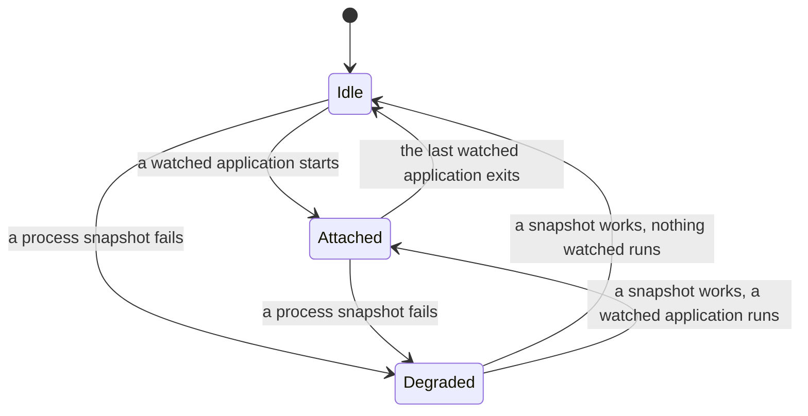

Degraded wins over the other two while `problem` is set.
[Lifecycle](Architecture.md#lifecycle) explains each state.

### Detection timers

The lifecycle thread (`apps/runtime/src/lifecycle.rs`) decides when to take a
process snapshot. Its state is two optional deadlines, `scan_at` and
`rescan_at`, plus whether any watched application runs and whether the last
snapshot failed.

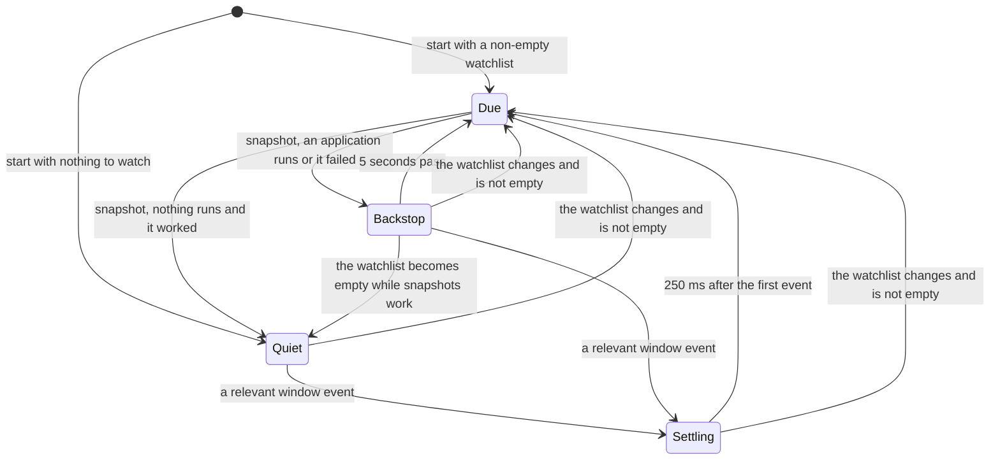

A created top-level window is relevant while anything is watched. A destroyed
window is relevant only while a watched application runs. More events while
**Settling** do not move the deadline, so a burst becomes one snapshot. The
two delays are `SETTLE` and `RESCAN`.

Each snapshot ends the session of an application whose process is gone, and
starts one for an application that runs without one. When several processes
fit one application, the session follows the process that owns the window its
reader reads, and a process that owned one keeps the session for
`OWNER_GRACE` after it owns none; [Lifecycle](Architecture.md#lifecycle) gives
the rule. Each start is followed by an `Identified` change with the build of
the executable that runs, which changes no state: the owner only logs it, as
[Build detection](Architecture.md#build-detection) describes. A new watchlist
ends the session of each application it drops or whose executable pattern it
changes, and forgets which process owned its window.

### Per-application run state

The model (`apps/runtime/src/model.rs`) has no run state type. An application's
automations run while all of these hold:

- It is in `attached`: detection found its process.
- `enabled` is true: automations are on in the tray. It starts true, or as
  the tray last left it when the settings remember that, as
  [Files and handoff](Architecture.md#files-and-handoff) describes.
- The plan has automations for it.

When they all hold, the application has an entry in `running`, keyed by its
reader's `SessionId`, with its engine session and its newest plan. The entry
also says whether a reader reads the application's values: `read_again` is
empty while the reader with the entry's `ReaderNumber` reads, and holds the
time the next reader starts while the last one ended. The model
holds no channel and no trace: each change returns `Order`s, the model's own
type, and the owner turns each into a message for a reader or the action
thread.

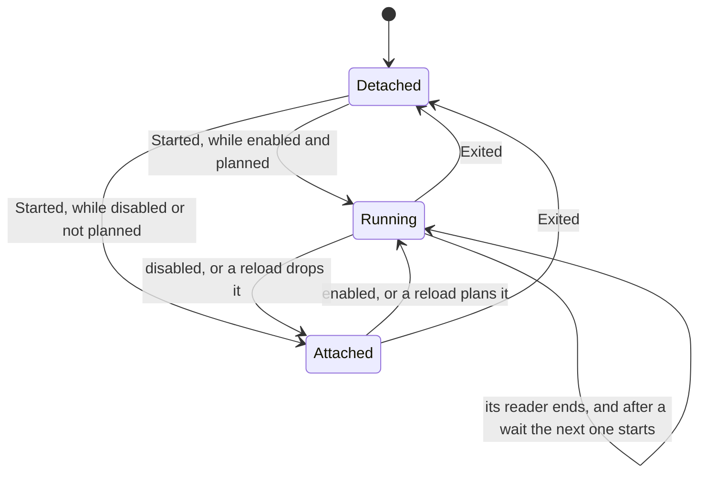

- **Running to Attached or Detached.** The engine session is stopped,
  which releases every rule that restores. The reader is stopped.
- **A reload that changes what it runs.** `replan` compares each plan's
  `Runs`: its window match, its values' checks and its rules, but not the
  automations' names that each rule's entry carries. When they differ, the
  application stops, which undoes what its automations changed, and starts
  again in a new session.
- **A reload that changes only names.** When only the plan's names differ, or
  the build its values were checked against, the session keeps running and
  takes the new plan, so the log and the tray use the new names. The reader
  sends each value and each value's problem by its position, and the owner
  logs a problem with the value's newest name.
- **Unseen.** When the reader says the values can no longer be seen, the owner
  calls `forget_values`. The rules keep their state, so a rule that fired stays
  fired until new readings decide its condition.
- **A new read interval.** `restart_readers` stops each running
  application's reader that reads at another interval and starts it again in
  the same session, and calls `forget_values` first, as for `Unseen`, because
  the new reader sends its first readings whether or not they changed. What
  the old reader sent just before it stopped carries its number, so it is
  dropped. A new trace restarts nothing: it reaches each reader as a
  message, as [Runtime trace](#runtime-trace) describes.
- **A reader that ended.** A reader thread sends `Reading::Ended` with its
  `ReaderNumber` as the last thing it does, however it ends
  (`workers::tell_end`). When the number is that of the session's newest
  reader, nothing stopped the reader, such as when it panicked:
  `reader_ended` calls `forget_values`, as for `Unseen`, and sets
  `read_again`, and the owner logs that the application's reader ended and
  joins the thread, which logs its panic. The session keeps running, with
  its rule state, and reads nothing until `read_again`: a panic drops the
  reader's capture without waiting for it, so the capture can still send
  what it read, which is dropped like a replaced reader's. Then the owner
  wakes with `Due`, and `recheck` starts the session's next reader, with the
  next number. The wait is 1 second (`READ_AGAIN`) the first time and
  doubles each time a reader of the session ends, up to 30 seconds
  (`READ_AGAIN_MAX`), so a reader that panics each time it starts costs one
  thread and three log lines for each wait. A reader that ends after it ran
  for `READ_AGAIN_MAX` waits 1 second again; that time counts from when the
  session started that reader, after a wait or for a new read interval. A
  new read interval while the session waits starts no reader: the next one
  reads at it. An `Ended` with any other number, or for a session that no
  longer runs, comes from a reader that the session stopped, and is dropped.
- **A reader that cannot start.** When the reader's thread cannot start, the
  owner logs it and sends itself that reader's `Ended`, so the session
  starts its next reader after the same wait.

### Reader thread

Each running application has a reader thread (`read` in
`apps/runtime/src/workers/reader.rs`). The thread's position in its loop is its
state, along with `Recovery`: why the last capture ended and how long to wait
before the next one, and the trace it records to.

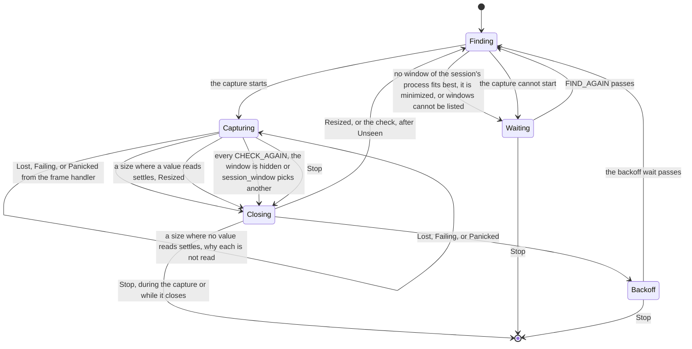

The thread can also panic in any state, which ends it.

- **Finding.** `find_window` lists the processes and windows and takes the one
  `session_window` picks among the session's process's (`Job::watched`), as
  detection does: of its windows that fit best, the one the last capture
  read while it shows, such as after a resize, then the first that shows.
  When the process owns none of the windows that fit best, such as while
  another process's window fits better, it waits, and detection follows the
  other process or keeps this one for its grace. Before the capture starts,
  `framed_at` asks `System::content_bounds` for the size the window's frames
  will have, the size of its
  [content](Screen-regions.md#window-content), and places the values there
  when some value reads there, so a window that is not at the first value's
  drawn size is not captured twice at each start.
  The size is a guess: frames of another size are followed as below, and
  after a capture ended with `Resized`, the next one starts at the size its
  frames settled at, without guessing again. The first capture otherwise
  starts at the first value's drawn size.
- **Capturing.** `watch` waits on `control` until the next `CHECK_AGAIN` or
  until a new size settles, whichever comes first. The capture's frame handler
  runs on another thread and sends `Lost`, `Resizing`, `Failing`,
  `Panicked`, or `Recovered` back to this one. A panic in the capture's
  frame loop outside the handler arrives as `Lost`, as
  [Frame handler](#frame-handler) describes. A `Trace` from the owner goes
  on to the frame handler over its own channel, and the capture goes on.
  Each `CHECK_AGAIN`, `moved_on` checks that the window still shows and that
  `session_window` still picks it, which it does while the window shows and
  fits as well as any, because a hidden window sends no frames and no close.
- **Settling.** `Resizing` names the size frames show now, and a `Settle`
  (`crates/sources/src/screen/settle.rs`) waits for it to hold for `SETTLE`,
  250 ms, starting again at each other size. The wait runs on this thread's
  timer, so a window that stops drawing once it is dragged still settles.
  The settled size is resolved once, as a `Placed`
  (`crates/sources/src/screen/placed.rs`). When a value reads
  there, the capture ends with `Resized`, which carries where each value reads,
  and starts again at those regions, once for each settled size. When none
  does, the capture goes on and this thread says why each value is not read
  there (`say_unread`), at once, even when the window draws no more frames.
  The problems said for each value since it was last read move between the
  two threads over channels: the handler keeps them while frames show the
  capture's size, hands them to this thread in its first `Resizing` for
  another size, and takes them back, with what this thread said, on the
  first frame of its own size again. Nothing moves for
  each frame. A capture started for a new size starts from those problems,
  and one started after a capture ended any other way starts from none. A
  size that settles back at the capture's own size changes nothing. Windows
  can recreate the frame pool at a new size in place, and `capture.rs`
  already does, but the capture's crop and packing are fixed when it starts,
  so a new layout needs a new capture.
- **Closing.** The thread closes the capture first, then drops what the closed
  capture sent after the message that ended it, still counting a `Stop` and a
  `Recovered`. A `Lost`, `Failing`, or `Panicked` among them, after
  `Resized` or the check ended the capture, is dropped too: that capture is
  closed already, and the next one starts at once, without a backoff. When
  the 2 second check ended the capture, it then sends `Unseen`, so no
  reading from the old capture can follow it.
- **Backoff.** After `Lost`, `Failing`, or `Panicked`, the thread waits
  before it looks again: `RESTART_WAIT_MIN` at first, doubling up to
  `RESTART_WAIT_MAX` while each new capture ends before it reads a frame. It
  logs the reason once until the reason changes. A restarted capture that
  reads a frame sends `Recovered`, which resets both. A frame whose reading
  panicked was not read, so a capture that panics on its first frame waits
  twice as long as the last and logs nothing new.
- **A new trace.** `Trace` from the owner reaches the thread in any state.
  While it waits or closes a capture, the thread keeps it for its next
  capture, which starts with it; while it captures, it hands it on too. No
  state changes for it.
- Each problem, such as no window fitting yet, is sent once until a different
  problem or a working capture replaces it.
- **Ending.** `Reader::start` runs the thread inside `workers::tell_end`, so
  the last thing the thread sends is `Reading::Ended`, with its session and
  its `ReaderNumber`, whether a `Stop` ended it or a panic. A panic drops the
  capture, which stops it without waiting. The thread does not start itself
  again: the owner starts the session's next reader after a wait, as
  [Per-application run state](#per-application-run-state) describes, and a
  reader that the session stopped has its `Ended` dropped there.

### Frame handler

`FrameReader::handle`, in `apps/runtime/src/workers/reader/frames.rs`, runs once
per frame and acts on what the frame means,
which `Placed::meaning` decides for every reader of saved values, as
[Window sizes](Screen-regions.md#window-sizes) describes: the window at the
capture's size, at another size, or at the capture's size with a region
outside it. Its state is `placed` (the window size whose values it reads,
and where each value reads at it, resolved once), `told` (the other size it last told
the reader frames show), `last` (each value's last reading), `problems`
(the problems said for each value since it was last read, handed to the reader while frames show
another size), `heard` (where the reader gives it back), `seen` (whether
it sent a reading since it last sent `Unseen`), `failures` (frames in a
row that failed), `restart` (whether the reader started this capture
again after the last one ended, and whether a frame came since), `ended` (whether it told the reader
its capture ended or that handling a frame panicked), and `trace` (what it
records to, the newest that the reader handed it before the frame).

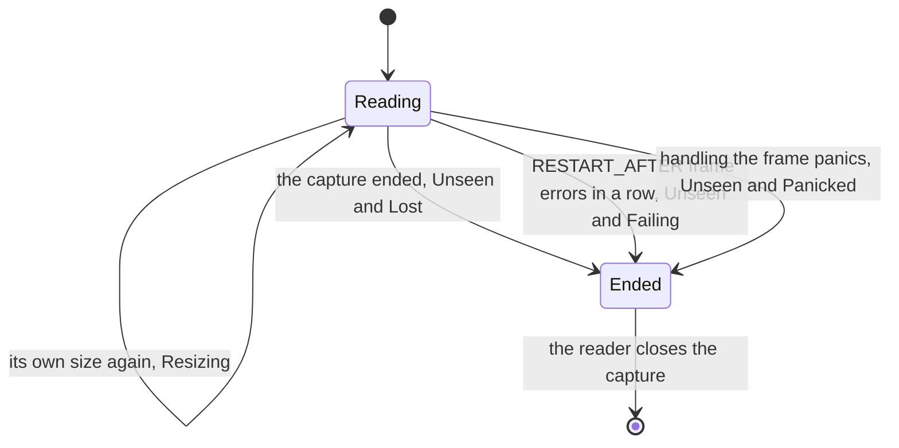

- A `Sample` goes to the owner only when a value reads differently from its
  last reading.
- A frame error is logged once until another problem or a good frame replaces
  it. A good frame starts the count again. A region that lies outside a window
  of the capture's own size does not count, because a new capture would fail
  the same way.
- The capture ends, as when the window closes, the graphics device is lost, or
  the frame pool cannot follow the window to a new size, with a
  `NotConnected` error. A panic in the capture's frame loop outside `handle`
  ends it the same way: `run_capture` (`crates/sources/src/screen/capture.rs`)
  runs the capture's [frame loop](#capture-frame-loop), catches the panic, and hands the
  handler a `NotConnected` error with the panic's message, so the reader
  logs it, sends `Unseen`, and captures again after the backoff. Unwound,
  the panic would end the capture's thread, and the reader would hear of it
  only once it closed the capture. A panic in `handle` itself never reaches
  `run_capture`, since `handle` catches its own.
- After a restart, the first good frame sends `Recovered` to the reader
  thread once it is handled without a panic, so a capture that panics on it
  has not recovered.
- `handle` runs on the capture's thread, so it catches a panic while it acts
  on a frame, sends `Unseen` as when the capture ends, and sends `Panicked`
  with the panic's message. Unwound, the panic would end the capture's
  thread, and the reader would hear of it only once it closed the capture.
  `seen` turns true only once a reading was sent and false only once
  `Unseen` was, so a panic between them cannot leave it wrong, and a
  capture that panicked before it sent a reading sends no `Unseen`.
- **Ended.** The capture can still hand frames to the handler until the reader
  closes it. The handler reads none of them, so nothing it sends follows
  `Unseen`.
- A frame at another size sends `Unseen` and reads nothing, and the handler
  tells the reader the size with `Resizing` once, not for each frame, so
  nothing is resolved for each frame. Only the reader resolves a size, once
  it settled.
- A settled size at which no value reads keeps the capture, because a
  restart would find the same size. The reader says once why each value is
  not read there, and the handler reads nothing until frames show its own
  size again.
- A value that does not read at the capture's own size, such as one whose
  scaled region reaches outside the window, says why once and is not
  copied.
- A value whose check fails on a frame keeps its last reading and says why.
  The handler keeps every problem it said for the value since the value was
  last read, and says each once: a good read forgets them. A number's check
  fails one way for each stage of its read, such as a character its
  reference has not learned, whatever the characters are, so a counter that
  stays unreadable while it counts is said once, with what its first failed
  read showed, and a region that flickers between two stages is said twice,
  not once for each frame
  ([Why a number is not read](Screen-regions.md#why-a-number-is-not-read)).
  At a size the value was not drawn at, the problem says its region is
  scaled there and to fix the value at that size if the region is off,
  which makes it another problem than the same stage at a drawn size.
- A region outside a window of the capture's own size keeps each value's
  last reading and sends no `Unseen`, as any one failed frame does. A
  `Placed` holds only regions that fit its size, so only a frame whose
  content the capture could not place says so, and the next frame reads.
- Each value's problems leave the window size out and are carried into the
  capture started for a new size, so the log says why once for each reason,
  not once for each size or each restart.

### Capture frame loop

`run_frames` in `crates/sources/src/screen/frames.rs` runs on each capture's
own thread, for the runtime's readers and the setup app's captures alike. The
Windows capture (`crates/sources/src/win/capture.rs`) is its `FrameSource`: it
waits for the thread's next event and makes each system call the loop asks
for. The loop's state is the frame it holds, when the handler's last wait
ends (`next_read`), when it last checked the window and the device
(`checked`), the size the system makes frames at (`frames`), and the interval
it last asked the system for (`asked`).

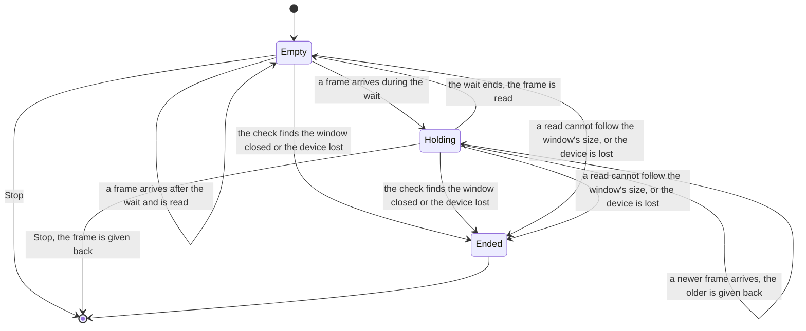

- **Empty.** The loop holds no frame and waits for the next event or the next
  check, whichever comes first.
- **Holding.** The loop holds the newest frame until the handler's wait ends,
  and gives every older one back to the system unread. It waits until the read
  or the next check, whichever comes first.
- **Reading.** The loop reads a held frame once the wait has ended. A frame of
  another size than the system's frames is dropped: the loop has the system
  make its frames at that size and reads the next frame at once. Otherwise it
  finds the [window's content](Screen-regions.md#window-content) in the
  frame, has the crop's regions copied, hands the copy to the handler, and
  takes the handler's wait. A wait of 64 ms or more also sets how often the
  system is asked for frames, as [Capture](Screen-regions.md#capture)
  describes. A handler that returns `NO_MORE_FRAMES`, as a one-frame grab's
  does, is handed no frame for a day, longer than such a capture runs.
- **A frame that fails.** A region that lies outside the window's content, or
  a copy the system fails, reaches the handler as that frame's error, and the
  loop goes on with the wait the handler returns. The
  [frame handler](#frame-handler) counts such frames.
- **Ended.** Every `HEALTH_CHECK`, 2 seconds, whatever arrives meanwhile, the
  loop asks whether the window is gone and whether the graphics device is
  lost. Either ends the capture, and so does a read that fails while the
  device is lost and a system that cannot make frames at the window's new
  size. The handler receives one `NotConnected` error that says why, and the
  loop gives back any frame it holds and returns. The capture's owner recovers: the runtime's
  [reader thread](#reader-thread) captures again after its backoff.
- **Stop.** Closing or dropping the session wakes the loop, which gives back
  the frame it holds and returns.

### Read schedule

`ReadSchedule` in `crates/sources/src/schedule.rs` sets the wait before the next
frame is read. Its only state is the current wait.

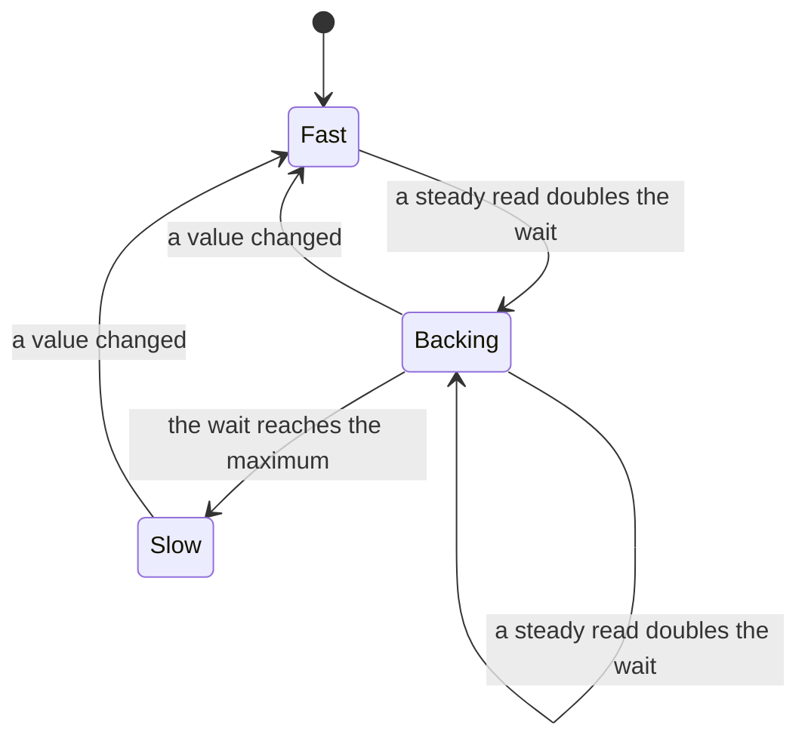

**Fast** and **Slow** are the fastest and slowest reads from the settings,
16 ms and 500 ms by default. The reader's job carries them, so a new read
interval stops the reader and starts it again in the same session, after the
owner forgets the session's values.
After a read that waits 64 ms or more, the capture asks Windows for frames no
more often than the wait, never below the minimum, so a window whose values
hold still is copied into the frame pool about twice a second rather than every
time it repaints. A shorter wait keeps the minimum.

### Number text

The number check reads characters left to right, and `NumberText::push` in
`crates/sources/src/screen/digits.rs` keeps which part of a number it is in.

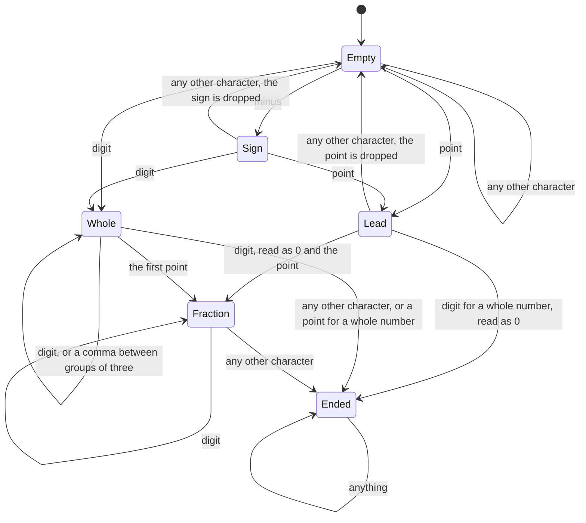

Before a digit, a character that does not fit starts the number over. After a
digit, it ends the number, and the rest of the region is ignored, so `12/50`
reads as 12 once `/` is learned. A character the value leaves out is "any
other character" whatever it is, a `-`, a `.`, or a `,` included
(`NumberText::push_text`), and a letter left out still counts as a letter
before a point. A read runs a second `NumberText` that takes each left-out
character as itself, and fails with `ReadError::LeftOut` when the two end
with different numbers. A `,` is skipped when it separates groups of
three digits before the point, so `1,234` reads as 1234. When the digits after
a `,` are not a group of three, as in `12,5`, the number ends at the `,` and
reads as 12. A `.` before any digit reads as `0.`, so `.5` reads as 0.5 (or 0 for
a whole number) and `-.5` as -0.5, unless a letter came before it, as in `Lv.5`. A value set to **Whole number only**
ends the number at its point, so `87.5%` reads as 87. A region with more than
24 characters (`MAX_CHARACTERS`) is a read error.

### Rule state

Each rule in an engine session (`crates/engine/src/lib.rs`) has a `RuleState`
of three fields: `armed`, `active`, and `last_fired`.

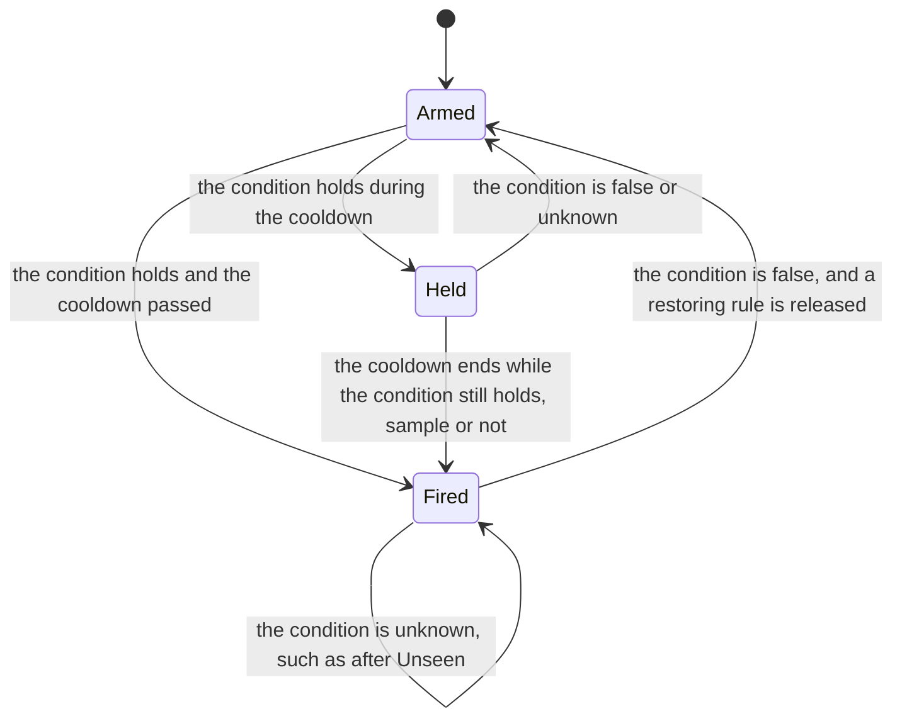

- **Fired** means `armed` is false. A rule that restores is also `active` until
  it is released.
- **Held** is not a field: it is a rule that is `armed`, whose condition holds
  on the values the session has, and whose cooldown from `last_fired` has not
  passed.
- In one sample, releases run before fires, so a restore never undoes a change
  another rule makes on the same value.
- A session that stops, because the application exited or its automations
  stop running, releases every active rule.
- The engine runs when a sample of any of the session's values arrives, and
  at the end of a held rule's cooldown. A value that holds still sends no
  sample, so `Session::next_due` gives the earliest time a held rule's
  cooldown ends. The owner wakes then if no event came first, and
  `Session::recheck` fires each held rule whose cooldown passed.

### Action thread and restore journal

The action thread (`apps/runtime/src/workers/act.rs`) makes the media and audio
controls when it starts, then runs each job in order. Its loop is a `Worker`
whose `actions` field holds the restore journal (`Actions`) once the controls
are made, or a `Missing` record with the last error and a `Backoff` while they
cannot be.

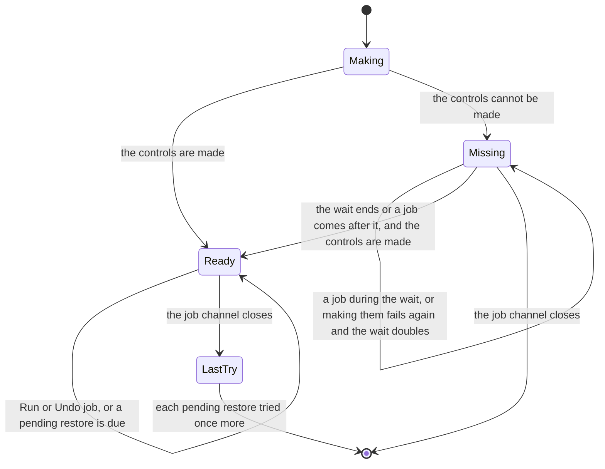

- **Missing.** A `Run` job logs that its actions did not run, and an `Undo` job
  has nothing to undo. When the wait ends, or the first job after it comes,
  the worker makes the controls again. The wait starts at 1 second and doubles
  after each failure, up to a minute. The log says when actions can run again.
- **Telling the owner.** `act::run` sends `ActionReport::CanRun` once when it
  starts, then `CanRun(false)` when the worker reaches **Missing** and
  `CanRun(true)` when it leaves it. A thread that the owner starts again
  after a panic thereby replaces what the old one said. The owner takes it
  that actions can run until the first report, keeps the last report in the
  model's `actions_can_run`, and the tray shows it.
- **Ready.** After each job, the worker tries the pending restores that are
  due. While any restore is pending, it waits for the next job only until the
  next one is due, or 10 seconds (`VOLUME_RETRY`) for a volume restore.
- **LastTry.** `last_try` tries every pending restore once, due or not, and
  forgets them.

The journal in `crates/actions/src/journal.rs` holds one entry per change that
a restoring rule made, in the order they were made. For each target, such as
one audio session's volume, the entries form a stack:

- **Perform, restoring.** The change is pushed with the state before it. If a
  restore of that target is pending, the change takes it over, so its own
  release puts back the state from before the first change.
- **Perform, not restoring.** Every entry for that target is removed, so no
  release undoes the permanent change. A pending restore of that target is
  dropped too.
- **Release.** The rule's entries are taken newest first. If a later entry on
  the same target exists, it inherits the older state. Otherwise the change is
  undone. A pending restore of the same target came from a newer rule, so the
  undo takes it in and puts back the older state. Each entry leaves the
  journal before its undo runs.
- **Failed undo.** The change moves to `pending` instead of being dropped. A
  volume restore is tried again until it works, and is dropped only once its
  audio session is gone. A media restore is tried once more, 2 seconds later
  (`MEDIA_RETRY`), then given up.

The journal lives only in memory, so a forced end, a crash, or an
end-of-session wait that runs out loses what it had not undone.

### Tray thread

The tray thread (`crates/platform/src/win/tray.rs`) runs a message loop. Its
state is whether the menu is open, and whether the window's procedure is
holding the end of the session.

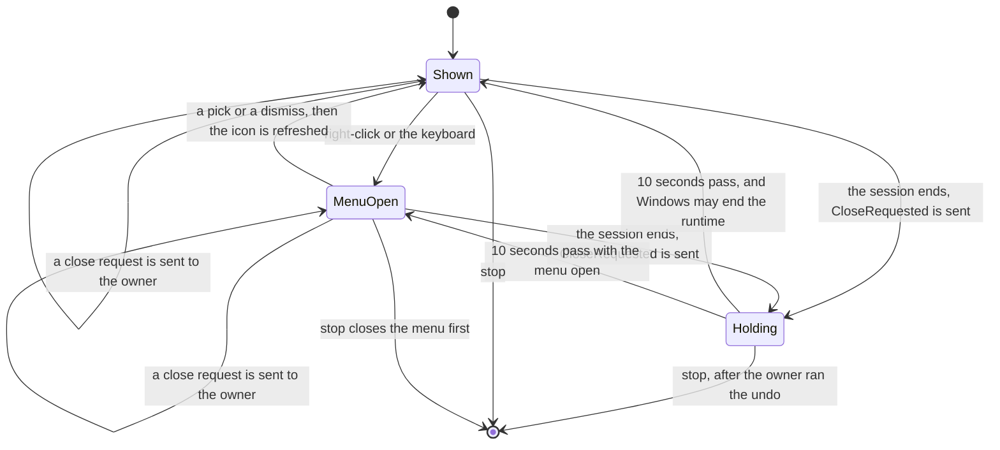

The window's procedure sends a close request and the end of the session to
the owner itself. Windows's menu loop drops what is posted to the tray loop
while the menu is open, but it still calls the procedure, so neither is lost.
[Tray](Architecture.md#tray) explains the posts.

- **Holding.** Windows asks first whether the session may end
  (`WM_QUERYENDSESSION`). The procedure gives a shutdown block reason and
  agrees. When the session really ends (`WM_ENDSESSION`), the procedure does
  not return until `Tray::stop` drops the sender it waits on, or 10 seconds
  (`END_SESSION_WAIT`) pass. Then it takes the reason back, as it also does
  when Windows calls the end off. If the wait runs out, the tray goes on as it
  was, and Windows may end the runtime. A critical shutdown, or a user who
  ends the session anyway, can also end the runtime before the wait is over.
- With no tray window, nothing hears the end of the session, and Windows ends
  the runtime without an undo.

### Reload watch

The reload watch waits on the auto-reset named event `Local\AppyTappy.Reload`
and sends `Reload` each time the setup app sets it. Several saves before the
reload watch wakes become one reload. `read_saved` reads the settings first,
gives the model their read interval, and starts, keeps, or stops the trace as
[Runtime trace](#runtime-trace) describes, so the readers that `replan` starts
read at the new interval. It then reads the saved applications and
automations; when they read, the owner sends detection the new watchlist and
`replan` switches to their plan. Then `restart_readers` starts over the
readers the plan kept running at the old interval, so no reader starts twice.
Last, the trace writer gets each running session's newest plan, for its
names. When either read fails, such as while
another program holds a file, the owner keeps what it has (the plan, or the
settings, or the defaults when they never read) and reads the files that
failed again, and only those. Its state is `Reloads`: `retry`, an optional
`Retry` with a time and the tries left; `failing`, which files the try reads;
`had` and `had_settings`, whether each read has worked yet; and `picked`,
whether the user picked Enable or Disable from the tray in this run.

The first settings read that works, even on a retry late in the run, applies
the remembered state when `rememberEnabled` is on: automations become enabled
or disabled as the tray last left them, as `enabled.txt` keeps it. That read
applies nothing once the user picked from the tray in this run, so it never
reverses a pick. Settings read after the first that worked apply no remembered
state either, whatever `rememberEnabled` says.

```mermaid
stateDiagram-v2
    [*] --> Current: the first read works and applies any remembered state
    [*] --> Retrying: the first read fails, so nothing runs, or the settings are the defaults
    Current --> Current: a save, and the read works
    Current --> Retrying: a save, and the read fails, so the plan keeps running
    Retrying --> Current: a save or a try reads; a pick beats remembered state
    Retrying --> Retrying: a try fails with tries left, or a save starts the tries over
    Retrying --> Waiting: the fifth try fails
    Waiting --> Current: a save, and the read works
    Waiting --> Retrying: a save, and the read fails
```

A try comes 2 seconds (`RETRY_WAIT`) after the read before it failed, and at
most 5 tries (`RETRIES`) follow one failed read. A try runs when the owner
wakes at its time, or with the first event after it. One automation that
cannot run, such as one that breaks a rule after a hand edit, does not fail
the read: it is logged and left out of the plan.

### Runtime trace

The owner's `Switch` in `apps/runtime/src/trace/switch.rs` holds the trace
that runs, if any: its number, its writer, the options it writes with, and
its end time. [Trace](Trace.md) describes what it records.

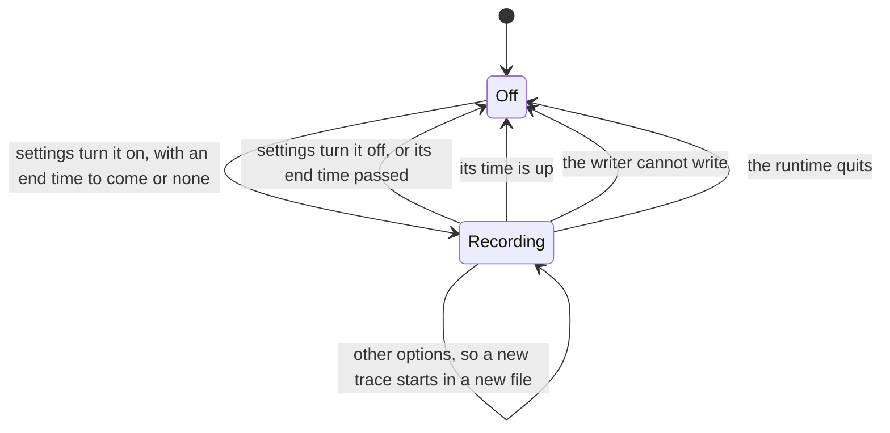

- **Starting.** Each start takes the next trace number, so a failure the old
  writer reports late (`TraceReport::Failed`) stops only the trace with its
  number. A trace whose writer cannot start, such as when the folder cannot be
  made, is logged and leaves the trace off.
- **A new trace.** Whenever the trace changes, `Crew::set_trace` sends the new
  handle to the action thread, detection, and each reader, and the owner
  starts later readers with it. A reader keeps its capture and its values,
  and hands the handle to its frame handler, which records to it from its
  next frame. Two handles are equal when they record the same categories of
  the same trace, so the same settings change nothing.
- **Its time is up.** The owner wakes at the end time (`wake`) and stops the
  trace. The settings still say `on`; the setup app shows the trace stopped,
  and turning it on again sets a new end time.
- **Stopping.** A stopped trace's writer writes what its buffer held and ends
  on its own time; the owner tells it to stop and never waits for it, and
  checks on it at its next settings read or wake (`Switch::reap`). Only
  quitting waits for every writer.
- **Writer failure.** The writer tells the owner why and ends, and the owner
  logs it and stops the trace. Each handle that sends to the writer after that
  turns itself off.
- **Quitting.** The trace stops after every other thread, so it holds what
  they did up to their end.

### Log rotation

`Log` in `crates/platform/src/log.rs` appends to `runtime.log`, and in the setup
app to `setup.log`. A line that would take it past 512 KiB (`LOG_LIMIT`) first
renames it to `runtime.old.log` (or `setup.old.log`) and opens a new file.
Rotating never fails a write (`rotate`).

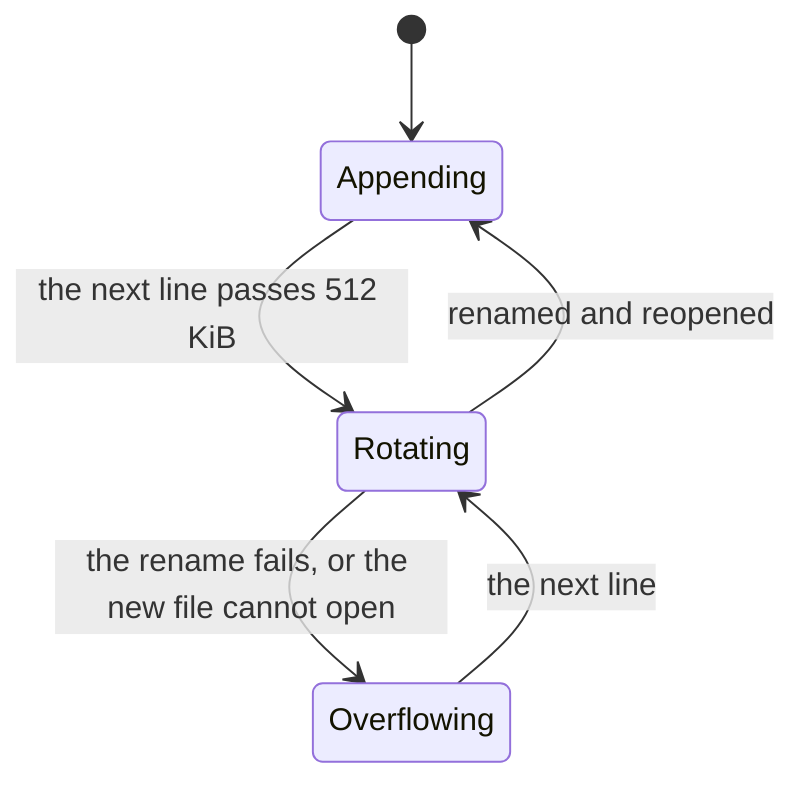

In **Overflowing** the line goes to the file the log has, past the limit, so
no line is lost. After a rename whose open failed, that file is
the `.old.log`. The next try finds no log to rename, so it only
opens one, and nothing is renamed twice. The new file replaces the old one
only once it opens.

## Setup app

### Pages and flows

The React side (`apps/setup/src/App.tsx`) has two pieces of state: `page`, the
tab shown, and `flow`, the value, reference, automation, or application being
made or edited. A flow covers the page while it is open. A flow can open
another flow for itself; it then waits under that one as its `opener` and
shows again when that one ends. `Flow` in `apps/setup/src/lib/flow.ts` names
the flows, and the transitions between them are pure functions there.

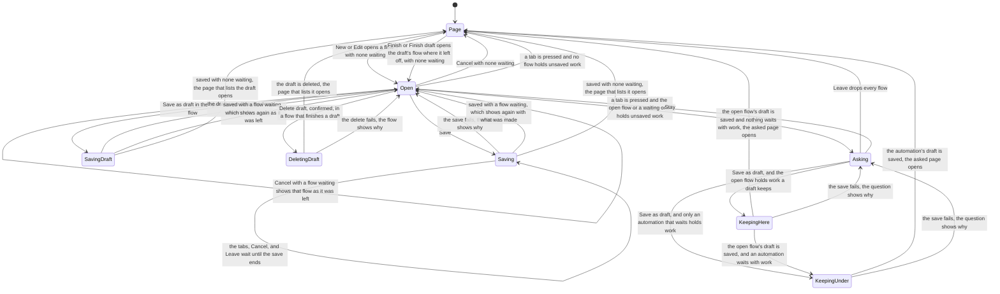

**Open** is one flow on screen with up to two waiting under it. The types
allow only these stacks, the flow on screen last; a fix or an edit of a saved
value is a value flow that no automation opens, and a flow that finishes a
draft opens from its page with none waiting:

| Stack                            | How it comes about                                                                             |
| -------------------------------- | ---------------------------------------------------------------------------------------------- |
| automation                       | **New automation** or **Edit**                                                                 |
| automation, application          | **Add application** in the automation editor                                                   |
| automation, value                | **New value** in the automation editor                                                         |
| automation, value, application   | **Add application** or **Change how it's found** in that value's [picker](#picker)             |
| value, application               | **Add application** or **Change how it's found** in the picker of a value from the Values page |
| reference, application           | The same in a reference's picker                                                               |
| value, reference, or application | **New** or **Edit** on its own page, with none waiting                                         |

- **Opening.** `valueFor` and `applicationFor` make the flow to open, with
  its opener in it. The opener keeps the application it showed chosen, so it
  shows again as the user left it. The automation editor also hands over its
  draft (`waiting`), because the opener unmounts while the other flow shows.
  The value and reference flows open the application flow only from their
  picker, before a capture holds anything, so they wait with nothing but that
  application.
- **Save and Cancel.** `afterFlow` decides what follows a flow that ended. A
  save shows the opener with what the save answered: the application's ID to
  a value or reference flow, whose picker starts with it, and the
  application's ID with the value's ID from `save_value` to the automation
  flow, with the number of the newest read of the saved lists started before
  the save was heard. **Cancel** shows the opener as it was left. With none waiting, a save
  opens the page that lists what was saved and **Cancel** the page under the
  flow.
- **Tab.** What leaving loses is what the open flow reports
  (`apps/setup/src/lib/unsaved.ts`) together with the draft of an automation
  that waits (`heldInAll`). A fix and an edit start from the screenshot the
  capture takes when they open, so that screenshot is not unsaved work, and a
  flow that finishes a draft starts from what the draft kept (`startOf` for
  an automation), so an unchanged draft is not unsaved work either. With
  nothing unsaved the tab's page opens. With unsaved work the question asks
  first, and `leaveQuestion` names what the open flow loses, the automation's
  unsaved changes, and what **Save as draft** keeps of them. **Leave** drops
  every flow, and **Stay** keeps the stack as it is. While a save runs, the
  tabs and the question's answers wait.
- **A saved draft is what a flow holds, written down.** A flow's unsaved work
  and its draft are one thing: an automation's draft keeps the
  `AutomationSetup` its flow carries while it waits, the editor's draft and
  the application chosen, and a value, fix, or reference keeps its capture's
  setup with the screenshots ([Drafts](Setup-app.md#drafts)). Each open flow
  reports how to save its draft to `App.tsx` (`useDraft` in
  `apps/setup/src/lib/drafts.ts`). An edit of a saved value reports none: it
  is never a draft, and its question says so.
- **Save as draft in a flow.** The flow saves its draft and ends as
  `drafted`. `afterFlow` then shows the page that lists the draft, or, with a
  flow waiting, that flow as it was left with nothing handed to it: a value
  kept as a draft is not a saved value, so the automation that waits still
  has none to watch. Saving a draft counts as a save, so the tabs and the
  question's answers wait for it, and so does **Change window**.
- **Save as draft in the question.** Each flow of the stack that holds work
  becomes a draft of its own, and nothing links them: first the open flow's,
  when it reported work and can be a draft, then that of an automation that
  waits with changes (`draftUnder`), saved over the draft that automation
  finishes when it finishes one. The question offers the answer whenever one
  of the two would be kept, and its text names exactly those, so nothing a
  draft keeps is called lost for good. The automation's draft is finished
  later from the Automations page, without the value or application flow it
  had opened, and the value's from the Values page, where saving it no longer
  returns to the automation. `keepStep` is the transition: it takes the
  state (`Keeping`: idle, the open flow's draft saving, or the waiting
  automation's saving) and the press or a save's answer, and gives the state
  that follows with what `App.tsx` does next: send a save, show a failure, or
  leave. A draft save that fails returns to the question, which shows why,
  with the stack as it was. When the open flow's draft is saved, the flow
  comes to know it (`resumed`), so when the automation's save fails after it,
  a second try saves over that draft, and saving the flow's item later
  deletes it. The automation's draft is the last save, and its success
  leaves, so no automation flow shows again without knowing a draft that was
  written for it. While either save runs, the tabs and the question's answers
  wait and the open flow is inert, so nothing in it can end or save it. An
  answer for a flow that is no longer the open one, or for a save that is not
  the one under way, is dropped.
- **An application opened from a picker.** **Change how it's found** opens
  the application flow for the picker's flow (`applicationFor`). When the
  application has a draft of changes, the flow finishes that draft, and the
  button says **Finish draft**, as the Applications page does, so there is one
  way to change an application that has a draft.
- **Finishing a draft.** **Finish** or **Finish draft** opens the flow
  `resumedFlow` makes from the draft, on the saved item it changes when that
  is still saved. A flow that finishes a draft deletes the draft once its
  item is saved, and its **Delete draft** deletes it without saving the item
  and ends the flow as `drafted`. A draft that stays because the delete after
  a save failed shows on its page, where it can be finished and deleted. A
  saved automation, application, or reference with a draft of changes offers
  **Finish draft** in place of **Edit**, so the saved item and its draft
  never change apart. A value, fix, or reference flow that finishes a draft
  brings the draft's screenshots back only after its window is picked, since
  picking a window clears the session's. **Change window** after that asks
  first, then starts the capture over without what the draft kept; a draft
  saved then still replaces the same draft, and leaving without one keeps it
  as it was.
- **A save that finishes after the user moved on.** `App.tsx` tells
  `afterFlow` whether the flow that saved is still the one open, by identity,
  and `afterFlow` changes nothing when it is not. The tabs and **Cancel** are
  disabled while a save runs, so this guards a save whose flow was replaced
  some other way.

- **Pictures.** Leaving a value or reference flow unmounts it and stops its
  capture, which clears its screenshots, recording, and found text, and
  **Change window**
  stops the capture too, before the picker shows, so nothing holds them
  while the user picks. A click picture taken for an automation's draft
  stays while the automation's flow is open or waits under a flow it opened,
  since the draft that names it waits with it. Once no automation flow is
  left, on a save, **Save as draft**, **Cancel**, or **Leave**, the window
  removes the click pictures that neither a saved automation nor a saved
  draft names (`holdsAutomation`,
  [Pictures kept](Setup-app.md#pictures-kept)). Deleting an automation's
  draft from the Automations page does the same, so its pictures go with it.
  A saved draft is the one thing that keeps pictures past its flow: its
  screenshots are copied into its folder when it is saved, and the capture's
  own still go when the flow closes.

No flow waits for the saved files to be read again before it closes. Each
save starts that read, and whatever shows next copes with lists that lack
what was just saved: a picker makes its own look, and the automation editor
waits for it, as the next section describes. A save that fails leaves its
flow open with the reason, and changes nothing that waits.

### What an automation watches

The **When** card of the automation editor
(`apps/setup/src/pages/AutomationEditor.tsx`) chooses the application, then
one of its values. Its state is the draft's watched value, the application
chosen before a value is picked, what a flow just handed over (`Handed` in
`apps/setup/src/lib/flow.ts`), and the saved applications and values as the
newest read of the pages' lists has them, with that read's number.
`watchStep` in `apps/setup/src/lib/watch.ts` names where those stand as one
`WatchStep`.

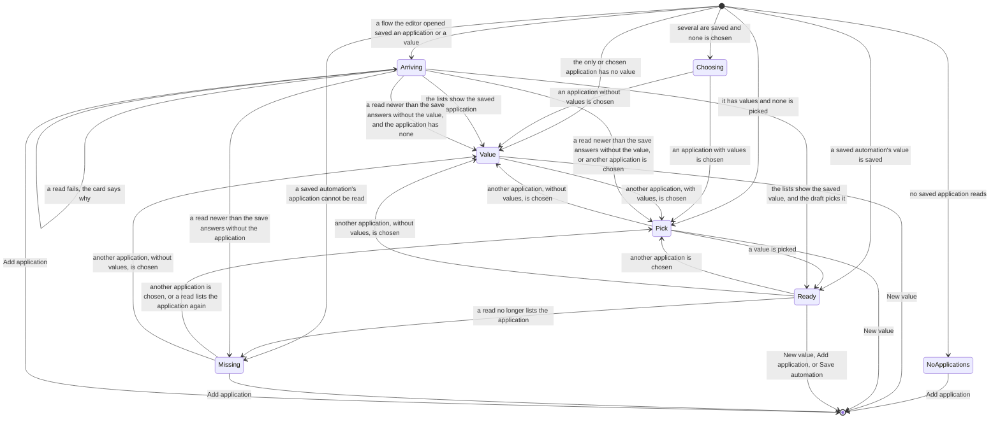

- **NoApplications**, **Choosing**, **Value**, and **Pick** say which step
  comes next, and **NoApplications** and **Value** make the flow that takes
  it the main button. **NoApplications** says so when applications are saved
  but none of their files reads. **Add application** is offered in every
  state, and **New value** in each that has an application the lists know.
- **Ready** has a value to compare, which the editor reads live.
- **Arriving** is exactly this: a flow handed something over, and no read of
  the saved lists that started after the hand-over has answered. `App.tsx`
  numbers the reads, the hand-over carries the number of the newest read
  started before it, and `watchStep` compares that with the number of the
  read the lists are from. Each save starts a read, and the lists are read
  again every three seconds while the editor is open, so a read that failed
  is tried again; meanwhile the card says why it failed. A value handed over
  takes the place of the draft's watched value at once (`returned`), so until
  it is picked the draft has no value: **Save automation** is off, and the
  foot of the editor says that what was saved is being read (`readiness`).
  When the lists show the value, the draft picks it (`arrived`) in the same
  render, with a comparison that suits it, and the card names it.
- A read newer than the hand-over that answers without what was handed over
  ends **Arriving**: nothing is on its way any more. A missing application
  is **Missing**. A missing value is **Pick**, or **Value** when the
  application has no other, and both say that the saved value is gone.
- **Missing** is a chosen application that the saved lists do not have with a
  readable file: the watched value's, one chosen by hand whose file broke
  since, or one a flow just saved. It says which, and the draft stays while
  the user chooses another application or adds it again.
- Every state can be left with the draft kept: by a choice in the card, or by
  **Add application**, which is offered in all of them.
- Opening **Add application** or **New value** ends the editor, and a new
  one opens when that flow ends, with the draft and what the flow saved, as
  [Pages and flows](#pages-and-flows) describes. Opening one while
  **Arriving** drops what the editor waited for. Nothing is lost by that,
  since the draft holds no value meanwhile: the saved value is in the list to
  pick once the editor shows again.

When the editor shows again after a flow it opened, the focus moves to the
control the step is taken with (`editorLanding` in
`apps/setup/src/lib/landing.ts`): **Add application**, the application list,
**New value**, the value list, or the comparison once a value is picked.
While **Arriving** it waits for the step to be known. It lands only while
nothing holds the focus, and it is dropped for good once the user puts the
focus anywhere themselves, such as in **Name** while the lists are read, so
it never takes the focus from what they are doing (`settle`). The card's
guide is a status region that stays mounted and describes those controls, so
a screen reader hears the step, that what was saved is being read, and the
value once it is picked. The [picker](#picker) does the same when it shows
after another flow (`pickerLanding`), by the same rule: the focus moves to
**Capture this window** once there is a window, and otherwise to the way
forward.

### Picker

The first step of the value and reference flows
(`apps/setup/src/components/Picker.tsx`) chooses the application and finds
the window to capture. Its state is the chosen application, the window picked
among several, the capture it asked for (`Start`), and the newest look at the
saved applications and the open windows (`Look`, from
`apps/setup/src/lib/useAppWindows.ts`). `pickerStep` in
`apps/setup/src/lib/picker.ts` names where those stand as one `PickerStep`.

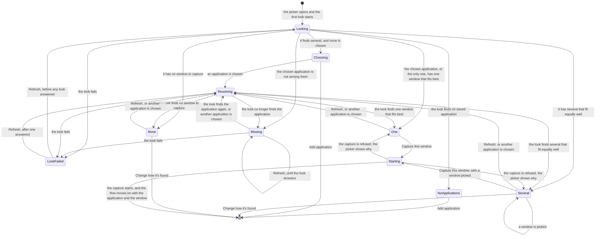

- A look is one `list_app_windows` command, so its applications, windows,
  and fits come from one listing of the desktop. One starts when the picker
  opens and on **Refresh**. An answer is dropped once another look replaced
  it. What the last look that answered found stays on show while the next
  one is made.
- **Looking** is before any look answered: not even the applications are
  known.
- **LookFailed** is a look that could not read the saved applications or list
  the windows. It shows the reason, whatever application is chosen, and
  **Refresh** looks again.
- **NoApplications** and **Choosing** show the list of saved applications
  with **Add application** in it. With one saved application there is no
  choice, and the picker resolves that one. A flow that has its application,
  **Fix at this size**, or **Edit** on a value or a reference, shows no list
  and never reaches them.
- **Missing** is a chosen application that the look does not find: the flow's
  own, one handed over by the application flow, or the last choice. The
  picker says so instead of asking for a choice as if none had been made.
  **Refresh** keeps it until the new look answers, since the last answer
  still lacks the application, and leaves it only if that look finds the
  application again. Choosing another application or **Add application**
  leaves it too; a flow with its own application has neither, so apart from
  such a look only **Cancel** leaves it.
- **Resolving** resolves the chosen application's window: at once from a
  look that has answered, and otherwise when the look under way answers.
  While a look is under way after one answered, a picker with no application
  chosen stays in **Choosing** or **NoApplications**.
- **One** has the window to capture. **Several** has one once the user picks
  it among the windows that fit equally well; a look that no longer lists the
  picked window leaves none picked. Both say when the windows are only the
  application's fallback.
- **None** is no window to capture: nothing fits, or a session reads a window
  the list of open windows leaves out, such as one with no title. Only
  **Refresh**, another application, or **Change how it's found** leaves it.
- **Starting** disables every control but **Cancel** until `pick_window`
  answers. A refusal, such as a window that closed since the look, shows in
  the step it came from, and the next choice or look clears it.
- **Add application** and **Change how it's found** end the picker: the
  application flow opens for the picker's flow, and a new picker opens when
  it ends, as [Pages and flows](#pages-and-flows) describes. **Change window**
  in the capture opens a new picker with the same application, and with the
  same window picked when several fit.

### Click target tries

The click target screen (`apps/setup/src/components/ClickTarget.tsx`) tries a
target with **Find it now** and **Click it now**. `Try` in
`apps/setup/src/lib/clickTry.ts` names the states, and `tryStep` there is the
transition.

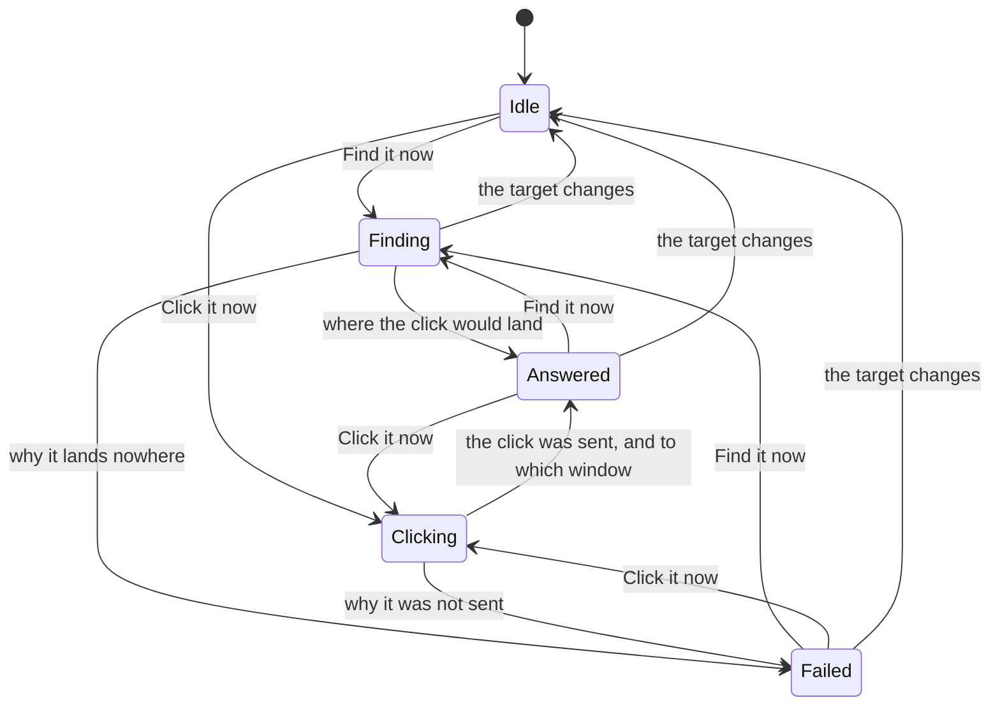

- **Finding** and **Clicking.** The try starts with the press and keeps its
  attempt number. A drawn picture is kept first, then the owner thread is
  asked, and the screen's buttons wait meanwhile. Every way the try can end
  answers it, a target that is not set up included, so none stays under way.
  Both commands end by themselves. The owner waits at most a second for a
  picture's frame. For a click sent to the window it then waits at most half
  a second for the windows' answers to where the place is on them, and for a
  click with the cursor about a tenth of a second while the buttons are held.
- **Clicking locks the target.** A click that is being sent is a real click,
  so from the press until its answer the button, **How to click**, where it
  clicks, and the application cannot change. A click that was sent therefore
  always shows its answer. `tryStep` also keeps **Clicking** through a change
  that reaches it all the same.
- **Answered.** **Find it now** answers where the click would land, which the
  live view marks. **Click it now** answers that the click was sent and names
  the window. When that is another window than the one the screen shows, the
  screen offers **Look again**.
- **Failed.** The screen shows why, such as a picture that is not found or a
  window that refused the click. The next try or a change of the target
  leaves the state.
- **The target changes.** A change of where the click lands goes back to
  **Idle** from every state but **Clicking**. A change of the button or of
  **How to click** does too, except that it keeps where **Find it now** said
  the click would land, since neither moves that place.
- **A late answer.** The settings stay enabled while **Find it now** looks,
  which clicks nothing. An answer whose attempt number is not that of the
  try under way is dropped, so where an earlier target would land never
  shows for the target as it is set up now.

### Update notice

The update notice at the end of the tabs (`apps/setup/src/lib/update.ts`,
drawn by `apps/setup/src/components/UpdateNotice.tsx`) offers a newer release.
It checks once, when the main window mounts, and shows nothing until a check
finds one. The owner thread keeps the downloaded installer until the install
takes it.

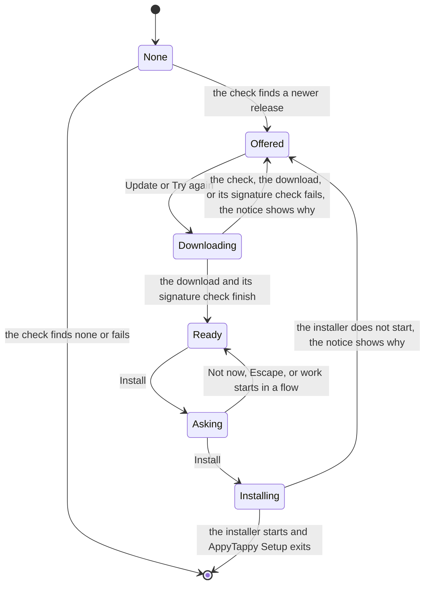

The download names the release it downloaded, so a release that came out
after the offer waits in **Ready** under its own version, and the question
names that version. A connection that sends nothing for 30 seconds fails the
check or the download. **Install** is disabled while a flow holds unsaved work
or saves, since the install closes AppyTappy Setup. Before the installer ends
the process, the owner saves where each panel is and stops the capture, as the
app's own end would. While the question to leave a flow has the nav's place,
the notice is hidden and keeps its state. An event that does not fit the
state, such as a late check during the download, changes nothing.

### Application import

**Import** on the Applications page (`apps/setup/src/lib/sharing.ts`, drawn by
`apps/setup/src/components/ImportApp.tsx`) reads a
[shared file](Setup-app.md#sharing) and saves it as a new application. Its
dialog is modal, so the page under it waits. The owner thread keeps nothing
between the read and the import: the dialog holds the file's bytes and sends
them with both.

```mermaid
stateDiagram-v2
    [*] --> Closed
    Closed --> Reading: the user picks a file
    Closed --> Refused: the picked file is larger than an import reads
    Reading --> Asking: the file was read, the dialog shows what it holds
    Reading --> Refused: the file cannot be imported, the dialog shows why
    Asking --> Asking: the name or the anti-cheat class changes
    Asking --> Importing: Import
    Importing --> Closed: the application is saved and listed
    Importing --> Asking: the save fails, the dialog shows why
    Asking --> Closed: Cancel or Escape
    Refused --> Closed: Close or Escape
```

**Asking** starts on the name the read offers and on the file's anti-cheat
class, or on not set when the file says none (`classToConfirm`). **Reading**
and **Importing** are busy: Cancel, Escape, the name, and the class wait
until the answer comes, so no answer can arrive for a dialog that was closed
or changed. A failed read ends in **Refused**, which only closes, and picking
the file again reads it again. A failed save, such as for a name that is
taken, goes back to **Asking** with what the user entered and the reason, and
**Import** tries again. An event that does not fit the state, such as a late
read while the dialog asks, changes nothing.

The export dialog (`ExportApp.tsx`) has no states beyond busy while the file
is made and saved; a failure shows in it and **Save file** tries again.

### Capture slot

The setup app's owner thread (`apps/setup/src-tauri/src/owner.rs`) has one
capture slot, `session`, shared by the value preview and the automation
editor's watch. Starting one stops the other. Its other state is `generation`,
`latest` (the newest frame), `failure`, `screenshots`, `check`, `recording`
(what the capture records, if anything: readings or looks), `found` (the
search of [Found text](#found-text), if any), and `watched`.

```mermaid
stateDiagram-v2
    [*] --> Closed
    Closed --> Previewing: a window is picked
    Closed --> Watching: the automation editor watches a value
    Previewing --> Failed: the capture reports an error
    Failed --> Previewing: a good frame
    Previewing --> Ended: the window closes
    Failed --> Ended: the window closes
    Previewing --> Closed: stop
    Failed --> Closed: stop
    Ended --> Closed: stop
    Watching --> Closed: stop
    Previewing --> Previewing: another window is picked, which stops and starts again
    Failed --> Previewing: another window is picked
    Ended --> Previewing: another window is picked
    Previewing --> Watching: the automation editor watches a value
    Watching --> Previewing: a window is picked
    Watching --> Watching: the window settles at another size, which starts the capture again at the value's region there
    Watching --> WatchFailed: the watch reports an error
    WatchFailed --> Closed: stop
    WatchFailed --> Watching: the editor watches again
    WatchFailed --> Previewing: a window is picked
```

- **Stop** closes the capture, adds 1 to `generation`, and clears every field
  above, so no frame, screenshot, recorded reading, or find outlives the
  capture. Saving a draft copies the screenshots to the draft's folder
  first; a flow that finishes that draft puts them back into `screenshots`
  after its window is picked (`restore_draft_screenshots`), each under the
  index it had, and changes no other field.
  A screen that previews a window says that it holds the capture
  (`useCapture` in `apps/setup/src/lib/capture.ts`): a value or reference
  flow, and a click's target screen. The capture stops when that screen
  goes, on **Change window**, and when a click's target screen looks for
  its window again. The screen stops the capture it started, by the number
  its pick answered (`ownCapture`), and the owner drops the stop when
  another capture took that one's place (`Owner::stop_capture`): a stop
  sent as a screen goes can arrive after the next screen's pick or the
  automation editor's watch started. While one holds it, the pages' lists are read only
  after a save.
- The automation editor's watch (`liveWatchStep` in
  `apps/setup/src/lib/liveWatch.ts`) holds the owner's watch number, the
  time before which it starts no new watch, and why its last reading was
  refused, if nothing was read since. A watch that reads **Lost**, or that
  cannot start, shows why and starts again a second later. The owner
  refuses to read a watch that another capture replaced: the editor then
  watches again at once and says nothing. When the watch that follows is
  refused too, with no reading between, the refusal is a failure: the
  editor shows it and tries again each second.
- **Failed** sets `failure`, a `CaptureFailure`. Preview answers with its
  error, a screenshot is refused, and a recording stops with the error as its
  problem. The next good frame clears it.
- **Ended** is a failure whose `ended` flag is set, for a `NotConnected`
  error: a closed window, a lost graphics device, or a capture panic. Frames
  after it are dropped, and a screenshot, a new recording, and **Record
  more** are refused with "Change window to pick it
  again". Only a stop or another pick leaves it.
- **WatchFailed** closes the capture and keeps the watch's error for the editor
  to show.
- **Watching** keeps `reads`, the window size its capture reads the value at
  and where the value reads there, and each poll asks `FrameMeaning::of`
  what the newest frame means, as the runtime's frame handler does. A frame at that
  size is read. At another size the watch waits for the size to settle, as
  the runtime's reader does: frames show it, and no other, for `SETTLE`,
  250 ms. Until then the editor's poll answers that it waits for a reading.
  Each frame and each poll checks the wait against `Host::now`, so a window
  that stops drawing still settles at the next poll. Once the size settles,
  the watch places the value there with `SavedValue::at`, once. When the
  value reads there, `reads` is that size, and when its region there differs
  from the one copied, the capture starts again under the same watch number,
  so the editor's poll goes on. A size at which the value does not read
  keeps the capture and `reads`, and is kept as `unread` until the value is
  placed at another size: the poll answers why while frames show that size,
  and reads again with the first frame that shows the capture's size.
- The screenshot shortcut is on while the capture view shows, except while the
  user is choosing a new shortcut. Choosing ends with a new shortcut, Esc, a
  second click, or when focus leaves **Change shortcut**.

### Live check

The capture screen tries a trial on the live window (`useLiveCheck` in
`apps/setup/src/lib/useLiveCheck.ts`): the check being set up, with
`set_check`, a reference being taught, with `set_characters`, or a saved
value's edit, with `try_edit`, as [Value edit](#value-edit) describes. Each
way the owner reads the window with what it took, a value in its saved
form (`LiveCheck` in `owner/live.rs`), so they share this machine and its
one guard. Each read asks `FrameMeaning::of` what the newest frame means,
as the runtime's frame handler does, and the capture copies the whole
window, so it goes on at every size. A frame at the size the value is placed
at is read, or answers why the value is not read there. At another size
nothing is read until the size settles, as for the runtime's reader: frames
show it, and no other, for `SETTLE`, 250 ms, which each frame and each read
checks, so a window that stops drawing still settles. The owner then places
the value there with `SavedValue::at`, once. A value placed where it reads
stays placed there when it does not read at the settled size, which the
owner keeps as `unread`: a read answers why while frames show that size,
and reads again with the first frame of the size the value is placed at.
Settling at a size where the value reads places it there and forgets
`unread`. Each new trial places its value at the newest frame's size at
once, so an edit that the page tries again on a size change reads there
without waiting for the size to settle.
Its state is `state`, a `CheckState`; `reads`, the reading or the problem
shown, which is kept outside the capture screen's own state (`liveReads` in
`apps/setup/src/lib/liveCheck.ts`) so that a new reading renders only the
parts that show it, and a read that answers what shows already renders
nothing;
`preview`, what saving an edit would do; `tried`, the number of the newest
trial; and `inForce`, the number of the trial the owner reads with, or none.
Below, a check stands for any of the three.

```mermaid
stateDiagram-v2
    [*] --> Idle
    Idle --> Setting: the draft makes a check
    Setting --> Set: the owner took the check
    Setting --> Failed: the owner refused the check
    Set --> Set: a read answers
    Setting --> Setting: the check changes
    Set --> Setting: the check changes
    Failed --> Setting: the check changes
    Setting --> Idle: the draft no longer makes a check
    Set --> Idle: the draft no longer makes a check
    Failed --> Idle: the draft no longer makes a check
```

- **Idle.** The draft lacks something, and the box says what. Nothing is
  shown as read.
- **Setting** (`pending`). The check waits 250 ms for the draft to hold
  still, then goes to the owner. A check is the same check while what it
  sends is the same (`key` of `trialOf` in `useLiveCheck.ts`), so a change
  of the draft that sends nothing new, such as an empty box added or moved
  in the reference editor, changes no check. Each change of the check, and
  each time the same edit is tried again, as when the window's size changes,
  takes the next number, starts the wait again, and leaves no number in
  force, and the owner's answer for a check the draft has left is ignored.
  The box says it is trying the check. The last reading is kept, to show
  until the first read with the new check answers, and a problem is cleared.
- **Set.** The owner took the check, and its number is in force. The window
  is read every 120 ms with `read_value`, each read after the last answered.
  An answer replaces what the box shows: a reading, no reading while the
  window's size settles, why the frame cannot be read, or that the value is
  not read at the window's size now, such as
  `Not read at 1280 × 720, the window's size now: …`. The check stays set
  through that answer, an edit's included, so frames of a size the value is
  read at answer a reading with no new trial.
- **Failed** (`error`). The owner refused the check, such as a label its
  reference cannot learn, and the box says why. The owner keeps the check it
  had, and nothing is read until the check changes.
- A read notes the number in force when it is asked, and its answer is taken
  only while that number is still in force. So an answer under an older
  check is dropped, reading or problem, and so is one asked between a change
  of the check and the owner taking the new one, which the owner read with
  the check before (`afterRead`).

### Matching pixels preview

The capture screen's matching pixels preview
(`apps/setup/src/lib/matchPreview.ts`, run by `useMatchPreview.ts`) tints the
pixels of the screenshot shown that a color setting takes. Its state is on
the page only: which settings' switches are on, the request in flight and
its number, the newest request wanted since, the newest answer, and the
newest failure. The owner thread keeps nothing for it; each request is one
`match_pixels` command.

```mermaid
stateDiagram-v2
    state "In flight" as InFlight
    state "In flight, one queued" as Queued
    [*] --> Off
    Off --> Blocked: the switch is turned on with nothing to ask
    Off --> InFlight: the switch is turned on, which sends a request
    Blocked --> InFlight: what was missing arrives, which sends a request
    InFlight --> Idle: the request is answered or fails
    InFlight --> Queued: what to ask changes
    Queued --> Queued: what to ask changes again, which replaces the queued request
    Queued --> InFlight: the request in flight is answered or fails, which sends the queued one
    Queued --> InFlight: what to ask goes back to what the request in flight asks
    Idle --> InFlight: what to ask changes, which sends a request
    InFlight --> Blocked: what to ask goes missing
    Queued --> Blocked: what to ask goes missing
    Idle --> Blocked: what to ask goes missing
    Blocked --> Off: the switch is turned off, or its setting leaves the inspector
    InFlight --> Off: the switch is turned off, or its setting leaves the inspector
    Queued --> Off: the switch is turned off, or its setting leaves the inspector
    Idle --> Off: the switch is turned off, or its setting leaves the inspector
```

- **What to ask** (`plan`) is the screenshot shown, a rectangle of it, and the
  rule: a reference's characters on the whole screenshot, or a bar's or a
  color check's colors in the region.
- **In flight** awaits one request's answer. The transition (`step`) sends a
  request at once while none is awaited and gives it the next number. One
  request counts at a time, so the tint follows a dragged slider as fast as
  the owner answers, and a drag never piles requests up.
- **In flight, one queued** also remembers the newest request wanted since.
  A newer one replaces it, so a burst of changes sends the first and the
  last. The queued request goes out when the one in flight is answered or
  fails.
- **Idle** shows the last request's answer, or why it failed, such as a
  screenshot that is gone or a region that reaches past the window. A failure
  tints nothing, and the next change to what is asked leaves it.
- **Blocked** has nothing to ask and says why under the switch: the live view
  shows instead of a screenshot, a color is not picked, the region is not
  drawn, or an edited value's region belongs to screenshots of another size
  than the one shown. Like **Off**, it forgets the request in flight, the queued request,
  and the answer, so nothing more is sent and an answer still on its way is
  dropped. Neither waits for that request, so turning the switch on again
  sends a new one while the forgotten one may still be with the owner: two
  can be there then, and only the newer one's answer counts. The capture
  screen clears the preview when it closes.
- **Off** shows the plain screenshot in the same render that turns the switch
  off. Each setting has its own switch, which stays as the user left it
  until the capture screen closes: going back a step and returning, or
  changing the kind of check and changing it back, shows the tint again
  without another press. A setting whose fields are not in the inspector
  shows no tint.
- An answer counts only under the number of the request in flight
  (`step`). `previewDriver` gives each answer the number its own request was
  sent with, so an answer to a request sent before **Off** or **Blocked** is
  not taken for the answer to a later one.
- While a request is in flight, the tint of the last answer stays if it is
  for the same rectangle of the same screenshot (`tinted`), and its counts
  dim and say that they are updating (`awaited`). An answer for another
  screenshot or rectangle stops showing at once.

**Show selected pixels**, under **Color match**, has no requests of its own.
It is a switch that stays as the user left it until the capture screen
closes, and it tints the selection the capture screen last made on the
screenshot shown (`selectedPixels`). While the selection for a new color
match is awaited, the last one for the same steps stays, and its count says
that it is updating. When that selection cannot be made, nothing is awaited:
the tint goes, and the line under the switch says so beside the error.

### Recording

The owner's `recording` field is `None` or one `Recorder`
(`apps/setup/src-tauri/src/recording.rs`): a recording of readings or
[a recording of looks](#recording-looks). The type holds one of them, so the
two never run together, and starting one replaces the other. Both hold a
`Lifecycle` (`recording/lifecycle.rs`), whose `stopped` field says whether it
still records, and whose `problem` says why it skips frames or why it stopped
by itself.

A recording of readings keeps a reading for each shape a region shows, for
the user to review. Its `Sightings` hold `full`, which says why it takes no
more once a frame did not fit.

```mermaid
stateDiagram-v2
    [*] --> None
    None --> Recording: Record
    Recording --> Full: a frame shows more shapes or readings than fit
    Recording --> Stopped: Stop
    Recording --> Stopped: the capture fails, with the failure as its problem
    Full --> Stopped: Stop
    Full --> Stopped: the capture fails, with the failure as its problem
    Stopped --> Recording: Record more, with the same settings
    Stopped --> Full: Record more, when it was full
    Stopped --> Recording: Record with other settings starts a new recording
    Recording --> Ended: the window closes
    Full --> Ended: the window closes
    Stopped --> Ended: the window closes
    Recording --> None: Discard, Change window, a window is picked, or the flow closes
    Full --> None: Discard, Change window, a window is picked, or the flow closes
    Stopped --> None: Discard, Change window, a window is picked, or the flow closes
    Ended --> None: Discard, Change window, a window is picked, or the flow closes
```

- A recording looks in its region alone or over the whole window
  (`Looking`), chosen when it starts and kept for its life. Over the whole
  window it sends frames to the [window look](#window-look) and keeps or
  counts each run of text the answer holds as a place's crop is. A frame
  the recording is not placed at ([below](#where-a-recording-is-placed))
  clears the places the last look found and is not sent, whenever it
  arrives. Stopping forgets those places, and so does **Record more**, after
  a stop that a failure made.
- A recording of the whole window holds the sizes of text it looks for
  (`Sizes` in `recording/find.rs`): the height of the text its region shows
  on its screenshot, and the height of the text in each of the reference's
  boxes that differs from the ones held
  ([Recording](Setup-app.md#recording)). The set is never empty and only
  grows: a new recording measures them, and **Record more** measures the
  boxes again and adds the sizes of the ones drawn since
  (`Recording::look_for`). No event removes a size; **Discard** and a new
  recording start the set again. The sizes are in pixels of the window the
  region was drawn on. Each look carries them scaled to the window size the
  recording is placed at when its frame goes out. A kept reading holds the
  size its text was taken for, as it was drawn, and a shape that shows at
  two sizes is one shape, kept and counted once.
- Each frame the recording is placed at is cropped to the region as it lies
  at that size. A crop the reader cannot read sets the recording's `problem`
  and is skipped while it goes on recording. A crop with no ink is skipped
  and clears the problem, as does a crop that reads. A capture failure stops
  the recording, and its problem says why.
- A crop that shows a shape no kept reading has is kept and sent to the text
  reader, and so is the first crop to carry cleanly a shape that no kept
  reading carries so ([Recording](Setup-app.md#recording)). Any other crop
  is counted and not kept.
- **Full** is a recording that still records but takes no more. A frame with
  more new shapes than fit in `MAX_SHAPES`, or with one more different
  reading than `MAX_READINGS`, is not counted and makes it full
  (`Sightings::count`). Each frame still sets or clears the problem, but
  nothing is kept or counted, and its view says why in `full`. A full
  recording stays full when it stops and when **Record more** goes on with
  it: **Stop** and review what it found, or **Discard** it to start a new
  one.
- **Record more** needs the same region, ink, tolerance, window size, and
  choice of where to look, and clears the problem. The window size is that
  of the screenshot the region was drawn on, whatever size the window has
  since. The boxes may differ, since they only add sizes to look for, and so
  may the side the region stays at and the application's answer on its
  window's size, which **Record more** takes as they are
  (`Recording::resume`). The page sends the
  stopped recording's own choice of where to look, so only the others can
  differ. When any of them differs (`settingsDiffer`), **Use its
  settings** shows and puts the ink and the tolerance back
  (`withRecordedInk`). A reference taught by itself read at a box, and the
  [Reference boxes](#reference-boxes) machine keeps the ID of the box each
  new recording starts at (`recorded`). **Use its settings**
  puts that box back where the recording read, first in the list
  ([Reference boxes](#reference-boxes)), on its own screenshot when that has
  the recording's size or else on the newest that has (`recordedPlace`). A
  reference taught for a value reads at the value's region, which the editor
  cannot change, so there the boxes stay. It never sets the draft's `region`.
- **Ended** is a stopped recording whose capture slot is **Ended**
  (`Recording::end`). Its problem says to change window, and **Record more**
  and a new **Record** are refused. Its readings stay for review, so a
  reference can still be saved from them.
- Starting a recording of looks replaces a recording of readings, as a
  discard would. The UI offers it only in the value flow, which discards the
  readings when the reference editor closes.
- A value saves the window size of the screenshot its region was drawn on
  (`drawnOn` in the UI). A number value reads with one of the application's
  references, and saving a reference teaches it from its boxes and the
  recording. A save or a try with a box's screenshot, a recording, or a
  compared screenshot of another window size is refused, and the error names
  which one (`check_spec::drawn_size`).

#### Where a recording is placed

A recording of readings is drawn on a screenshot, so its region and the
sizes of text it looks for are in the pixels of one window size. It holds
`placed`, the window size it records at and where its region lies there, and
a `Settle` that says when frames have kept a new size. `Follows`
(`recording/follow.rs`) is the one rule for what the region and a text size
are at another window size. It asks the application's answer on how often
its window changes size: **Often** scales them as a saved value scales
([Window sizes](Screen-regions.md#window-sizes)), with the region staying at
the side the value stays at, and **Rarely** records only at the size the
region was drawn at. A recording of the region alone records the scaled
region's pixels, so the region must lie inside the window
(`Follows::region`). A recording of the whole window only looks near the
region, so there a region that scales outside the window is moved and cut
to lie inside it (`Follows::near`). A recording of looks does not follow
its window ([Recording looks](#recording-looks)).

A size settles on the frame that finds it kept for `SETTLE`, or, when the
window stops drawing at its new size and sends no such frame, when the page
next asks for the recording (`Owner::recording_state`, which calls
`Recording::settled`). The owner then records the newest frame, which shows
that size, once.

```mermaid
stateDiagram-v2
    [*] --> Placed: Record, placed at the size the region was drawn at
    Placed --> Settling: a frame of another window size
    Settling --> Placed: a frame of the size it is placed at, when the rule places it there
    Settling --> Unplaced: a frame of the size it is placed at, when the rule places it nowhere there
    Settling --> Settling: a frame of yet another size, which starts the wait again
    Settling --> Placed: a frame or the page's poll finds one size kept for SETTLE, and the rule places the recording there
    Settling --> Unplaced: a frame or the page's poll finds one size kept for SETTLE, and the rule places the recording nowhere
    Settling --> Placed: Record more, which forgets the size that had yet to settle
    Settling --> Unplaced: Record more, which forgets the size that had yet to settle
    Unplaced --> Settling: a frame of another window size
    Unplaced --> Placed: Record more, when the rule places the recording at that size as the user has it now
    Placed --> Unplaced: Record more, when the rule places the recording nowhere at that size
    Placed --> Unplaced: another example adds a text size, when the rule places the recording nowhere at that size
```

- **Placed** records each frame of its size: it crops the region as it lies
  there, or sends the frame to the [window look](#window-look) with the text
  sizes scaled to it. Each frame means what it means to every reader of a
  place on the window (`FrameMeaning`).
- **Settling** records nothing and changes no problem. A drag across many
  sizes stays here and records none of them. It clears the places the last
  look found and abandons a look that is out, since both are of the window
  as it was.
- **Unplaced** records nothing. The settle, **Record more**, or new text
  size that places it nowhere, and each frame of its size, sets the
  recording's `problem` to the reason (`follow::Unplaced`), so a window that
  draws no new frame still says why:
  - The recording does not follow the window to that size.
  - The scaled region reaches outside the window, for a recording of the
    region alone.
  - Scaling down made the text shorter than `MIN_TEXT_HEIGHT`, 5 pixels,
    too few rows to tell one character from another: one of the text sizes
    a recording of the whole window looks for, or the whole region of a
    recording of the region alone. Text the user drew that short is not
    refused at the size drawn or a larger one.

  The first two say to resize the window, and the last to make it larger.
  It leaves when frames keep a size the rule places the recording at, such
  as the size the region was drawn at.

- The recording stays what it was through all three: it still counts its
  time, and **Stop**, **Record more**, and **Discard** work as in
  **Placed**. A stopped recording takes no frames and is placed nowhere
  new, also when the page asks for it.
- **Record more** places the recording again at the size it is placed at,
  as the application's answer and the examples are by then, so an example
  that is too small at that size makes it **Unplaced**. It forgets a size
  that had yet to settle at the stop, since the window may have had any
  size since: the first frame after it starts the wait at whatever size the
  window has then.

### Region drag

The region surface (`apps/setup/src/components/RegionSurface.tsx`) draws,
moves, and resizes the region on a screenshot, on the capture screen and on the
click target screen. In the reference editor the region is the selected box,
and the surface outlines the screenshot's other boxes beside it. Its drag is a pure machine, `step` in
`apps/setup/src/lib/drag.ts`. The surface turns pointer events into the
machine's events and carries out the effects it answers with: capture the
pointer, free it, hand over a region, or hand over the snap tool's rough box.
A region is handed over with how the drag made it, `made`: `drawn` anew, or
`adjusted` by a move or a resize.
Every point is in the screenshot's own pixels, so the zoom and the size of the
window never reach the machine.

```mermaid
stateDiagram-v2
    [*] --> Idle
    Idle --> Drawing: press off the region, or with the snap tool
    Idle --> Moving: press inside the region with the box tool
    Idle --> Resizing: press on a corner's handle with the box tool
    Drawing --> Drawing: move, or the screenshot shifts under the pointer
    Moving --> Moving: move, or the screenshot shifts under the pointer
    Resizing --> Resizing: move, or the screenshot shifts under the pointer
    Drawing --> Idle: release, or a move with the button up, hands over the box drawn
    Moving --> Idle: release, or a move with the button up, hands over the moved region
    Resizing --> Idle: release, or a move with the button up, hands over the resized region
    Drawing --> Idle: cancel, lost or failed capture, or the surface changes
    Moving --> Idle: cancel, lost or failed capture, or the surface changes
    Resizing --> Idle: cancel, lost or failed capture, or the surface changes
```

- **Idle.** Only a press of the main button with the box or the snap tool
  starts a drag, and it captures the pointer. A click that picks a color or
  selects with the click tool never enters the machine.
- **Other boxes.** A press with the box tool on another box, away from the
  region and its corners, selects that box before the machine hears of the
  press, and the surface gives the machine that box as the region. The press
  therefore starts **Moving** that box, and a press away from every box
  starts **Drawing**.
- **Slop.** In every state, nothing changes until the pointer has traveled 3
  pixels of the view from the press. A click therefore draws, moves, and
  resizes nothing, so it leaves a region typed to the exact pixel as it is.
  Past the slop the drag follows the pointer's whole travel, also back to the
  press.
- **Drawing.** The box is the part of the screenshot between the press and the
  pointer. The press can be in the empty space around the screenshot, and a
  box that holds none of the screenshot is no box. With the box tool the box
  becomes the region. With the snap tool it is the rough box, and the region
  stays as it is.
- **Moving.** The region as it was at the press moves by the pointer's travel
  and stops at the screenshot's edges.
- **Resizing.** The pressed corner moves by the pointer's travel from where it
  was at the press, so a press that is off the corner's tip does not make it
  jump. The corner across from it stays where it was at the press, also after
  the dragged corner passes it. A drag that would leave no box keeps the last
  one.
- **Shift.** A scroll or a zoom moves the screenshot under a pointer that
  stays still, and no pointer event tells of it. The surface then says where
  on the screenshot the pointer is, and the drag follows as for a move.
- **Release** carries where the pointer was let go, which the last move may
  not have reached. The drag follows to there, ends, frees the pointer, and
  hands over what it made: the region, or the rough box. **Drawing** hands
  its region over as `drawn`, and **Moving** and **Resizing** as `adjusted`.
  The reference editor changes the selected box for an adjusted region and
  adds a box, which it selects, for a drawn one (`useBoxes` in
  `apps/setup/src/lib/useBoxes.ts`); every other surface takes either as the
  region. A drag that drew no box, or left the region where it was, hands
  over nothing.
- **A move with the main button up** ends the drag the same way, but with the
  box as it last was. No release event follows a button that comes up while
  another is held, and where it came up is not known.
- **Failures.** A drag is interrupted when the browser cancels the pointer,
  when the surface loses the pointer's capture, or when the surface changes:
  another screenshot or another size shows, the tool changes, or a click
  starts to pick a color. Each ends the drag in **Idle** with the pointer
  freed and hands over nothing. A capture that cannot be taken, because the
  pointer is gone already, ends the drag the same way with nothing to free:
  without it no release would reach the surface. Only letting go changes the
  region, so the region is as it was before the drag, and the next press
  starts a new one.
- A press of the pointer that already drags means its release never arrived:
  the old drag is dropped without handing anything over, and a new one
  starts. Events of any other pointer change nothing.
- Dragging on the view selects no text, and the view refuses the browser's own
  drag of a selection, which would cancel the pointer in the middle of a drag.

The zoom of the view (`apps/setup/src/components/ZoomView.tsx`) is one number
kept beside the machine: 1 shows the whole screenshot. It goes back to 1 when
the live view shows or a screenshot of another size does. It changes only the
size the screenshot shows at, so a drag goes on through a zoom or a scroll.

### Live draw

While a value has no place yet, the capture screen's first step lays a region
surface over the live window, so the user can drag where the value shows
without taking a screenshot first. The press takes the screenshot the region
goes on. `liveDraw` in `apps/setup/src/lib/liveDraw.ts` is the pure
`(state, event)` transition, and `useLiveDraw` there holds the state, numbers
the presses, and takes the screenshot.

```mermaid
stateDiagram-v2
    [*] --> Idle
    Idle --> Pressed: press, which starts taking a screenshot
    Pressed --> Pressed: the drag draws a box
    Pressed --> Pressed: release, while the screenshot is still being taken
    Pressed --> Pressed: the screenshot arrives or fails, before the release, and shows once it has arrived
    Pressed --> Idle: the release and the screenshot have both come, which places the region
```

- **Idle.** The live window plays. A press of the main button on the surface
  moves to **Pressed** with a new press number and asks for a screenshot,
  which is listed but not shown, so the live view stays under the drag.
- **Pressed.** The live view holds still (`frozen`). The state keeps the box
  the [region drag](#region-drag) hands over, in the pixels of the live
  frame, whether the pointer was let go, and the screenshot: being taken,
  arrived, or failed. A box that arrives after the release is ignored. A
  second press changes nothing. `liveShown` says what the stage shows of it:
  - A screenshot that arrives before the release shows in place of the frame
    held still, once its pixels are there, and the drag goes on over it. A
    failed one leaves the frame.
  - From the release until the screenshot arrives, the box drawn stays
    outlined, and the surface takes no new drag.
  - A live frame asked for before the press can arrive after it. Its size is
    not taken while the view holds still (`liveSizeAfter`), since the box is
    measured in the size held.
- **Placed.** Once the pointer is let go and the screenshot has arrived or
  failed, in either order, the machine returns to **Idle** and emits what the
  press placed: the screenshot and the box. The capture screen then shows the
  screenshot and puts the box on it, scaled from the live frame's size to
  the screenshot's (`scaleRect`).
- **A click, or a drag that drew no box,** places the screenshot with no box.
  The screenshot shows, and the user draws on it.
- **Failures.** A screenshot that cannot be taken arrives as none. The
  machine still returns to **Idle** on the release, nothing is placed, and
  the screenshots' own error says why. A drag the region surface interrupts
  hands over no box. The surface reports the pointer as let go when it is
  released, when the browser cancels it, and when the surface loses its
  capture. If none of those reaches the surface, the press stays under way
  with the live view held, and the next release on the surface ends it.
- **Stale guard.** A screenshot carries the number of the press that took
  it. One that arrives for another press than the one under way is dropped,
  and so is one that arrives once its press already has a screenshot.

The surface shows only while the first step sets a new value's place, the
live view shows, the value has no region, no recording runs, no review is
open, and no color is being picked (`drawsLive` in
`apps/setup/src/components/Capture.tsx`).

### Value steps

The capture screen sets a value up in steps, one field `step` of
`CaptureSetup` (`apps/setup/src/lib/captureDraft.ts`): `where`, `how`, and
`check`. `stepTabs` in `apps/setup/src/components/capture/Stepper.tsx` names
them.

```mermaid
stateDiagram-v2
    [*] --> Where
    Where --> How: Next, or the step's tab
    How --> Check: Next, or the step's tab, for a number
    How --> Where: Back, or the step's tab
    Check --> How: Back, or the step's tab
    Check --> Where: the step's tab
```

- **Where** (**Where to read**) names the value, picks its check, and sets
  its place on one screenshot, by a [live draw](#live-draw) or on a
  screenshot the user takes. The strip lists only that screenshot, and
  entering the step shows it (`shownOnStep`), whichever screenshot a later
  step showed. A new screenshot becomes the one the place is on: the region
  moves onto it when it has the size the region is drawn at, and is cleared
  when it has another (`onPicture` in `apps/setup/src/lib/check.ts`). While
  either size is unknown, such as a screenshot whose pixels did not arrive,
  the region stays as it is. This step records nothing.
- **How** is **Characters** for a number that is not a fix: it picks the
  reference, opens the reference editor, or records readings. For every
  other value it is **How to read it**: the check's fields, the reading on
  the live window, and the save.
- **Check** (**Check and save**) exists for a number that is not a fix: the
  reading on the live window and the save. A value of another kind whose
  `step` is `check`, such as after its check changed, shows **How**
  (`shownStep`).
- A tab is ticked once its step has what it sets: a name and a region for
  **Where**, and a reference for **Characters**. No step blocks the next;
  the save button waits until the whole value can be saved.
- While the reference editor is open, the tabs show **Characters** as the
  current step and are disabled until the reference is saved or discarded.
- A draft keeps `step`, so finishing a draft opens on the step it was saved
  on.

### Reference boxes

A reference being taught learns from `Draft.boxes`
(`apps/setup/src/lib/boxes.ts`): each box has an ID no other box of the draft
has, the screenshot it is on, its region, and its text. A box added from a
find whose text nobody typed is also `guessed`: its text is the text
reader's guess until someone types it, by hand or with an answer of the
[character check](#character-check), and a retype clears the mark even when
it types the same text. `boxStep` there is the
pure `(state, event)` transition over the boxes and the ID of the selected
box, and `useBoxes` in `apps/setup/src/lib/useBoxes.ts` holds that ID and
sends each event to the draft's boxes.

```mermaid
stateDiagram-v2
    [*] --> NoneSelected
    NoneSelected --> Selected: draw a box, press a box, or select one in the list
    Selected --> Selected: select another box, or move, resize, or retype this one
    Selected --> NoneSelected: delete the selected box
    Selected --> NoneSelected: the reference editor opens or closes
    NoneSelected --> Selected: Use its settings puts the reading box back
    Selected --> Selected: Use its settings puts the reading box back
```

- **Selected.** The stage draws the selected box as the region surface's
  region while the screenshot shown is the one the box is on, and the other
  boxes there as outlines. Selecting a box in the list shows its screenshot.
  **Find more like it** samples the selected box, and the matching pixels
  preview counts the pixels in it.
- **A drag** on the screenshot shown hands over a region as drawn or
  adjusted ([Region drag](#region-drag)). A drawn one adds a box there and
  selects it, and focus moves to its text in the list. An adjusted one
  changes the selected box when that is on the screenshot shown, and no
  other box.
- **A selected box on another screenshot** than the one shown stays
  selected, but the stage has no region: a drag there adds a new box, an
  adjusted one too.
- **A new box's ID** is one past the highest ID among the boxes the event is
  applied to, so two events before a render each go on from the boxes the
  last one left, and a deleted box's ID is not used again while a higher one
  is in use.
- **Delete** in a box's row, or the Delete key on the stage while the box is
  selected there, removes it. Deleting the selected box selects none.
- **A deleted box's ID** selects nothing (`boxOf`), so a selection that
  outlives its box reads as **NoneSelected**.
- A box with no text teaches nothing (`boxLabels`). Added
  [found text](#found-text) becomes boxes with text.
- The reference reads, and records, at the value's region when it is taught
  for a value, or else at its first box (`readingOf` in
  `apps/setup/src/lib/check.ts`), whose row the list marks **Reads here**.
  Every box must be on a screenshot of that one's size; on a screenshot of
  another size the stage refuses a new box and says which size they go on
  (`boxBlocked`). While the editor is open, the stage shows the boxes and
  not the value's region, and nothing in the editor changes the draft's
  `region`.
- **A new recording** of a reference taught by itself sends `recorded` with
  the ID of the box it reads at. Deleting that box clears the ID, because a
  box drawn later can take a deleted box's ID.
- **Use its settings** after a [recording](#recording) of a reference taught
  by itself sends `restore`: the recorded box moves back to where it read and
  to the top of the list, and is selected. When that box was deleted, a new
  box with no text takes its place, which reads there and teaches nothing,
  and becomes the recorded box.
- Opening and closing the reference editor drops the boxes (`toReference`,
  `fromReference`); a draft of a reference keeps them.

### Recording looks

A recording of looks (`apps/setup/src-tauri/src/recording/looks.rs`, started in
`owner/looks.rs`) keeps a screenshot each time a value's region shows a look
that no screenshot shows yet. It has no review and nothing to go on with: a
stopped one only says what it kept and why it stopped, and **Start recording**
always starts a new one.

```mermaid
stateDiagram-v2
    [*] --> None
    None --> Recording: Start recording
    Recording --> Resting: a frame is compared, whether or not it is kept
    Resting --> Recording: four times as long as that frame took has passed
    Recording --> Paused: a frame of another window size
    Paused --> Recording: a frame of the size the region was drawn at
    Recording --> Stopped: Stop recording
    Paused --> Stopped: Stop recording
    Recording --> Stopped: the capture fails, with the failure as its problem
    Paused --> Stopped: the capture fails, with the failure as its problem
    Recording --> Stopped: it kept 16 screenshots, with the limit as its problem
    Stopped --> Recording: Start recording starts a new recording
    Recording --> Ended: the window closes
    Paused --> Ended: the window closes
    Stopped --> Ended: the window closes
    Recording --> None: the reference editor opens or records, a window is picked, or the flow closes
    Paused --> None: the reference editor opens or records, a window is picked, or the flow closes
    Stopped --> None: the reference editor opens or records, a window is picked, or the flow closes
    Ended --> None: the reference editor opens, a window is picked, or the flow closes
```

- **Recording** crops each frame to the region and compares the crop with
  every look it knows: the region on each screenshot of the same window size
  that the session held when it started, and on each frame it kept. A crop
  within the tolerance of one of them changes nothing. Any other is a new look:
  the window's whole content goes to the screenshot store, and the recording's `kept` list
  gets its index.
- **Resting** is a recording whose `rests_until` is still to come. After each
  comparison it is set to four times as long as the frame took from arriving
  to compared (`REST`), counted from the end of the comparison. A frame that
  the owner handles before then is not compared: it changes nothing in the
  recording, and a look it shows is kept when a later frame shows it.
  Comparing so takes at most a fifth of the owner thread's time, whatever the
  region's size. The time a frame waited for the owner counts toward what it
  took, so a recording rests longer after the owner was busy, and the UI
  shows it as recording all the while. **Resting** leaves by every arrow that
  leaves **Recording**.
- **Paused** is a recording whose `problem` says the window has another size
  than the screenshot the region was drawn on. It keeps nothing, and the next
  frame of the right size clears the problem and records.
- **Stopped** keeps its `kept` list and its problem for the UI to show. A
  capture failure stops it as it stops a recording of readings, and its
  problem names **Start recording** as the way on, where a recording of
  readings names **Record more** (`Recorder::after_failure`); frames that come
  again do not restart it. The limit, `MAX_LOOKS`, stops it when it keeps
  its 16th screenshot. The user recovers from either with **Start recording**,
  which starts a new recording with a new ID that knows the looks of every
  screenshot still held.
- **Ended** is a stopped recording whose capture slot is **Ended**. Its
  problem says to change window, and a new recording is refused. The
  screenshots stay until the capture stops.
- Leaving a recording, by any arrow to **None**, keeps the screenshots it
  kept: they belong to the capture slot's `screenshots`, which only a removal
  or a stop of the capture releases. While it records, rests, or is paused,
  the owner refuses to remove any screenshot, so the looks it knows and the
  screenshots that show them stay in step.
- The reference editor records readings, so opening it discards a recording of
  looks first (`openEditor` in `Capture.tsx`), and the owner replaces one when
  a recording of readings starts.

### Value edit

**Edit** on the Values page opens the capture screen on a saved value
(`apps/setup/src/components/Capture.tsx`, with the edit's own logic in
`apps/setup/src/lib/edit.ts` and `useValueEdit.ts`). No type names the
edit's states: they follow from the draft's region, the screenshot it was
drawn on (`drawnOn`), and its states, compared with the saved value.

```mermaid
stateDiagram-v2
    [*] --> Unplaced: Edit, and the window is captured
    Unplaced --> Placed: a screenshot has the window size the value was drawn at
    Placed --> Moved: the region is drawn, moved, or typed on a screenshot of that size
    Moved --> Placed: the region is put back where it was saved
    Unplaced --> [*]: Save changes, Discard, or the flow is left
    Placed --> [*]: Save changes, Discard, or the flow is left
    Moved --> [*]: Save changes, Discard, or the flow is left
```

- **Unplaced.** The region is where it was saved, on no screenshot, because
  none has the window size the value was drawn at. The region shows on no
  screenshot and cannot be drawn or typed, and the editor says which size
  the value was drawn at and which the screenshot has. The edit is a `kept`
  drawing, which needs no screenshot, so the name, the pin, the check's kind
  and its settings still save. A window that never takes that size never
  leaves this state; the editor points to **Fix at this size** for it.
- **Placed.** `drawnOn` is the newest screenshot of that size, and the region
  shows on every screenshot of that size. The edit is still a `kept` drawing
  while the region equals the saved one.
- **Moved.** The region differs from the saved one, so the edit is a `drawn`
  drawing on `drawnOn`.

A saved state check has a second machine beside it, which says where each
state's picture comes from:

```mermaid
stateDiagram-v2
    [*] --> SavedPictures: the saved check is a state check
    SavedPictures --> NeedsScreenshots: the region moves
    NeedsScreenshots --> SavedPictures: the region is put back where it was saved
    SavedPictures --> TakenAgain: Take the states again, or a selection on a screenshot
    NeedsScreenshots --> TakenAgain: a state is added from a screenshot
    TakenAgain --> SavedPictures: every taken state is removed, with the region where it was saved
    TakenAgain --> NeedsScreenshots: every taken state is removed, with the region moved
```

- **SavedPictures.** The draft has no state of its own and the region is the
  saved one (`keepsStates`). The edit names the saved pictures in their
  order, and the names in `stateNames` and the tolerance can change.
- **NeedsScreenshots.** The saved pictures no longer fit the region, so the
  edit is not built and **Save changes** waits; the editor says each state
  needs a new screenshot.
- **TakenAgain.** Every state comes from a screenshot of the size the value
  was drawn at, as for a new value, and takes the next saved name.

Each change to the edit is tried on the owner thread after a quarter of a
second (`try_edit`, through `useLiveCheck`). The same edit is tried again
when the window's size changes, which the page asks the owner for twice a
second (`window_size`), and after a save the owner refused. The owner makes
the edited value its `check`, placed where the value reads at the newest
frame's size, and answers what a save would do. At a size the value is not
read at, the check stays set and the answer says why. The owner clears
`check` only when the edit cannot be tried. An answer for an
edit that has changed since is dropped, as a late check's is.

- **The edit cannot be built or read back.** The reading box says why, such
  as a name another value has or a state's screenshot of another size, and
  **Save changes** waits. The next change tries again.
- **An automation refuses it.** The answer names the automations, the editor
  shows them, and **Save changes** waits until a change no longer breaks
  them. `edit_value` refuses the same edit, so a file that changed since the
  answer cannot let one through.
- **It removes fixes.** The answer lists their window sizes, and **Save
  changes** waits until the user turns on **Remove its fix**. The agreement
  holds the sizes agreed to, and counts only while the answer lists exactly
  those, so an edit that later removes other fixes asks again. The save
  carries those sizes, and `edit_value` refuses it unless they are exactly
  the fixes the edit removes when it runs.
- **The save fails.** The editor shows why and stays open with the draft, the
  saved value is as it was, and the edit is tried again, so the answer shows
  what the saved files say now.

### Pin choice

The pin of a new value, and of a saved value being edited, is picked in the
capture screen's first step
(`apps/setup/src/components/Capture.tsx`, shown by `PinPicker.tsx`). The
choice is one `PinChoice`, automatic or by hand with a pin
(`apps/setup/src/lib/pin.ts`). It lives on the capture's draft beside the
region, so one update changes both. What the control shows, `PinView`,
follows from the choice and the region, so no pin is kept beside the region
it came from.

```mermaid
stateDiagram-v2
    [*] --> Automatic: a new value, or an edit of a value whose pin is the side its region is nearest
    [*] --> ByHand: an edit of a value saved with another side
    Automatic --> Automatic: the region is drawn, moved, resized, or typed, and the pin follows it
    Automatic --> ByHand: a side is picked on the grid
    ByHand --> ByHand: another side is picked
    ByHand --> ByHand: the region is moved, resized, or typed, and the pin stays
    ByHand --> Automatic: Back to automatic
    ByHand --> Automatic: a new region is drawn
```

- **Automatic** shows as `waiting` until a region is drawn on a screenshot,
  and nothing can be picked by hand before then. After that, the pin is the
  third of the window the region's center is in (`guessPin`), worked out
  again each time the control draws. **Change** opens the grid without
  leaving **Automatic**.
- **ByHand** keeps its pin wherever the region goes. While the region is
  nearest another side, the control says so and names both
  (`pinNotice`), next to **Back to automatic**, so a pin chosen for one place
  never governs another unseen.
- A region set on the screenshot is new when it keeps neither the size nor a
  corner of the one before (`pinChoiceAfterRegion`): a move keeps the size
  and a corner drag keeps a corner, even when it flips the region over. A
  region drawn on a larger screenshot can reach past the one shown, where a
  corner drag keeps its still corner inside the picture, so the corners of
  the region before are compared as kept inside it. The typed fields only
  move or resize. A State check's selection fits the region without this
  check, so it keeps a pin chosen by hand and the control says when the two
  disagree.
- The reference editor draws on the same screenshot for its own characters,
  so a region drawn there leaves the choice alone.
- A fix has no choice: it reads at its own region, and its value keeps its
  pin.
- **Back to automatic** moves the focus to **Change**, which takes its
  place. The notice is a live region that stays in the page while it has
  nothing to say.

### Reading area

**This content may move**, in the same step, is one flag, `mayMove`. With the
check's kind it comes to one of three (`movingContent` in
`apps/setup/src/lib/moving.ts`):

- **Fixed**, while the flag is off: the region is drawn around the value.
- **Area**, for a Number or a Bar fill check: the region is a reading area,
  drawn dashed and named so on the screenshot, with what else it would read.
- **Unsupported**, for a Color or a State check: the region stays a plain
  region, and the step says why and what to do instead.

Changing the check's kind moves between **Area** and **Unsupported**, and the
flag moves to and from **Fixed**. Saving sends `readingArea` only in
**Area** (`isReadingArea`), so a value whose check cannot read a reading
area saves without one while the switch stays on. The owner refuses a save
that names one for such a check, with the rule of `AppFile::check`.

A fix has no switch. It starts in **Area** when its value saved a reading
area and in **Fixed** otherwise, and stays there, since a fix keeps its
value's kind of check. [Content that moves](Screen-regions.md#content-that-moves)
says what the saved flag is for.

An edit has the switch. It starts in **Area** when its value saved a reading
area and in **Fixed** otherwise, and moves as a new value does; the owner
refuses an edit that names a reading area for a Color or a State check.

### Window look

A recording of the whole window has its frames looked over on a thread of
its own (`apps/setup/src-tauri/src/recording/look.rs`), so the owner thread
answers commands while a look runs. The recording holds a gate (`Gate` in
`recording.rs`) that lets one frame out at a time.

```mermaid
stateDiagram-v2
    [*] --> Idle
    Idle --> Out: a frame the recording is placed at arrives, SCAN_EVERY or more after the last one sent
    Out --> Idle: the look answers
    Out --> Idle: the look fails, which stops the recording
    Idle --> Idle: the look thread is gone, which stops the recording
    Out --> Abandoned: Record more after a stop, or a frame the recording is not placed at arrives
    Abandoned --> Idle: the look answers or fails, and the answer is dropped
```

- **Idle** holds when the last frame that went out arrived. A frame less
  than `SCAN_EVERY` after it is skipped and not counted. The first frame
  goes out at once.
- **Out** skips every frame, so the owner holds one frame for the look and
  no queue of them. A look that takes longer than `SCAN_EVERY` makes the
  looks rarer: the next frame goes out when the answer comes.
- **Abandoned** is a look that is out and whose answer no longer counts. It
  skips every frame like **Out**, and when the answer comes the next frame
  goes out at once.
- The answer (`Message::Looked`) carries the recording's ID and when its
  frame arrived. The owner drops one for a recording that was discarded or
  replaced. The recording counts and keeps the runs it holds, and sends each
  new reading to the [text reader](#text-reader).
- **An answer after a stop.** The gate opens and what the look saw is
  dropped, since a stopped recording keeps no more. **Record more** sends
  the next frame. When **Record more** comes before the answer, the look is
  **Abandoned**: its frame is from before the stop, so its answer is dropped
  too.
- **An answer after a resize.** A frame the recording is not placed at
  ([Where a recording is placed](#where-a-recording-is-placed)) is not
  looked over. A look that is out then is **Abandoned**, because the places
  it found text are not where the window shows it now. That holds from the
  first frame of another size, before the size settles, and when the window
  returns to the size before the answer comes.
- **Failures.** A look that panics answers that it failed, and a look
  thread that ended refuses the frame. Either stops the recording with
  "Recording stopped: the window could not be looked over. Record more to
  try again.", opens the gate, and forgets the places the last look found.
  **Record more** sends a frame again, and stops the same way if the thread
  is gone.
- A look takes the 32 runs nearest the recording's region as it lies at the
  frame's size (`MAX_LINES`), of all the sizes together, so the text around the value is counted before
  other text in the window.
- A job carries the sizes of text to look for, as the recording held them
  when the frame went out, scaled to the frame's window size, and the answer
  says which of them each run has. Two sizes that scale to one are looked
  for once, and a run of that size is of the smaller.
  **Record more** can add a size while a look is out; that look is then
  **Abandoned**, and the next frame goes out with the sizes as they are.

### Text reader

The text reader (`apps/setup/src-tauri/src/recording/ocr.rs`) runs on its own thread. It
loads its model on the first line it gets, then reads each recorded reading and
each find of a search, and sends the text back with the recording's or the
search's ID and the line's index (`ocr::Source`). It reads a find again when
the user asks for a [reread](#found-text), as a new job of the same search.
It skips a queued job of a recording or search older than the newest of its
kind. The owner drops text
for a recording or search that is gone. If the thread has stopped, the owner
marks the reading or find as failed and asks the user to type it.

### Found text

A search for text like the selected box of a reference
(`apps/setup/src-tauri/src/owner/found.rs`) is `None` or a `Found` with its ID,
the screenshot it searched, and each find's region, pixels, and text.

```mermaid
stateDiagram-v2
    [*] --> None
    None --> Found: Find more like it finds ink in the box
    Found --> Found: Find more like it again replaces it, with a new ID
    Found --> Found: Reread sends finds to the text reader again
    Found --> None: Find more like it fails, such as for a box with no ink
    Found --> None: Add or Not these
    Found --> None: Change window, a window is picked, the editor closes, or the flow closes
```

Each find's text is a machine of its own:

```mermaid
stateDiagram-v2
    [*] --> Pending: the find's ink goes to the text reader
    [*] --> Failed: the find has no ink, or the text reader has stopped
    Pending --> Read: the text reader answers for the search's ID
    Pending --> Failed: the text reader answers that it could not read it
    Read --> Pending: Reread names the find
    Failed --> Pending: Reread names the find
    Read --> Failed: Reread names the find, and it shows no ink in the color now
```

- Each find starts `Pending` and turns `Read` or `Failed` when the text
  reader answers for the search's ID. The UI polls only while one is pending.
  Reads queued for a forgotten search still run; the owner drops their text,
  and a newer search's jobs make the reader skip the rest.
- **Reread** (`reread_found`) names the search by its ID and the finds by
  index. The owner cuts each named find's ink again from the pixels it kept,
  with the characters' color and tolerance the draft has now, and sends it
  to the text reader, so the find is `Pending` again. A find with no ink in
  that color is `Failed`, and so is every find once the reader has stopped.
  A find that is still `Pending` is left waiting, so one read at a time is
  out for a find, and the reader's next answer for it is for its newest
  read. A reread that names a search that was replaced or forgotten reads
  nothing and answers nothing. A find named twice is read once. The reader
  reads the same ink as the same text, so a reread changes a find's text
  only after the color or the tolerance changed, and each find's view
  carries the color and tolerance its ink was last cut with (`read_with`).
- The UI keeps each find's tick, its text, and whether the user typed it
  (`useFound`) until a new search or a dismissal; a reread keeps them. A find
  starts unticked. It is listed when its text may show only characters the
  reference needs, a lookalike digit counted as its digit (`fitsNeeds`), or
  while it is being read or the user typed it. Answers to a search the user
  moved on from are ignored by the UI's turn and, for pictures, by the
  search's ID. A reread also starts a new turn, so the search's state as it
  was read before the reread does not put the finds back and end the wait for
  their text.
- A ticked find is flagged without asking the owner when it has no text, or
  when the reader's guess has a letter while the reference has learned none
  (`foundRows`), and otherwise when the reference cannot learn it after the
  draft's own boxes (`found_problems`). **Add** waits until no ticked find is
  pending or flagged and the owner has answered for the current text.
- **Deselect flagged** unticks every flagged find (`withoutFlagged`), which
  leaves **Add** the rest. It shows while a ticked find is flagged.
- The UI offers **Reread** for the listed finds the reader could not read
  and the flagged ones whose text is the reader's guess (`rereadOffer`). Text
  the user typed is never read again. It reads again each find whose read
  failed, since a failure can pass, and each guess last read with another
  color or tolerance than the draft has now. When that leaves none, the
  button stays, does nothing, and says to change the color or the
  tolerance.
- The screenshot outlines the finds the list holds (`listed`), each under
  its number in the search, so a skipped find leaves a gap in the numbers.
  A find ticked while it was being read is skipped like any other once its
  text shows characters the reference does not need, and the note that
  counts the skipped finds says so.
- **Add** appends the ticked finds to the draft's boxes
  ([Reference boxes](#reference-boxes)), each with its own region and text,
  and forgets the search. A later search of the same screenshot is given the
  regions of the boxes there, and the finder leaves out runs that meet them
  before it caps the list, so it offers the rest.
- **Failures.** A search that fails forgets the search before it and says
  why. A reread that fails leaves the finds as they were and says why above
  the list. A failed check of which finds the reference can learn flags
  none, since the save learns the text again.

### Character check

The check of a reference's characters one at a time
(`apps/setup/src/lib/confirm.ts`, held by `useCharacterCheck.ts`) is closed, or
a `Guide`: the answers given so far, by shape, the places it left out, the
places that have joined it, and a cursor. Beside it the hook holds `past`,
the answers of the checks closed since the reference's editor opened, and
`leftOut`, the readings the open check took from the draft. `turn` is its
pure `(state, event)` transition for what the user does, and `join` is the
one for places that show under an open check. Each answers with the next
guide and the edits of the places' texts and ticks. `heldStep` in
`useCharacterCheck.ts` is the transition over what the hook holds: the guide
or none, `past`, and `leftOut`.

```mermaid
stateDiagram-v2
    [*] --> Closed
    Closed --> Character: Check characters, and a step still asks
    Closed --> Unfitted: Check characters, and only text that fits no step is left
    Closed --> Done: Check characters, and nothing is left to ask
    Character --> Character: Yes, Skip, or Back to another step
    Character --> Character: a shape is retyped, and the step has shapes left
    Character --> Character: Not a character, or It is a character
    Character --> Character: a retyped shape was the step's last, and a step follows
    Character --> Unfitted: Yes, Skip, or the last shape retyped on the last step, while text fits no step
    Character --> Done: Yes, Skip, or the last shape retyped on the last step
    Unfitted --> Character: Back
    Unfitted --> Done: Next
    Done --> Unfitted: Back, while text fits no step
    Done --> Character: Back
    Character --> Character: a place joins
    Unfitted --> Unfitted: a place joins
    Done --> Done: a place joins
    Character --> Closed: Back to the screenshot, Back to review, or Escape
    Unfitted --> Closed: Back to the screenshot, Back to review, or Escape
    Done --> Closed: Done, or Escape
    Character --> Closed: the reference's editor closes
    Unfitted --> Closed: the reference's editor closes
    Done --> Closed: the reference's editor closes
```

- The places are every [box](#reference-boxes) of the reference, every
  [found text](#found-text) the list holds, ticked or not, and every
  [recording](#recording) reading (`checkPlaces`). The check asks about the
  boxes, the finds, the readings that review keeps, and the readings a
  save would learn next (`savedReadings`): while review is open, the ones
  its **Keep** would put on the draft, and otherwise the ones the draft
  keeps, which review may have left out since without **Keep**. Any other
  reading that review leaves out joins no step. A reading review leaves out
  never changes its keep; it gets the answers, so its text does not
  disagree with the kept ones. A box has
  no tick (`ticks`): it gets the answers in its text, gets its whole text
  from them when it has none, and is never left out, so the tile of a
  shape that is no character names the boxes that still teach it. A box's
  characters come from `box_characters`, asked once for each place and
  characters' color (`useBoxCharacters.ts`); until they arrive the box
  waits like text still being read, and joins when they do. A box that
  shows no characters is asked nothing: no text fits it, and it has no tick
  to leave it out with, so it is never on the `Unfitted` stop. Each place
  carries where its characters are in its picture and a name for each one's
  shape (`recording/character.rs`), which is the same for the same shape in
  a find and in a reading.
- The steps follow from the places' texts and the answers (`steps`); the
  guide holds neither. A place whose text has one character for each of its
  shapes gives each shape that character. A shape goes with its answer, or
  else with the character most places give it. The characters the reference
  needs come first.
- **Yes** answers each unanswered shape of the step with the step's
  character and goes on. A character typed under a shape, and committed with
  Enter or by leaving the field, answers that shape with it and stays on the
  step while it has shapes left; when it was the last, the check goes to the
  stop that follows. **Not a character** answers that a shape is none, and
  the kept places that show it are left out and remembered in `left`. The
  shape stays in its step, where **It is a character** takes the answer back
  and keeps those places again, unless another of their shapes is no
  character. **Skip** and **Back** move without answering and stop at the
  ends.
- Each answer edits the places through the same edits the list of finds and
  review make (`changes`), in the turn that gives it and only for the shapes
  that turn answers: every place that shows one gets the answer at that
  shape's character, and the rest of its text stays. A place the check asks
  about is ticked or kept once all its shapes have answers, and left out
  when one is no character. A tick the user changes afterward stays.
- **A place joins once its text is read.** The guide names the places that
  have joined in `seen`: the ones whose text was read when the check opened,
  and each one since. A place that first shows under an open check, or
  whose text the reader sends then, gets every answer that stands for its
  shapes, as the turn that gave the answer would have written it (`join`,
  which `useCharacterCheck.ts` runs after each render). Its text takes the
  answered characters, it is left out and remembered in `left` for a shape
  that is no character, and it is ticked or kept once all its shapes have
  answers. A reading that review leaves out gets the text and keeps its
  keep. A place whose text the user typed keeps that text and is only left
  out. A place joins once, so a text or a tick the user changes afterward
  stays. One that is gone, or being read again, leaves `seen` and joins
  anew.
- **Text that fits no step.** A place whose text has another number of
  characters than its picture has shapes joins no step. Once every one of
  its shapes has an answer, the answers are its text. One still left is the
  `Unfitted` stop, where the user types its text or leaves it out. The stop
  names its places when the check comes to it and lists those until it
  leaves, so a text that fits by now stays while the user types it. **Next**
  takes each listed text that fits as the answer for its shapes that had
  none, and goes to `Done`.
- Escape closes the check, or review when the check is not open over it:
  one listener on the window decides for both (`escapeCloses` in
  `useCharacterCheck.ts`), so review never closes underneath the check. It
  hears the key after whatever has focus, and skips one that a question, a
  hint, or a shortcut being chosen took and marked with `preventDefault`.
- A character typed under a shape commits when the field loses focus, which
  pressing a button causes, and can move the check to its next stop before
  the button is let go. Each step has its own buttons
  (`CharacterCheck.tsx`), so that click lands on no button and answers for
  nothing.
- Closing forgets the answers, so the next check asks from the start. The
  texts and ticks they wrote stay with the boxes, the finds, and review.
- **A reading the draft keeps already** takes the check's edit on the draft
  too, so that saving learns what the check wrote (`editedReading`). Its
  kept text gets only the characters the edit changed, and the draft keeps
  it or not as before unless the edit changes its keep, so what review
  changed without **Keep**, a text or a cleared tick, stays review's. A
  draft text of another length than review's does not line up with the
  edit and stays as it is. A reading left out goes from the
  draft, and `leftOut` remembers the text the draft kept it with;
  **It is a character**, or its tick on the `Unfitted` stop, puts it back
  with that text. A reading the draft never kept stays off it. Closing
  forgets `leftOut` with the answers, and a reading of another recording
  than the one `leftOut` names is not in it.
- Closing moves the answers into `past`, which only says what the user has
  confirmed. The characters nobody has confirmed (`unconfirmed`) are the
  ones a reference saved next would learn from a text reader's guess, a box
  that is still `guessed` or one of the same `savedReadings` with the
  reader's text, for a
  shape that neither an answer, open or past, nor a text the user typed
  gives that character. A guessed box that shows no characters counts for
  none, since no answer could confirm it. While there are any, the editor
  offers **Check characters** under **Not confirmed yet**, above
  **Save reference** (`CheckOffer.tsx`). The offer is no state: saving
  never waits for it. It says "confirmed" because
  [review](#recording) counts a reading as checked once the user keeps it,
  which confirms none of its characters.
- **The reference's editor closes** on **Discard** or a save. That closes
  an open check and forgets `past` and `leftOut` (`forget`), so no answer
  reaches the next reference's offer.

The check has no failure state of its own, and every turn is an edit the
list of boxes, the list of finds, or review takes. Its one request asks
which characters a box shows; a box whose request fails shows none, so the
check leaves it to the list of boxes instead of waiting for it. What goes
wrong is that the places change under an open check, and each case recovers
on the next render (`settle`) or the next answer:

- **A text disagrees with an answer.** The user types over a text by hand.
  The text stays as it is. The shape counts as unanswered again, so its
  step shows the other character the text has and asks once more, and the
  next answer writes every place that shows the shape.
- **A place is still being read.** It has no text, so it joins no step and
  is not on the `Unfitted` stop. `Done` says how many are not checked yet.
  When its text arrives it joins: it gets the answers that stand, and its
  other shapes join the steps. The cursor stays where it is: the user
  reaches a step that asks again with **Back**, or by opening the check
  again, which starts at the first step that still asks.
- **The step under the cursor is gone.** An edit by hand leaves no place
  that gives a shape the step's character, or a search or a recording is
  replaced or forgotten. The cursor moves to the first step that still
  asks, or to `Unfitted` or `Done`. The same holds for an `Unfitted` stop
  none of whose places is left.
- **No places at all.** The check is `Done` and says there is nothing to
  check.

### Bar detection

Detecting a bar's colors (`apps/setup/src/lib/detect.ts`, driven by
`useBarSetup.ts`) is a request to the owner thread and its answer. Its state
is `Detecting`, and `detectStep` is its `(state, event)` transition, which
also says which colors go into the draft.

```mermaid
stateDiagram-v2
    [*] --> Idle
    Idle --> Detecting: Detect the bar
    Detecting --> Found: colors are proposed, and the draft has none or has these
    Detecting --> Asking: colors are proposed, and the draft has a color picked by hand
    Detecting --> Declined: no colors are proposed, or the request fails
    Asking --> Found: Use detected colors
    Asking --> Idle: Keep my colors
    Found --> Detecting: Detect the bar
    Declined --> Detecting: Detect the bar
    Detecting --> Idle: the region or the screenshots change
    Found --> Idle: the region or the screenshots change
    Asking --> Idle: the region or the screenshots change
    Declined --> Idle: the region or the screenshots change
```

- **Found** and **Asking** are one `found` state whose `asking` flag says
  whether the user has yet to answer. Entering **Found** from **Detecting**
  puts the colors in a draft that has none, and **Use detected colors** puts
  them over the ones picked by hand. No other transition changes the draft.
- **Declined** holds the sentence to show: why no bar is proposed, or the
  failed command's message. It is left by detecting again or by a change of
  the region or the screenshots.
- A detection is keyed by the region, the screenshot it was drawn on, and
  the indexes of the screenshots there are, so taking, recording, or
  removing one changes the key. An answer or a failure is taken only in
  **Detecting** and only for that request's key, so one for a region or
  screenshots that changed since is dropped, as is one that arrives after
  the user detected again.
- The note that says how the colors were found shows while the draft holds
  the proposal's two colors, either way around, so **Swap colors** keeps it
  and picking another color by hand hides it.

What the colors measure is not a machine: the newest answer is kept with
the key it was asked under, and `measuredFor` shows it only under that key.
A request whose inputs changed before it answered is ignored.

### Overlays

Each application whose overlay is on has an entry on the owner thread
(`apps/setup/src-tauri/src/overlay.rs`) and a window of the setup app's own
(`apps/setup/src-tauri/src/overlay/window.rs`). The window shows as an overlay
over the application or as a panel.

```mermaid
stateDiagram-v2
    [*] --> Off
    Off --> Opening: the overlay is turned on
    Opening --> Reading: the file and the window are found
    Opening --> Retrying: no window fits, or the file cannot be read
    Retrying --> Opening: 5 polls pass (RETRY_POLLS)
    Reading --> Retrying: the capture reports an error, such as a closed window
    Reading --> Reading: the window settles at another size
    Reading --> Opening: a save that works changes its values, references, application, or overlay
    Retrying --> Opening: a save that works changes its values, references, application, or overlay
    Reading --> Off: the overlay is turned off, or its application is removed
    Retrying --> Off: the overlay is turned off, or its application is removed
```

The Values page keeps a second set of entries, `live`, one for each running
application whose values it shows, whether its overlay is on or not. They
move through the same states but have no window: the page's poll opens one,
and leaving the page turns them all off. Each value's reading carries the
value's ID, so the page matches a reading to its row by ID.

Each frame means to an entry what `Placed::meaning` says, as it does to the
runtime's frame handler. At another window size, an entry reads nothing
until the size settles for `SETTLE`, which the poll checks against `Host::now`, so a window that stops
drawing still settles. Until then each value shows no reading. Once the size
settles, the entry places its values there with `SavedValue::at`, once. When
some value reads there, the capture starts again at their regions, and the
state pictures are drawn again, once for each settled size. When none does,
the capture goes on and each value shows why it is not read there, such as
that its region is too small, as `NotRead`.

`overlay::window::sync` opens a window for each overlay that is on and closes
each that is not. The owner thread runs it through its host: when the main
window mounts, and from `Owner::write_app` after each overlay change and after
an application is removed, so a removed application's overlay or panel
closes. It tries every window, and a window that cannot open or close does not
stop the others. `set_overlay` and `remove_app` then answer with a message
that names each such window, and the change they saved stays saved.

### Saved files and copies

Only one copy of the setup app runs. `tauri-plugin-single-instance` hands a
second copy over to the first, which brings its window forward
(`bring_forward`), and the second copy exits before it shows a window.

Every write in `crates/config/src/store.rs` goes to a temporary file, is synced,
and is renamed over the saved file, so a reader sees the old file or the new
one. Each save reads the file, changes it, and writes it back. A save of an
application's file, an edit of one of its values included, goes through
`Owner::update_app`, which loads the file,
changes it and hands it to `Owner::write_app`, and a save of the automations
or the settings goes through `Owner::update_runtime`. After a save that works,
they tell who reads what it changed, as its `Changed` kind says:

- **The runtime and the overlays:** an application, its values, or the
  references they read with, and an imported application.
- **The runtime only:** the automations, the settings, an application's
  anti-cheat class, and the build its values were checked against.
- **The overlays and their windows:** turning an overlay on or off and
  changing its mode.
- **The runtime, the overlays and their windows:** removing an application.

A save that failed changed nothing anyone reads, so it tells neither, and an
overlay that was reading goes on reading. A delete tells them once it has
written the application's file, and removing an application tells them even
when the removal fails partway. After each save of an application's file,
whether it worked or failed, the setup app removes the pictures in its folder
that the file as saved does not name, of those AppyTappy named. So a save that
fails after it wrote some pictures takes them back, and pictures that a save
left when the program ended in the middle of it go with the application's
next save. That removal is best effort: one that fails does not fail the
save, and the next save tries again. Deleting a reference that is already
gone saves nothing and tells no one, but still removes the pictures an
earlier delete left behind. An edit that leaves a value as it was saved
writes nothing and tells no one. Moving a panel writes the application's
file without telling anyone.

The owner keeps one saved reference in memory, `kept_reference`: the one the
reference editor's characters add to, with its samples' pictures, as
`Owner::keep_reference` read it when the editor first asked about those
characters (`apps/setup/src-tauri/src/owner/references.rs`). It has two
states. **Empty** reads the application's file and the pictures for each
ask. **Kept** answers every ask about that reference from memory, a few for
each edit in the editor. A reference is kept only when every sample's
picture could be read, so one that is missing a picture is read again on
each ask and learned once the picture is back. `Owner::write_app` empties it
before any application is written, whether the write works or fails, and
keeping another reference replaces it. A file changed outside the setup app
while a reference is kept is not seen until then.

A click's picture is written to the `clicks` folder when its target is set
up, before its automation is saved. Each save of the automations removes the
click pictures that neither they nor a draft names, and so does the end of
the automation's flow, so a target set up for an automation that was neither
saved nor kept as a draft leaves no file. While the drafts cannot be listed,
none is removed.
[Pictures kept](Setup-app.md#pictures-kept) lists what each folder holds.

Drafts are files of the setup app alone, in their own folder, and saving or
deleting one tells no one. Each draft's folder is in one of three states: in
place, being written beside it in a `.saving` folder, or moved aside to an
`.old` folder while the new one takes its place. A save that stops between
them leaves the old draft, or the next listing puts it back, as
[Drafts](Setup-app.md#drafts) describes.

A temporary file is named `<file>.<process ID>-<time>.tmp`. After a save,
`remove_leftovers` deletes the temporary files in the same folder that another
run left and that have not changed for ten minutes, such as one a crash left
between the write and the rename. Those in the `clicks` folder go when the
click pictures are removed. A failed delete does not fail the save, and
the next save tries again.

### Setup log

`SetupLog` in `apps/setup/src-tauri/src/debug/log.rs` writes `setup.log` while
debug details show. The owner thread holds it and sets it from **Show debug
details** each time it loads or saves the settings.

```mermaid
stateDiagram-v2
    [*] --> Off
    Off --> Open: debug details show and the log opens
    Off --> Off: debug details show but the log cannot open, or no files folder is known
    Open --> Off: debug details hide
    Open --> Open: a command ends and its line is written
```

A log that cannot open stays **Off** until the next settings load or save
tries again; the page works the same without it. A line the log cannot take is
lost, and the command's answer reaches the page either way. While open, it
rotates as **Log rotation** says.

### Trace rows reader

`RowReader` in `apps/setup/src-tauri/src/debug/trace_file.rs` reads a trace
file's rows from where its last read stopped. The overview's trace tail and
the metrics' trace view each hold one. It reads in one of two ways: **Skip**
for the tail, which follows what happens now, and **CatchUp** for the view,
which reads every row in the end.

```mermaid
stateDiagram-v2
    [*] --> HeaderUnknown
    HeaderUnknown --> HeaderUnknown: the header is not all written yet
    HeaderUnknown --> Reading: the header matches this version
    HeaderUnknown --> OtherVersion: the header is another version's
    Reading --> Reading: a read takes the rows added since the last one
    Reading --> Cut: Skip, and more was added than one read takes
    Reading --> Cut: no row ends within one read's worth
    Cut --> Reading: the next line break
    Reading --> HeaderUnknown: the file shrank, so it was replaced
    Cut --> HeaderUnknown: the file shrank, so it was replaced
    OtherVersion --> HeaderUnknown: the file shrank, so it was replaced
```

A read takes at most 4 MiB. In **Cut**, the reader drops everything up to the
next line break, so it never reads half a row, and says it skipped rows. A row
ends at a line break outside quotes; a cut that lands inside a quoted line
break can read the quotes the wrong way round, and the next whole read's worth
with no row end puts it back in **Cut**, so the buffer stays bounded. In
**CatchUp**, only that misread leads to **Cut**. **OtherVersion** reads no
rows: it passes over the file and shows why. A file that shrank is read again
from its start in the same read, and the read says so, so its holder lets go
of the rows it had.

### Trace tail

`TraceTail` in `apps/setup/src-tauri/src/debug/trace_file.rs` keeps the Debug
overview's place in the newest trace file, with a
[trace rows reader](#trace-rows-reader) that skips. The owner thread holds one
and keeps it while the newest file stays the same; a newer file gets a new
tail. When its reader says the file was replaced, it drops its timings and
rows and counts the new file's. The summary says when it read only the newest
rows. The timings keep the newest 10,000 of each kind, so memory stays fixed
however long the trace runs.

### Trace view

`owner.trace_view` in `apps/setup/src-tauri/src/owner/debug.rs` holds a
`TraceView` from `debug/trace_view.rs` for the Debug page's **Metrics** and
**Trace rows** tabs, with a [trace rows reader](#trace-rows-reader) that
catches up.

```mermaid
stateDiagram-v2
    [*] --> None
    None --> Viewing: the page asks for a trace file's metrics or rows
    Viewing --> Viewing: another ask for the same file reads on, at most two reads
    Viewing --> Viewing: another file is asked for, so the view starts again on it
    Viewing --> Viewing: the file shrank, so the view lets go of what it read
    Viewing --> None: the page leaves both trace tabs
```

A name that is not a bare `trace-*.csv` file in the trace folder is refused
before any view changes. Only one file is viewed at a time. The view keeps
each count for the whole file and by the second for the last 10 minutes, the
newest 20,000 times of each kind and the newest 100,000 rows, so it holds
about the same amount however long the trace, more only for each value and
automation it names. A file from another version shows why and holds no rows.
On the page, each read it starts makes the reads before it stale, and a
stale read stops between its steps and shows nothing, so a read that
outlasts the page never builds a view again after `close_trace`.
