# State machines

AppyTappy has few `enum State` types, but much of its behavior is still a set of
state machines. This page names each one, draws it, and says which events move
it. It also says where a machine can reach a state it never leaves, or a state
that does the wrong thing. Each of those has an issue, linked under
**Open problems** at the end of its section.

Read [Architecture](Architecture.md) first: it describes the threads that these
machines run on.

## How to read this page

An _implicit_ state machine is state that is spread over a few fields, flags,
or `Option`s, plus the code that changes them. No type lists its states, so
this page does. For example, the runtime has no type for an application's run
state; whether it runs follows from three maps and a flag on the owner thread.

The diagrams are [Mermaid](https://mermaid.js.org/) state diagrams. GitHub
draws them. A box is a state, and an arrow is a transition labeled with the
event that causes it. `[*]` is where the machine starts or ends.

Many messages travel between threads, so a message can arrive after the state
it was about has gone. Four guards drop such stale messages:

- **Session IDs.** The runtime gives each reader session a new `SessionId`. The
  owner drops a reading whose session no longer runs.
- **Generations.** The setup app's owner thread adds 1 to `generation` each
  time it starts or stops a capture. A frame or a failure from an older
  generation is dropped.
- **Recording IDs.** Each recording gets a new `id`, so text that the text
  reader sends back for a discarded recording is dropped.
- **Overlay numbers.** Each overlay capture gets its own number from
  `Overlays::next`, and a reading from an older capture is dropped.

Source files are named as code text rather than linked, so a file that moves
leaves no broken link.

## Runtime

### Owner thread start and stop

`owner::watch` in `apps/runtime/src/owner.rs` starts every thread, runs the
event loop, and stops every thread in a fixed order.

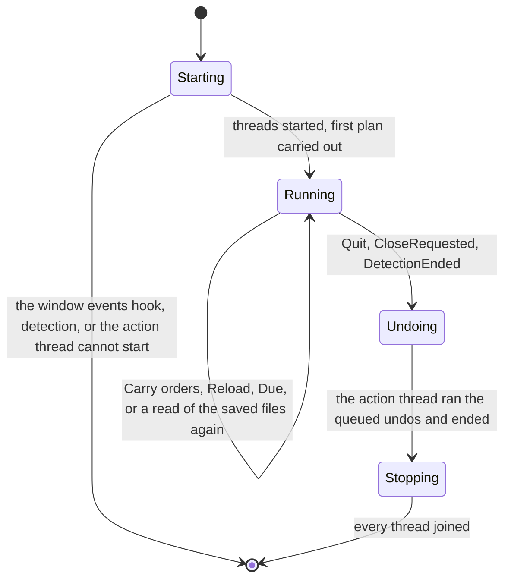

- **Starting.** The window events hook starts first, and the runtime exits if
  it cannot. Then the tray and the reload watch start. Each of those two is
  optional: the runtime logs why it cannot make one and runs without it. Then
  the saved files are read, and the lifecycle and action threads start. If
  either cannot start, the runtime stops what it started and exits with the
  error. A first read that fails starts with an empty plan and reads again, as
  [Reload watch](#reload-watch) describes.
- **Running.** Each event becomes a `Step`: `Carry` some orders, `Reload` the
  saved files, or `Stop`. The owner waits for its next event only until the
  first of two times (`wake`): when a rule that its cooldown held back is due,
  and when it reads the saved files again after a read failed. Either time
  sends it `Due`, whose step rechecks the held rules and, once the retry is
  due, reads the saved files again. With neither, it waits with no limit.
  After each step the tray gets a fresh menu if it changed.
- **Undoing.** `model.set_enabled(false)` stops every running application and
  queues the undo of what its automations changed. The owner then drops the
  job sender and joins the action thread, which runs the queued undos before
  it ends.
- **Stopping.** The tray stops only after the undo, because at the end of the
  session it holds Windows back until `Tray::stop` (see
  [Tray thread](#tray-thread)). Then the reload watch and the window watch
  stop, and dropping the inputs ends detection. Each reader is stopped, and
  every thread is joined.

### Runtime state

`model::State` is the runtime's one named state, which the log and the tray
show. It is derived each time from the model rather than stored:

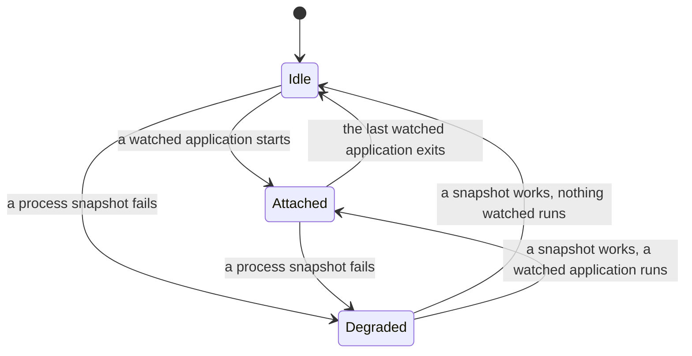

Degraded wins over the other two while `problem` is set.
[Lifecycle](Architecture.md#lifecycle) explains each state.

### Detection timers

The lifecycle thread (`apps/runtime/src/lifecycle.rs`) decides when to take a
process snapshot. Its state is two optional deadlines, `scan_at` and
`rescan_at`, plus whether any watched application runs and whether the last
snapshot failed.

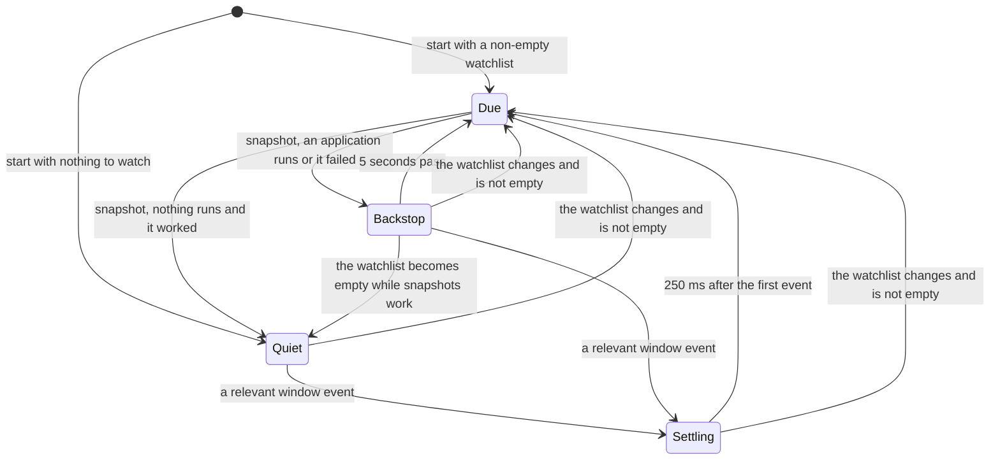

A created top-level window is relevant while anything is watched. A destroyed
window is relevant only while a watched application runs. More events while
**Settling** do not move the deadline, so a burst becomes one snapshot. The
two delays are `SETTLE` and `RESCAN`.

Each snapshot ends the session of an application whose process is gone, and
starts one for an application that runs without one. When several processes
fit one application, the session follows the process that owns the window its
reader reads, and a process that owned one keeps the session for
`OWNER_GRACE` after it owns none; [Lifecycle](Architecture.md#lifecycle) gives
the rule. Each start is followed by an `Identified` change with the build of
the executable that runs, which changes no state: the owner only logs it, as
[Build detection](Architecture.md#build-detection) describes. A new watchlist
ends the session of each application it drops or whose executable pattern it
changes, and forgets which process owned its window.

### Per-application run state

The model (`apps/runtime/src/model.rs`) has no run state type. An application's
automations run while all of these hold:

- It is in `attached`: detection found its process.
- `enabled` is true: automations are on in the tray.
- The plan has automations for it.

When they all hold, the application has an entry in `running`, with its engine
session, its reader's `SessionId`, and its newest plan.

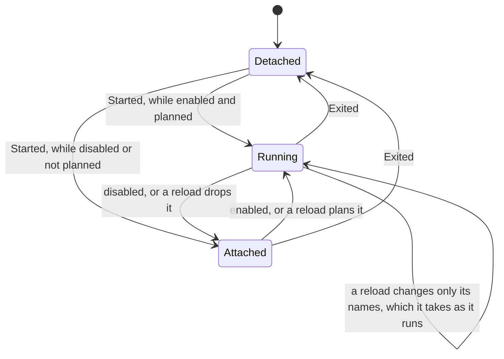

- **Running to Attached or Detached.** The engine session is stopped or ended,
  which releases every rule that restores. The reader is stopped.
- **A reload that changes what it runs.** `replan` compares each plan's
  `Runs`: its window match, its values' checks and its rules. When they
  differ, the application stops, which undoes what its automations changed,
  and starts again with `Start::Resume`. A resumed session fires no `Started`
  rules, because those already ran.
- **A reload that changes only names.** When only the plan's `Labels` differ,
  its names or the build its values were checked against, the session keeps running
  and takes the new plan, so the log and the tray use the new names. The
  reader sends a value's problem by its position, and the owner logs it with
  the value's newest name.
- **Unseen.** When the reader says the values can no longer be seen, the owner
  calls `forget_values`. The rules keep their state, so a rule that fired stays
  fired until new readings decide its condition.

### Reader thread

Each running application has a reader thread (`read` in
`apps/runtime/src/workers/reader.rs`). The thread's position in its loop is its
state, along with `Recovery`: why the last capture ended and how long to wait
before the next one.

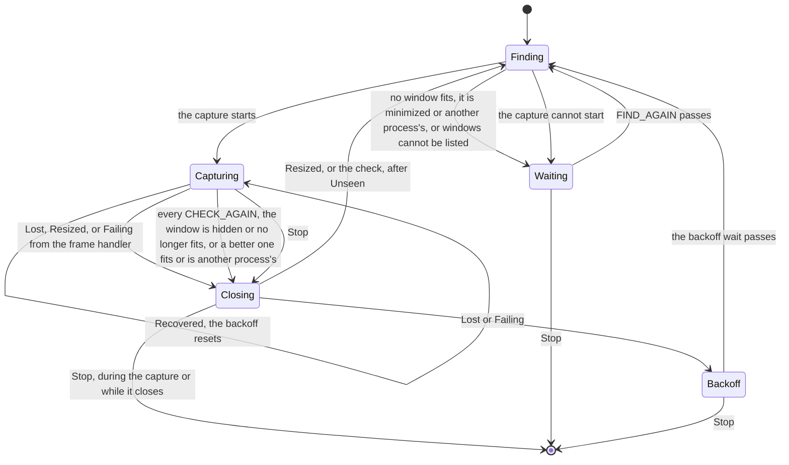

- **Finding.** `find_window` lists the processes and windows, takes the windows
  that fit best with `best_windows`, and picks one with `read_window` for the
  session's process (`Job::process`), as detection does: one of that process's
  windows when it owns one, and otherwise the first that shows. It captures the
  window only when it is that process's, and otherwise waits for the session
  to follow the other process.
- **Capturing.** `watch` waits on `control` for at most `CHECK_AGAIN` at a time.
  The capture's frame handler runs on another thread and sends `Lost`,
  `Resized`, `Failing`, or `Recovered` back to this one. On each timeout,
  `moved_on` checks that the window still shows and still fits as well as any
  window, because a hidden window sends no frames and no close.
- **Closing.** The thread closes the capture first, then drops what the closed
  capture sent after the message that ended it, still counting a `Stop` and a
  `Recovered`. When the 2 second check ended the capture, it then sends
  `Unseen`, so no reading from the old capture can follow it.
- **Backoff.** After `Lost` or `Failing`, the thread waits before it looks
  again: `FIND_AGAIN` at first, doubling up to `RESTART_WAIT_MAX` while each new
  capture ends before it reads a frame. It logs the reason once until the reason
  changes. A restarted capture that reads a frame sends `Recovered`, which
  resets both.
- Each problem, such as no window fitting yet, is sent once until a different
  problem or a working capture replaces it.

### Frame handler

`FrameReader::handle` runs once per frame and decides what each frame means.
Its state is `size` (the window size whose values it reads), `last` (each
value's last reading), `seen` (whether it sent a reading since it last sent
`Unseen`), `failures` (frames in a row that failed), `restarted` (whether the
reader started this capture again after the last one ended), and `ended`
(whether it told the reader its capture ended).

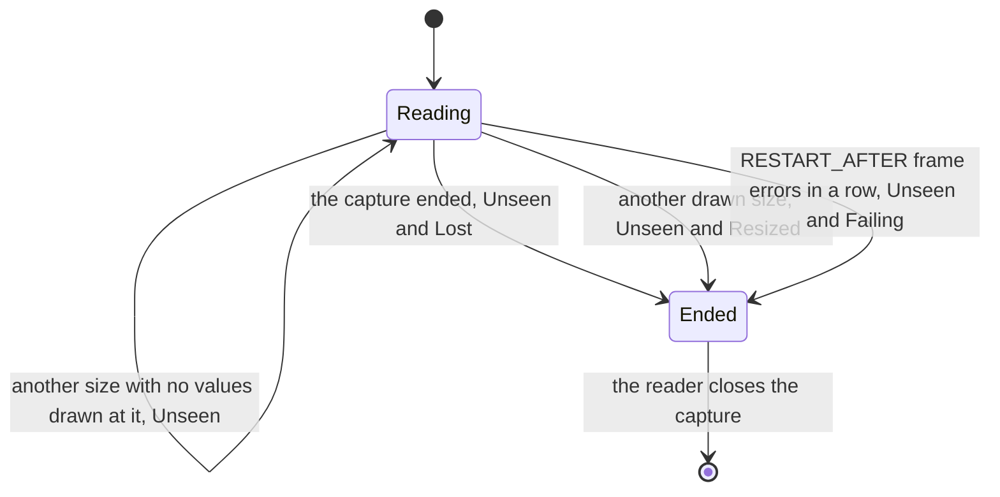

- A `Sample` goes to the owner only when a value reads differently from its
  last reading.
- A frame error is logged once until another problem or a good frame replaces
  it. A good frame starts the count again. A region that lies outside a window
  of its own drawn size does not count, because a new capture would fail the
  same way.
- The capture ends, as when the window closes, the graphics device is lost, or
  the frame pool cannot follow the window to a new size, with a
  `NotConnected` error.
- After a restart, the first good frame sends `Recovered` to the reader thread.
- **Ended.** The capture can still hand frames to the handler until the reader
  closes it. The handler reads none of them, so nothing it sends follows
  `Unseen`.
- A window size at which no value was drawn sends `Unseen` and keeps the
  capture, because a restart would find the same size.

### Read schedule

`ReadSchedule` in `crates/sources/src/schedule.rs` sets the wait before the next
frame is read. Its only state is the current wait.

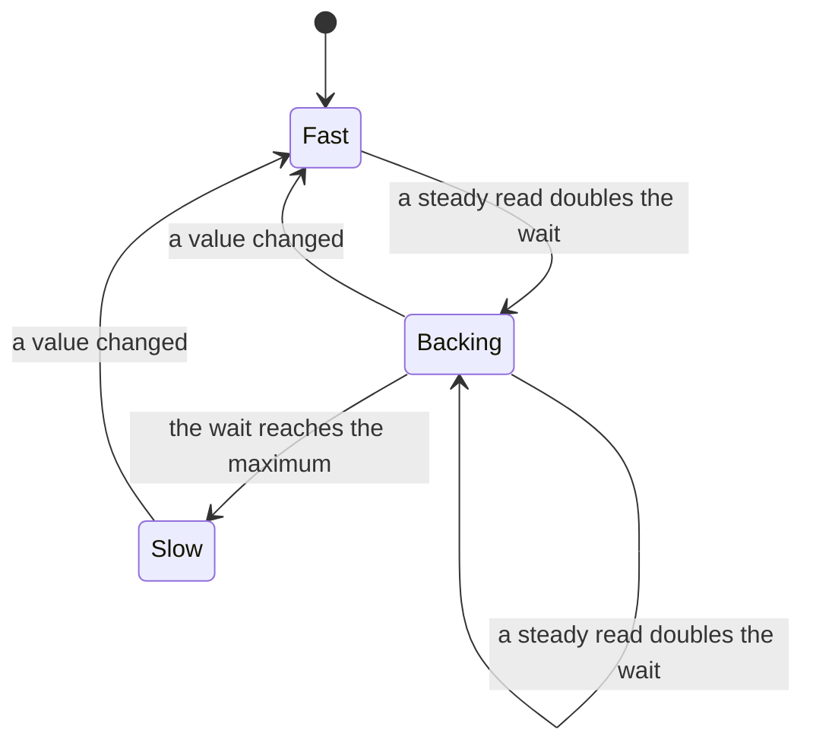

The reader always uses `ReadInterval::DEFAULT`, so **Fast** is 16 ms and
**Slow** is 500 ms.
`Activity::NearThreshold` also resets the wait to the minimum, but the reader
never reports it, so a value near a rule's threshold backs off like any other.

### Number text

The number check reads characters left to right, and `NumberText::push` in
`crates/sources/src/screen/digits.rs` keeps which part of a number it is in.

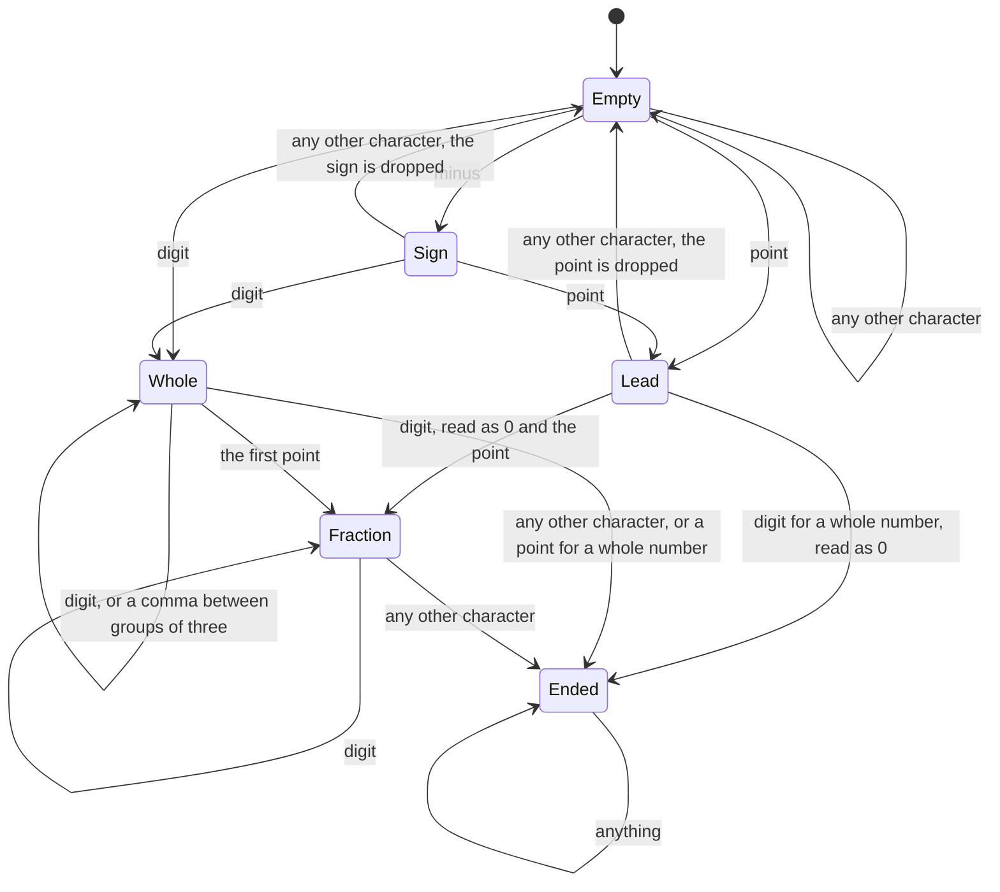

Before a digit, a character that does not fit starts the number over. After a
digit, it ends the number, and the rest of the region is ignored, so `12/50`
reads as 12 once `/` is learned. A `,` is skipped when it separates groups of
three digits before the point, so `1,234` reads as 1234. When the digits after
a `,` are not a group of three, as in `12,5`, the number ends at the `,` and
reads as 12. A `.` before any digit reads as `0.`, so `.5` reads as 0.5 (or 0 for
a whole number) and `-.5` as -0.5, unless a letter came before it, as in `Lv.5`. A value set to **Whole number only**
ends the number at its point, so `87.5%` reads as 87. A region with more than
24 characters (`MAX_CHARACTERS`) is a read error.

### Rule state

Each rule in an engine session (`crates/engine/src/lib.rs`) has a `RuleState`
of three fields: `armed`, `active`, and `last_fired`. Saved automations make
`Becomes` rules that re-arm when their condition is false, so this is the
machine that saved automations use.

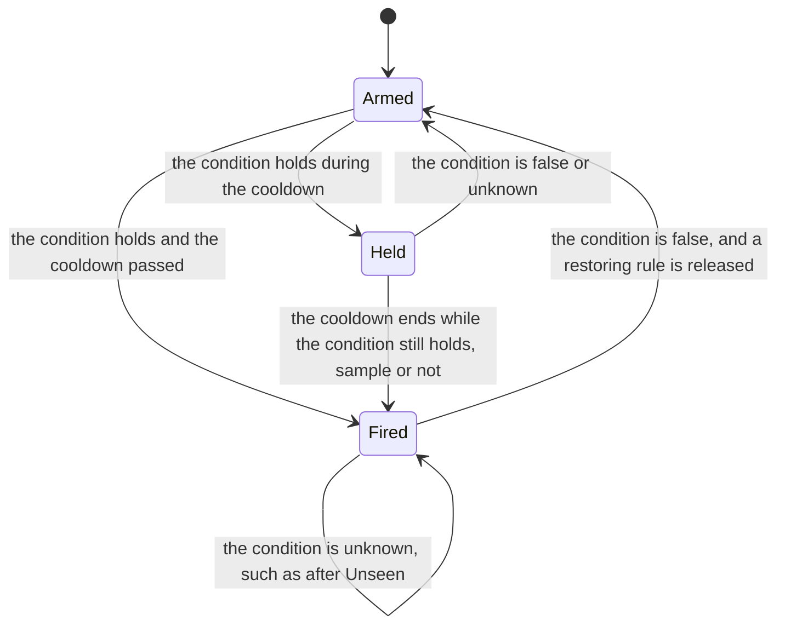

- **Fired** means `armed` is false. A rule that restores is also `active` until
  it is released.
- **Held** is not a field: it is a rule that is `armed`, whose condition holds
  on the values the session has, and whose cooldown from `last_fired` has not
  passed.
- A rule whose re-arm is `Never` is released when its condition turns false but
  stays disarmed for the rest of the session.
- In one sample, releases run before fires, so a restore never undoes a change
  another rule makes on the same value.
- A session that ends or stops releases every active rule. One that ends
  because the application exited then fires the `Exited` rules.
- The engine runs when a sample of any of the session's values arrives, and
  at the end of a held rule's cooldown. A value that holds still sends no
  sample, so `Session::next_due` gives the earliest time a held rule's
  cooldown ends. The owner wakes then if no event came first, and
  `Session::recheck` fires each held rule whose cooldown passed.

### Action thread and restore journal

The action thread (`apps/runtime/src/workers/act.rs`) makes the media and audio
controls when it starts, then runs each job in order. Its loop is a `Worker`
whose `actions` field holds the restore journal (`Actions`) once the controls
are made, or a `Missing` record with the last error and a `Backoff` while they
cannot be.

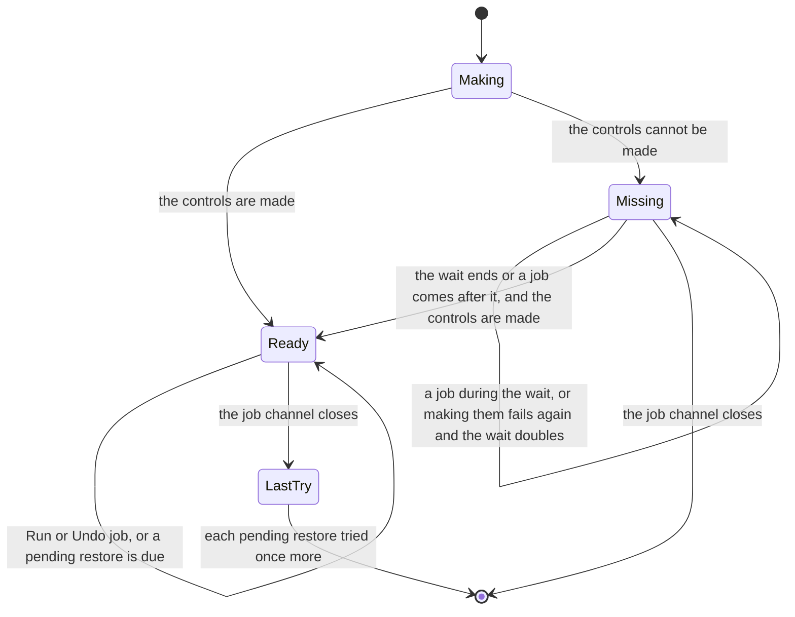

- **Missing.** A `Run` job logs that its actions did not run, and an `Undo` job
  has nothing to undo. When the wait ends, or the first job after it comes,
  the worker makes the controls again. The wait starts at 1 second and doubles
  after each failure, up to a minute. The log says when actions can run again.
- **Telling the owner.** `act::run` sends `ActionReport::CanRun(false)` when the
  worker reaches **Missing** and `CanRun(true)` when it leaves it, and only
  then; the owner takes it that actions can run until it hears otherwise. The
  owner keeps the last report in the model's `actions_can_run`, and the tray
  shows it.
- **Ready.** After each job, the worker tries the pending restores that are
  due. While any restore is pending, it waits for the next job only until the
  next one is due, or 10 seconds (`VOLUME_RETRY`) for a volume restore.
- **LastTry.** `last_try` tries every pending restore once, due or not, and
  forgets them.

The journal in `crates/actions/src/journal.rs` holds one entry per change that
a restoring rule made, in the order they were made. For each target, such as
one audio session's volume, the entries form a stack:

- **Perform, restoring.** The change is pushed with the state before it. If a
  restore of that target is pending, the change takes it over, so its own
  release puts back the state from before the first change.
- **Perform, not restoring.** Every entry for that target is removed, so no
  release undoes the permanent change. A pending restore of that target is
  dropped too.
- **Release.** The rule's entries are taken newest first. If a later entry on
  the same target exists, it inherits the older state. Otherwise the change is
  undone. A pending restore of the same target came from a newer rule, so the
  undo takes it in and puts back the older state. Each entry leaves the
  journal before its undo runs.
- **Failed undo.** The change moves to `pending` instead of being dropped. A
  volume restore is tried again until it works, and is dropped only once its
  audio session is gone. A media restore is tried once more, 2 seconds later
  (`MEDIA_RETRY`), then given up.

The journal lives only in memory, so a forced end, a crash, or an
end-of-session wait that runs out loses what it had not undone.

### Tray thread

The tray thread (`crates/platform/src/win/tray.rs`) runs a message loop. Its
state is whether the menu is open, and whether the window's procedure is
holding the end of the session.

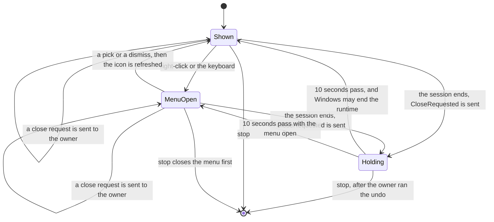

The window's procedure sends a close request and the end of the session to
the owner itself. Windows's menu loop drops what is posted to the tray loop
while the menu is open, but it still calls the procedure, so neither is lost.
[Tray](Architecture.md#tray) explains the posts.

- **Holding.** Windows asks first whether the session may end
  (`WM_QUERYENDSESSION`). The procedure gives a shutdown block reason and
  agrees. When the session really ends (`WM_ENDSESSION`), the procedure does
  not return until `Tray::stop` drops the sender it waits on, or 10 seconds
  (`END_SESSION_WAIT`) pass. Then it takes the reason back, as it also does
  when Windows calls the end off. If the wait runs out, the tray goes on as it
  was, and Windows may end the runtime. A critical shutdown, or a user who
  ends the session anyway, can also end the runtime before the wait is over.
- With no tray window, nothing hears the end of the session, and Windows ends
  the runtime without an undo.

### Reload watch

The reload watch waits on the auto-reset named event `Local\AppyTappy.Reload`
and sends `Reload` each time the setup app sets it. Several saves before the
reload watch wakes become one reload. The owner then reads the saved files
(`reread`). When they read, it sends detection the new watchlist and calls
`replan`. When they cannot be read as a whole, such as while another program
holds a file, the owner keeps the plan it has and reads them again. Its state
is `retry`, an optional `Retry` with a time and the tries left, and `had`,
whether any read has worked yet.

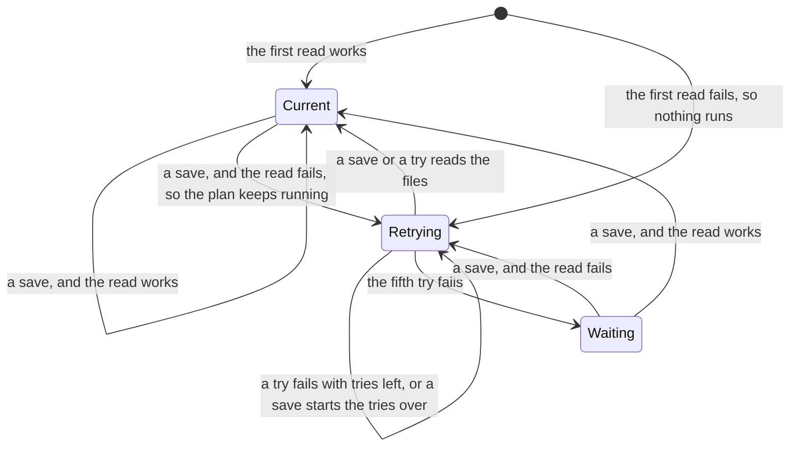

A try comes 2 seconds (`RETRY_WAIT`) after the read before it failed, and at
most 5 tries (`RETRIES`) follow one failed read. A try runs when the owner
wakes at its time, or with the first event after it. One automation that
cannot run, such as one that breaks a rule after a hand edit, does not fail
the read: it is logged and left out of the plan.

### Log rotation

`Log` in `apps/runtime/src/log.rs` appends to `runtime.log`. A line that would
take it past 512 KiB (`LIMIT`) first renames it to `runtime.old.log` and opens a new
file. Rotating never fails a write (`rotate`).

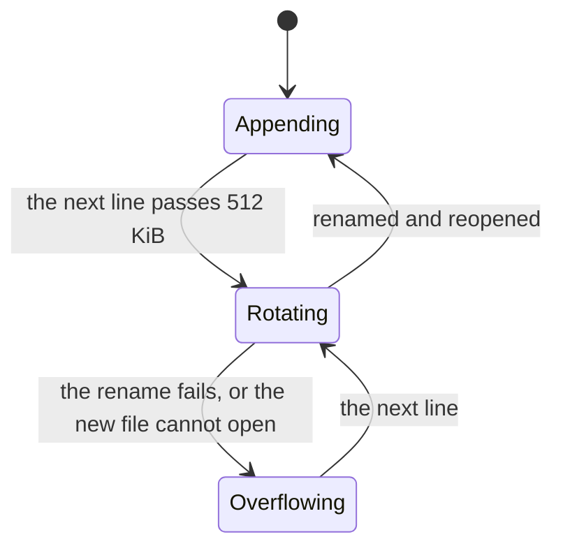

In **Overflowing** the line goes to the file the log has, past the limit, so
no line is lost. After a rename whose open failed, that file is
`runtime.old.log`. The next try finds no `runtime.log` to rename, so it only
opens one, and nothing is renamed twice. The new file replaces the old one
only once it opens.

## Setup app

### Pages and flows

The React side (`apps/setup/src/App.tsx`) has two pieces of state: `page`, the
tab shown, and `flow`, the value, reference, automation, or application being
made or edited. A flow covers the page while it is open.

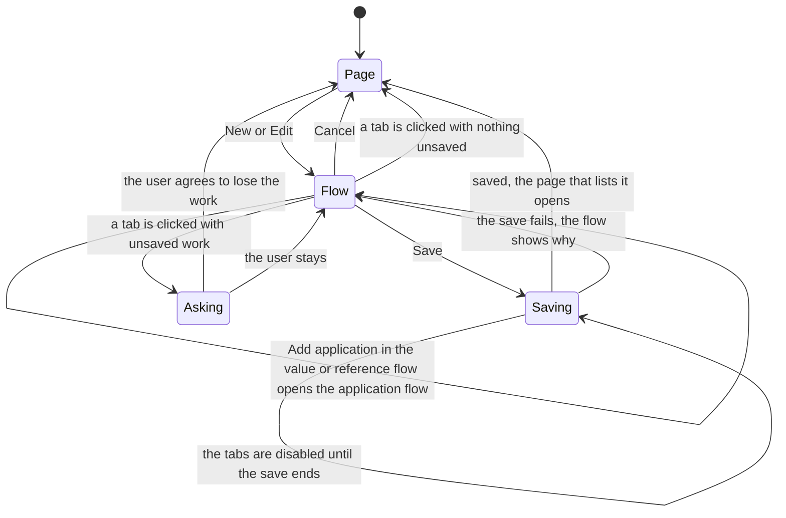

The unsaved work of a flow, such as its screenshots and recording, lives in the
flow's components and in the owner thread. Each flow reports what leaving it
would lose (`apps/setup/src/lib/unsaved.ts`), and the tabs and **Change window**
ask before they drop unsaved work. While a save runs, both are disabled. A save closes
its flow only while that flow is still open (`saved` in `App.tsx`), so a save
that finishes after the user moved on leaves the next flow alone. Leaving the
value or reference flow unmounts it and stops its capture, which clears its screenshots and
recording.

### Capture slot

The setup app's owner thread (`apps/setup/src-tauri/src/owner.rs`) has one
capture slot, `session`, shared by the value preview and the automation
editor's watch. Starting one stops the other. Its other state is `generation`,
`latest` (the newest frame), `failure`, `screenshots`, `check`, `recording`,
and `watched`.

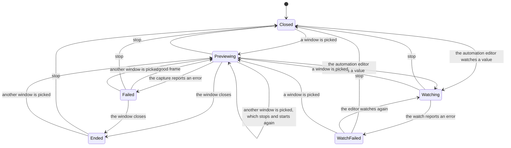

- **Stop** closes the capture, adds 1 to `generation`, and clears every field
  above.
- **Failed** sets `failure`, a `CaptureFailure`. Preview answers with its
  error, a screenshot is refused, and a recording stops with the error as its
  problem. The next good frame clears it.
- **Ended** is a failure whose `ended` flag is set, for the closed-window
  error Windows reports. Frames after it are dropped, and a screenshot, a new
  recording, and **Record more** are refused with "Change window to pick it
  again". Only a stop or another pick leaves it.
- **WatchFailed** closes the capture and keeps the watch's error for the editor
  to show.
- The screenshot shortcut is on while the capture view shows, except while the
  user is choosing a new shortcut. Choosing ends with a new shortcut, Esc, a
  second click, or when focus leaves **Change shortcut**.

### Recording

A recording (`apps/setup/src-tauri/src/recording.rs`) keeps each reading a
region shows once, for the user to review. It is `None` or a `Recording` whose
`stopped` field says whether it still records, and whose `problem` says why
it skips frames or why it stopped by itself.

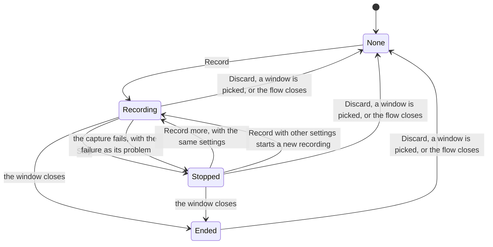

- Each frame is cropped to the region. A crop of another window size, or one
  the reader cannot read, sets the recording's `problem` and is skipped while
  it goes on recording. A crop with no ink is skipped and clears the problem,
  as does a crop that reads. A capture failure stops the recording, and its
  problem says why.
- A crop whose characters are new is kept and sent to the text reader. A
  recording keeps at most 200 readings (`MAX_READINGS`).
- **Record more** needs the same region, ink, tolerance, and window size, and
  clears the problem. When any of them differs (`settingsDiffer`), **Use its
  settings** shows and puts all of them back, with the region on a screenshot
  of the recording's size.
- **Ended** is a stopped recording whose capture slot is **Ended**
  (`Recording::end`). Its problem says to change window, and **Record more**
  and a new **Record** are refused. Its readings stay for review, so a
  reference can still be saved from them.
- A value saves the window size of the screenshot its region was drawn on
  (`drawnOn` in the UI). A number value reads with one of the application's
  references, and saving a reference teaches it from its labeled screenshots
  and the recording. A save or a try whose labeled screenshots, recording, or
  compared screenshot has another window size is refused, and the error names
  which one (`check_spec::drawn_size`).

### Text reader

The text reader (`apps/setup/src-tauri/src/recording/ocr.rs`) runs on its own thread. It
loads its model on the first reading it gets, then reads each reading and sends
the text back with the recording's ID and the reading's index. The owner drops
text for a recording that is gone. If the thread has stopped, the owner marks
the reading as failed and asks the user to type it.

### Overlays

Each application whose overlay is on has an entry on the owner thread
(`apps/setup/src-tauri/src/overlay.rs`) and a window of the setup app's own
(`apps/setup/src-tauri/src/overlay/window.rs`). The window shows as an overlay
over the application or as a panel.

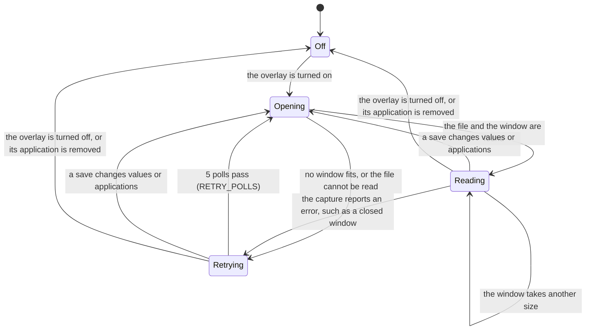

`overlay::window::sync` opens a window for each overlay that is on and closes
each that is not. It runs when the main window mounts, after each overlay
change, and after an application is removed, so a removed application's
overlay or panel closes. It tries every window, and a window that cannot open
or close does not stop the others. `set_overlay` and `remove_app` then answer
with a message that names each such window, and the change they saved stays
saved.

### Saved files and copies

Only one copy of the setup app runs. `tauri-plugin-single-instance` hands a
second copy over to the first, which brings its window forward
(`bring_forward`), and the second copy exits before it shows a window.

Every write in `crates/config/src/store.rs` goes to a temporary file, is synced,
and is renamed over the saved file, so a reader sees the old file or the new
one. Each save reads the file, changes it, and writes it back. After a request
that saves values, automations, or applications, the setup app tells the
runtime to read the saved files again. Turning an overlay on or off and moving a
panel write the application's file without telling the runtime.

A temporary file is named `<file>.<process ID>-<time>.tmp`. After a save,
`remove_leftovers` deletes the temporary files in the same folder that another
run left and that have not changed for ten minutes, such as one a crash left
between the write and the rename. A failed delete does not fail the save, and
the next save tries again.

## MCP investigation server

The [MCP investigation server](MCP-investigation-server.md) answers one request
at a time. Its `Session` in `apps/mcp/src/tools.rs` keeps the executables the
user refused, and at most one attached process with its memory scan.

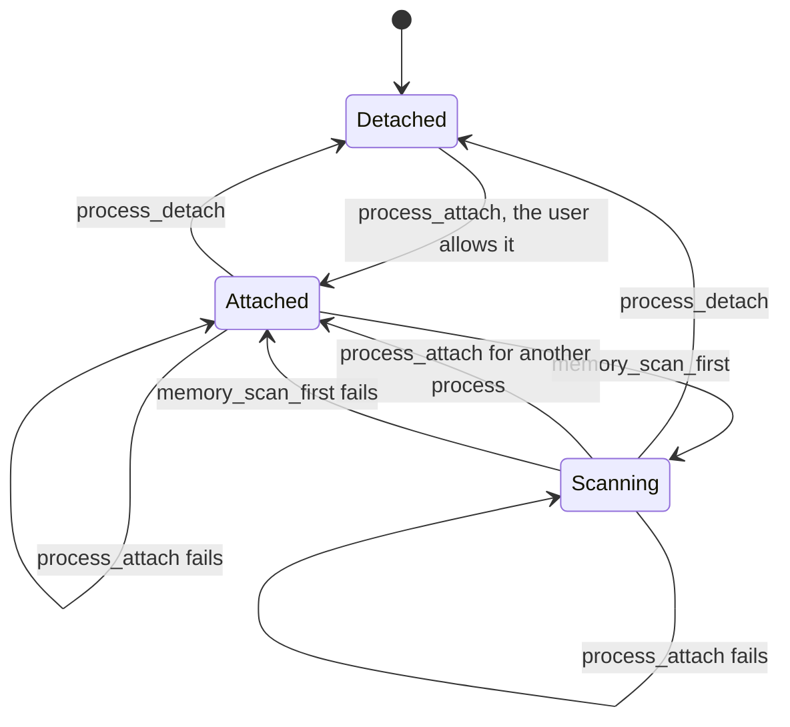

A program the user refuses is refused again without asking for the rest of the
session, whatever its process ID.

- **An attach that fails** leaves the session as it was. `open_attachment`
  opens and checks the new process, and only once that works does
  `process_attach` replace the attached one. The error says which process is
  still attached, unless the user refused that process's own program.
- **A first scan that fails** has already dropped the previous scan, on
  purpose: an unknown-value scan can copy up to 2 GiB of memory, and keeping
  the old one too could double that. Its error says the previous scan was
  dropped.
