# State machines

AppyTappy has few `enum State` types, but much of its behavior is still a set of
state machines. This page names each one, draws it, and says which events move
it. It also says where a machine can reach a state it never leaves, or a state
that does the wrong thing. Each of those has an issue, linked under
**Open problems** at the end of its section.

Read [Architecture](Architecture.md) first: it describes the threads that these
machines run on.

## How to read this page

An _implicit_ state machine is state that is spread over a few fields, flags,
or `Option`s, plus the code that changes them. No type lists its states, so
this page does. For example, the runtime has no type for an application's run
state; whether it runs follows from three maps and a flag on the owner thread.

The diagrams are [Mermaid](https://mermaid.js.org/) state diagrams. GitHub
draws them. A box is a state, and an arrow is a transition labeled with the
event that causes it. `[*]` is where the machine starts or ends.

Many messages travel between threads, so a message can arrive after the state
it was about has gone. Four guards drop such stale messages:

- **Session IDs.** The runtime gives each reader session a new `SessionId`. The
  owner drops a reading whose session no longer runs.
- **Generations.** The setup app's owner thread adds 1 to `generation` each
  time it starts or stops a capture. A frame or a failure from an older
  generation is dropped.
- **Recording IDs.** Each recording gets a new `id`, so text that the text
  reader sends back for a discarded recording is dropped.
- **Overlay numbers.** Each overlay capture gets its own number from
  `Overlays::next`, and a reading from an older capture is dropped.

Source files are named as code text rather than linked, so a file that moves
leaves no broken link.

## Runtime

### Owner thread start and stop

`owner::watch` in `apps/runtime/src/owner.rs` starts every thread, runs the
event loop, and stops every thread in a fixed order.

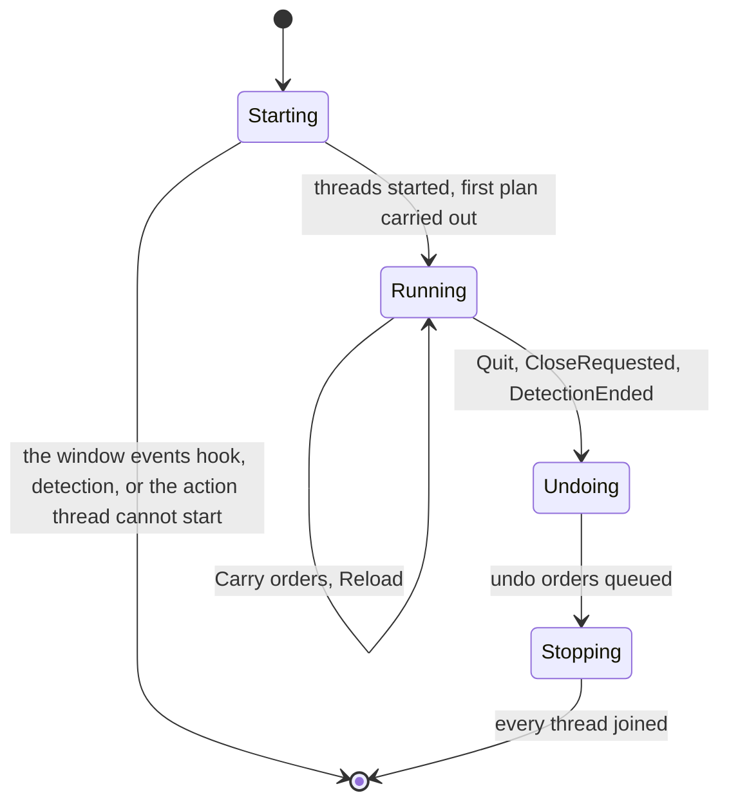

- **Starting.** The window events hook starts first, and the runtime exits if
  it cannot. Then the tray and the reload watch start. Each of those two is
  optional: the runtime logs why it cannot make one and runs without it. Then
  the saved files are read, and the lifecycle and action threads start. If
  either cannot start, the runtime stops what it started and exits with the
  error.
- **Running.** Each event becomes a `Step`: `Carry` some orders, `Reload` the
  saved files, or `Stop`. After each step the tray gets a fresh menu if it
  changed.
- **Undoing.** `model.set_enabled(false)` stops every running application and
  queues the undo of what its automations changed.
- **Stopping.** The tray stops first, so its icon goes first. Then the reload
  watch and the window watch stop. Dropping the inputs and the action jobs ends
  detection and the action thread, which runs the queued undos before it ends.
  Each reader is stopped, and every thread is joined.

Open problems:

- [#88](https://github.com/TheLunchTrae/appy-tappy/issues/88): when Windows ends
  the session, the runtime can be ended before the undo runs.
- [#92](https://github.com/TheLunchTrae/appy-tappy/issues/92): a reload that cannot
  read the saved files replaces the running plan with an empty one.

### Runtime state

`model::State` is the runtime's one named state, which the log and the tray
show. It is derived each time from the model rather than stored:

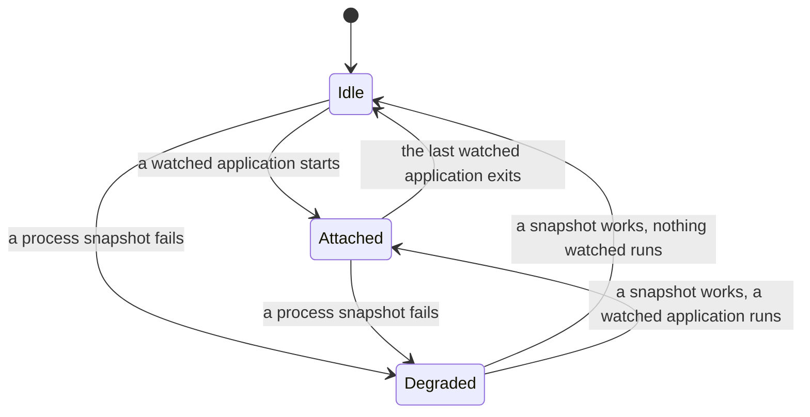

Degraded wins over the other two while `problem` is set.
[Lifecycle](Architecture.md#lifecycle) explains each state.

### Detection timers

The lifecycle thread (`apps/runtime/src/lifecycle.rs`) decides when to take a
process snapshot. Its state is two optional deadlines, `scan_at` and
`rescan_at`, plus whether any watched application runs and whether the last
snapshot failed.

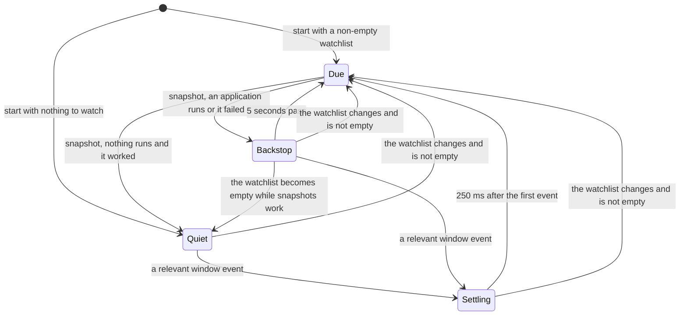

A created top-level window is relevant while anything is watched. A destroyed
window is relevant only while a watched application runs. More events while
**Settling** do not move the deadline, so a burst becomes one snapshot. The
two delays are `SETTLE` and `RESCAN`.

Each snapshot ends the session of an application whose process is gone, and
starts one for an application that runs without one. When several processes
fit one application, the session follows the process that owns the window its
reader reads, and a process that owned one keeps the session for
`OWNER_GRACE` after it owns none; [Lifecycle](Architecture.md#lifecycle) gives
the rule. A new watchlist ends the session of each application it drops or
whose executable pattern it changes, and forgets which process owned its
window.

### Per-application run state

The model (`apps/runtime/src/model.rs`) has no run state type. An application's
automations run while all of these hold:

- It is in `attached`: detection found its process.
- `enabled` is true: automations are on in the tray.
- The plan has automations for it.

When they all hold, the application has an entry in `running`, with its engine
session, its reader's `SessionId`, and the plan it started with.

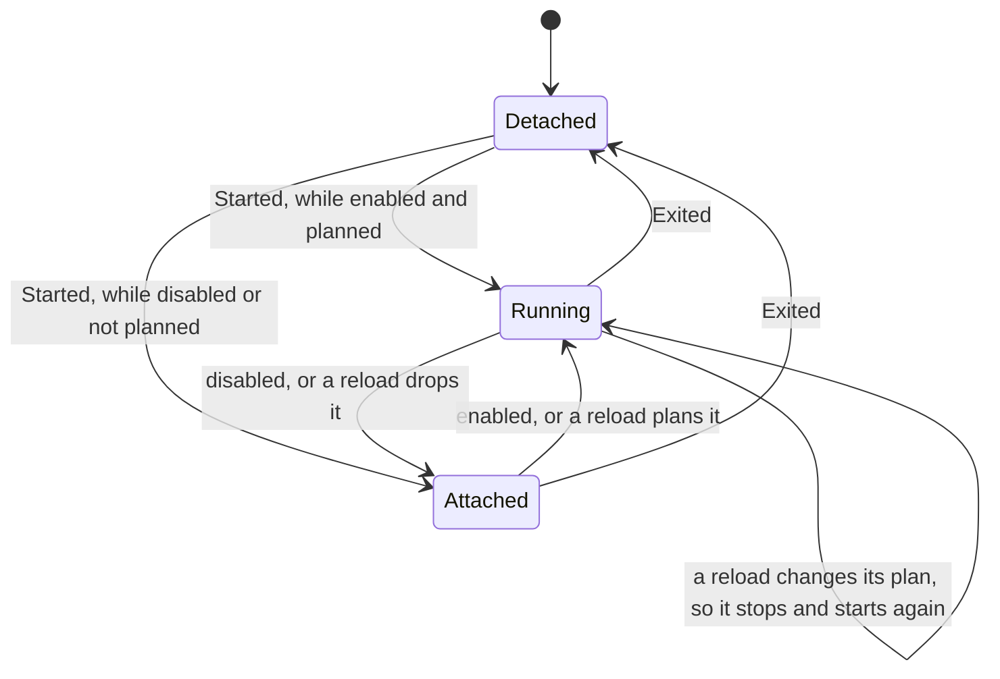

- **Running to Attached or Detached.** The engine session is stopped or ended,
  which releases every rule that restores. The reader is stopped.
- **A reload that changes the plan.** The application stops, which undoes what
  its automations changed, and starts again with `Start::Resume`. A resumed
  session fires no `Started` rules, because those already ran.
- **Unseen.** When the reader says the values can no longer be seen, the owner
  calls `forget_values`. The rules keep their state, so a rule that fired stays
  fired until new readings decide its condition.

### Reader thread

Each running application has a reader thread (`read` in
`apps/runtime/src/workers/reader.rs`). The thread's position in its loop is its
state, along with `Recovery`: why the last capture ended and how long to wait
before the next one.

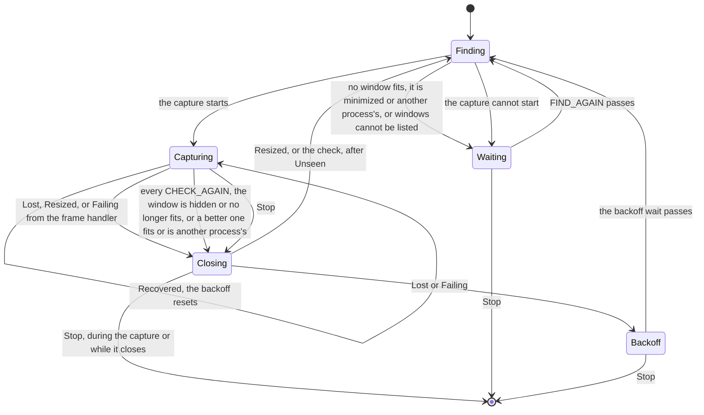

- **Finding.** `find_window` lists the processes and windows, takes the windows
  that fit best with `best_windows`, and picks one with `read_window` for the
  session's process (`Job::process`), as detection does: one of that process's
  windows when it owns one, and otherwise the first that shows. It captures the
  window only when it is that process's, and otherwise waits for the session
  to follow the other process.
- **Capturing.** `watch` waits on `control` for at most `CHECK_AGAIN` at a time.
  The capture's frame handler runs on another thread and sends `Lost`,
  `Resized`, `Failing`, or `Recovered` back to this one. On each timeout,
  `moved_on` checks that the window still shows and still fits as well as any
  window, because a hidden window sends no frames and no close.
- **Closing.** The thread closes the capture first, then drops what the closed
  capture sent after the message that ended it, still counting a `Stop` and a
  `Recovered`. When the 2 second check ended the capture, it then sends
  `Unseen`, so no reading from the old capture can follow it.
- **Backoff.** After `Lost` or `Failing`, the thread waits before it looks
  again: `FIND_AGAIN` at first, doubling up to `RESTART_WAIT_MAX` while each new
  capture ends before it reads a frame. It logs the reason once until the reason
  changes. A restarted capture that reads a frame sends `Recovered`, which
  resets both.
- Each problem, such as no window fitting yet, is sent once until a different
  problem or a working capture replaces it.

### Frame handler

`FrameReader::handle` runs once per frame and decides what each frame means.
Its state is `size` (the window size whose values it reads), `last` (each
value's last reading), `seen` (whether it sent a reading since it last sent
`Unseen`), `failures` (frames in a row that failed), `restarted` (whether the
reader started this capture again after the last one ended), and `ended`
(whether it told the reader its capture ended).

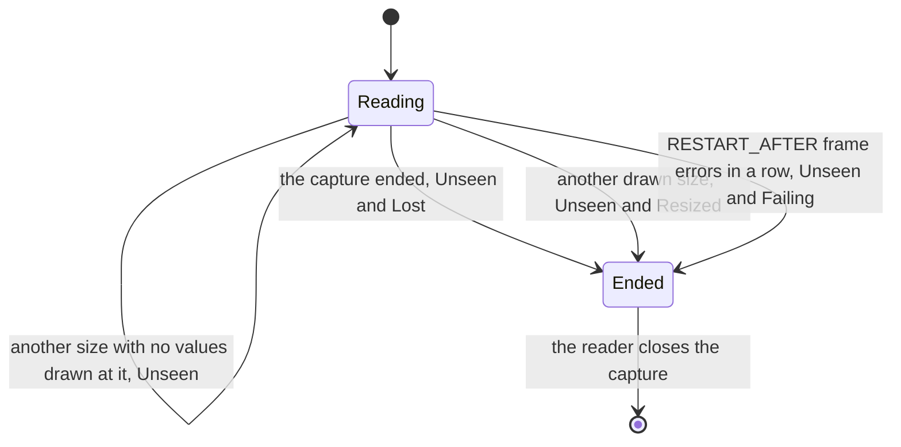

- A `Sample` goes to the owner only when a value reads differently from its
  last reading.
- A frame error is logged once until another problem or a good frame replaces
  it. A good frame starts the count again. A region that lies outside a window
  of its own drawn size does not count, because a new capture would fail the
  same way.
- The capture ends, as when the window closes, the graphics device is lost, or
  the frame pool cannot follow the window to a new size, with a
  `NotConnected` error.
- After a restart, the first good frame sends `Recovered` to the reader thread.
- **Ended.** The capture can still hand frames to the handler until the reader
  closes it. The handler reads none of them, so nothing it sends follows
  `Unseen`.
- A window size at which no value was drawn sends `Unseen` and keeps the
  capture, because a restart would find the same size.

### Read schedule

`ReadSchedule` in `crates/sources/src/schedule.rs` sets the wait before the next
frame is read. Its only state is the current wait.

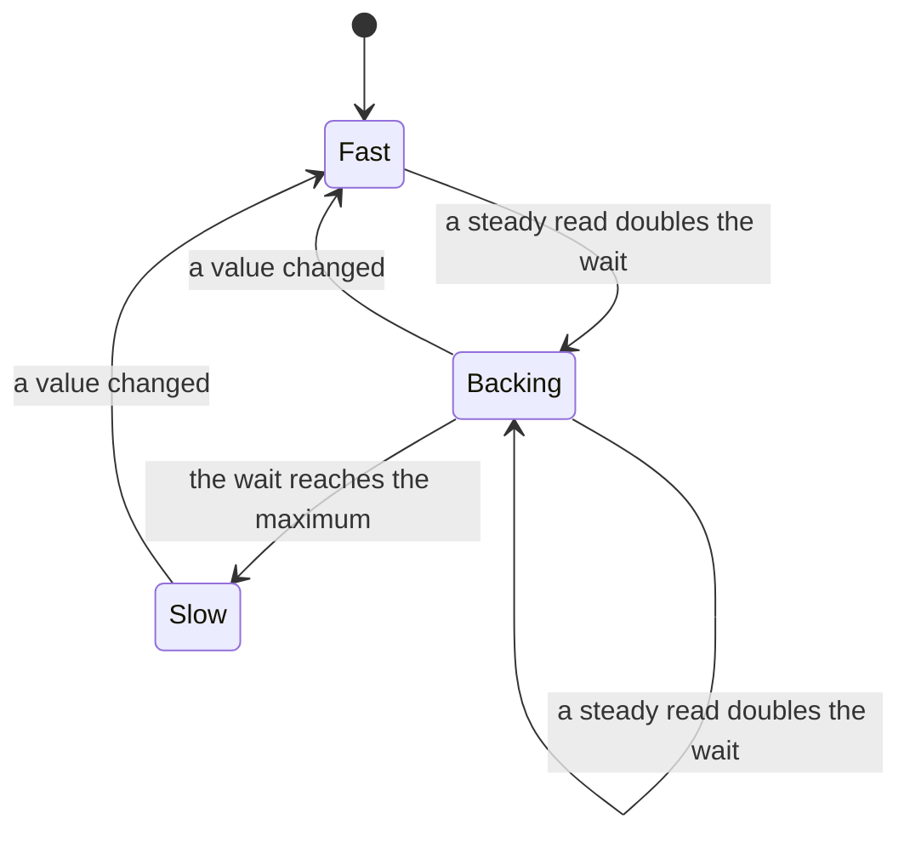

The reader always uses `ReadInterval::DEFAULT`, so **Fast** is 16 ms and
**Slow** is 500 ms.
`Activity::NearThreshold` also resets the wait to the minimum, but the reader
never reports it, so a value near a rule's threshold backs off like any other.

### Number text

The number check reads characters left to right, and `NumberText::push` in
`crates/sources/src/screen/digits.rs` keeps which part of a number it is in.

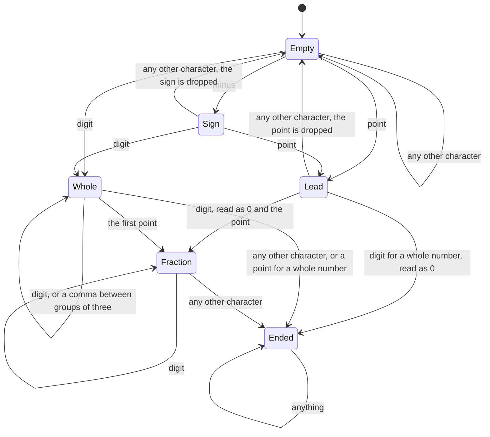

Before a digit, a character that does not fit starts the number over. After a
digit, it ends the number, and the rest of the region is ignored, so `12/50`
reads as 12 once `/` is learned. A `,` is skipped when it separates groups of
three digits before the point, so `1,234` reads as 1234. When the digits after
a `,` are not a group of three, as in `12,5`, the number ends at the `,` and
reads as 12. A `.` before any digit reads as `0.`, so `.5` reads as 0.5 (or 0 for
a whole number) and `-.5` as -0.5, unless a letter came before it, as in `Lv.5`. A value set to **Whole number only**
ends the number at its point, so `87.5%` reads as 87. A region with more than
24 characters (`MAX_CHARACTERS`) is a read error.

### Rule state

Each rule in an engine session (`crates/engine/src/lib.rs`) has a `RuleState`
of three fields: `armed`, `active`, and `last_fired`. Saved automations make
`Becomes` rules that re-arm when their condition is false, so this is the
machine that saved automations use.

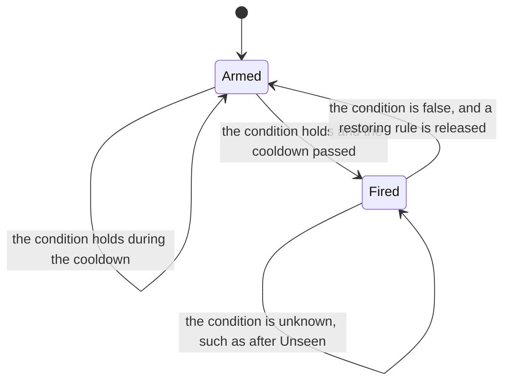

- **Fired** means `armed` is false. A rule that restores is also `active` until
  it is released.
- A rule whose re-arm is `Never` is released when its condition turns false but
  stays disarmed for the rest of the session.
- In one sample, releases run before fires, so a restore never undoes a change
  another rule makes on the same value.
- A session that ends or stops releases every active rule. One that ends
  because the application exited then fires the `Exited` rules.
- The engine runs only when a sample of any of the session's values arrives.
  It has no timer.

Open problems:

- [#91](https://github.com/TheLunchTrae/appy-tappy/issues/91): a rule held back by
  its cooldown is checked again only on the next sample, so it never fires
  while the value holds still.

### Action thread and restore journal

The action thread (`apps/runtime/src/workers/act.rs`) makes the media and audio
controls once, then runs each job in order.

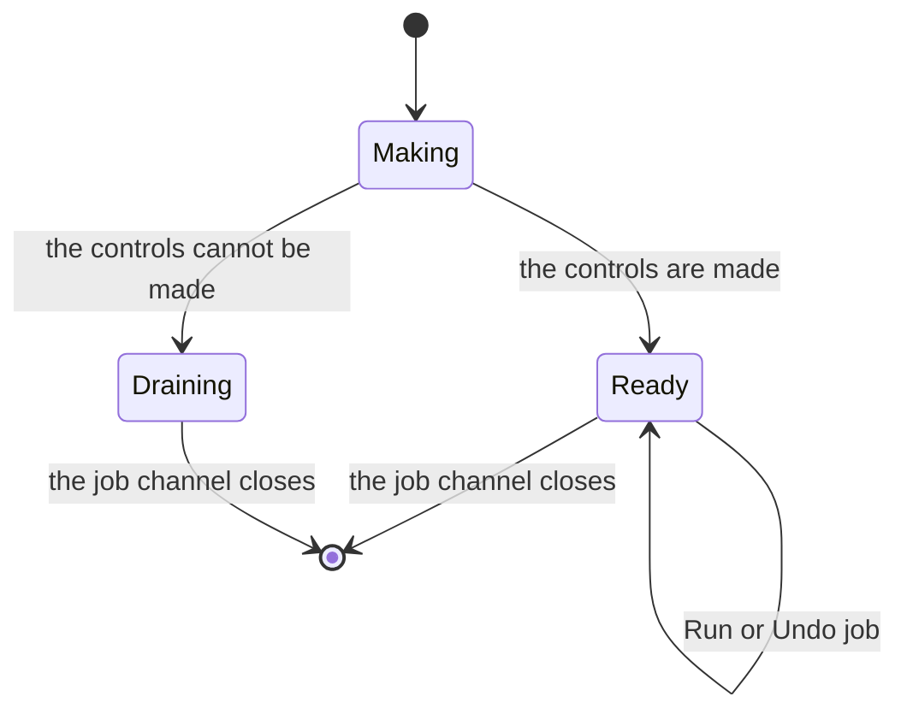

In **Draining** every job is dropped.

The journal in `crates/actions/src/journal.rs` holds one entry per change that
a restoring rule made, in the order they were made. For each target, such as
one audio session's volume, the entries form a stack:

- **Perform, restoring.** The change is pushed with the state before it.
- **Perform, not restoring.** Every entry for that target is removed, so no
  release undoes the permanent change.
- **Release.** The rule's entries are taken newest first. If a later entry on
  the same target exists, it inherits the older state. Otherwise the change is
  undone. Each entry leaves the journal before its undo runs.

The journal lives only in memory.

Open problems:

- [#93](https://github.com/TheLunchTrae/appy-tappy/issues/93): one failure making
  the controls leaves the thread in **Draining** for the whole run.
- [#94](https://github.com/TheLunchTrae/appy-tappy/issues/94): a failed undo is
  dropped with its entry and never tried again.
- [#88](https://github.com/TheLunchTrae/appy-tappy/issues/88): a forced end loses the
  in-memory journal.

### Tray thread

The tray thread (`crates/platform/src/win/tray.rs`) runs a message loop. Its
state is whether the menu is open.

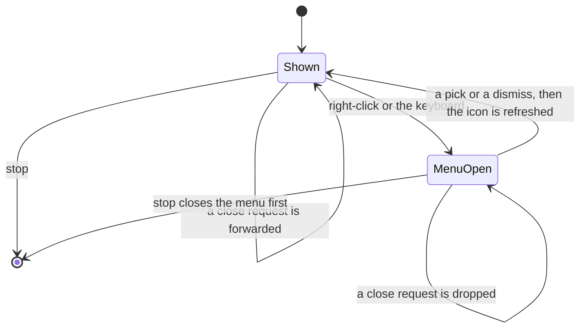

[Tray](Architecture.md#tray) explains why a post made while the menu is open
is dropped.

Open problems:

- [#88](https://github.com/TheLunchTrae/appy-tappy/issues/88): the end-of-session
  notice is acknowledged before the undo runs, and is dropped while the menu is
  open.

### Reload watch

The reload watch waits on the auto-reset named event `Local\AppyTappy.Reload`
and sends `Reload` each time the setup app sets it. Several saves before the
reload watch wakes become one reload. The owner then reads the saved files,
sends detection the new watchlist, and calls `replan`.

Open problems:

- [#92](https://github.com/TheLunchTrae/appy-tappy/issues/92): a read that fails
  stops every automation until the next save.

### Log rotation

`Log` in `apps/runtime/src/log.rs` appends to `runtime.log`. A line that would
take it past 512 KiB (`LIMIT`) first renames it to `runtime.old.log` and opens a new
file.

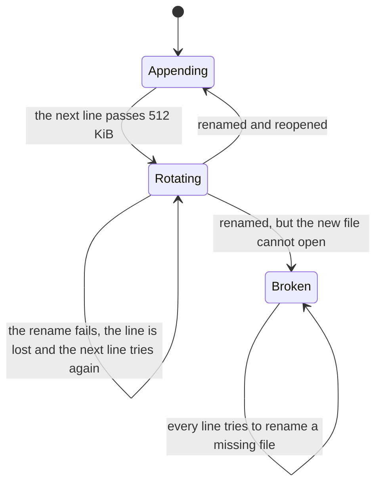

Open problems:

- [#101](https://github.com/TheLunchTrae/appy-tappy/issues/101): **Broken** lasts for
  the rest of the run.

## Setup app

### Pages and flows

The React side (`apps/setup/src/App.tsx`) has two pieces of state: `page`, the
tab shown, and `flow`, the value, reference, automation, or application being
made or edited. A flow covers the page while it is open.

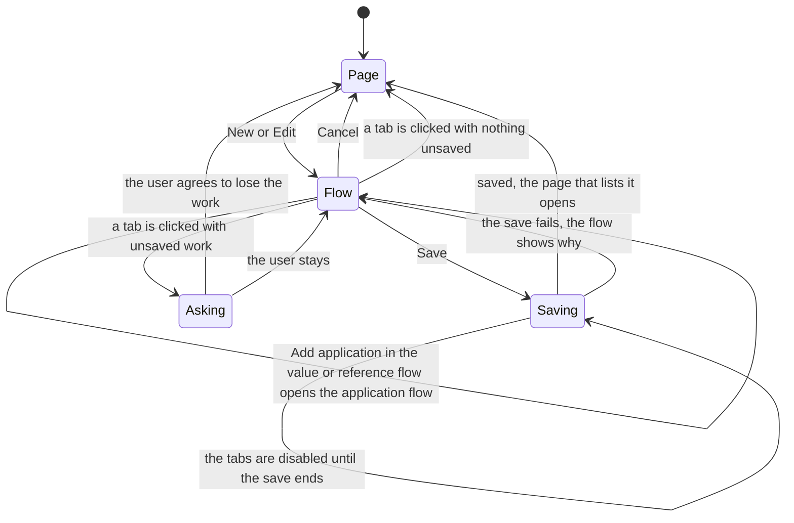

The unsaved work of a flow, such as its screenshots and recording, lives in the
flow's components and in the owner thread. Each flow reports what leaving it
would lose (`apps/setup/src/lib/unsaved.ts`), and the tabs and **Change window**
ask before they drop unsaved work. While a save runs, both are disabled. A save closes
its flow only while that flow is still open (`saved` in `App.tsx`), so a save
that finishes after the user moved on leaves the next flow alone. Leaving the
value or reference flow unmounts it and stops its capture, which clears its screenshots and
recording.

### Capture slot

The setup app's owner thread (`apps/setup/src-tauri/src/owner.rs`) has one
capture slot, `session`, shared by the value preview and the automation
editor's watch. Starting one stops the other. Its other state is `generation`,
`latest` (the newest frame), `failure`, `screenshots`, `check`, `recording`,
and `watched`.

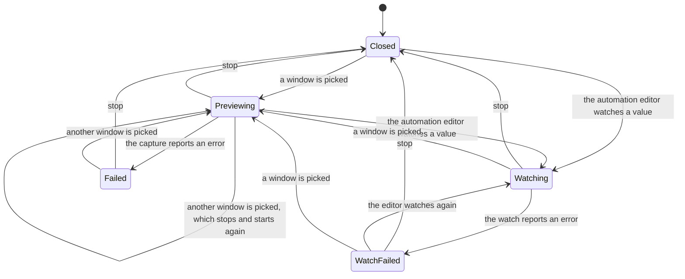

- **Stop** closes the capture, adds 1 to `generation`, and clears every field
  above.
- **Failed** sets `failure`. Preview answers with it, but frames keep updating
  `latest`, and only a stop clears it.
- **WatchFailed** closes the capture and keeps the watch's error for the editor
  to show.
- The screenshot shortcut is on while the capture view shows, except while the
  user is choosing a new shortcut.

Open problems:

- [#98](https://github.com/TheLunchTrae/appy-tappy/issues/98): one frame error stays
  shown until the window is picked again, and a screenshot can be taken after
  the window closed.
- [#103](https://github.com/TheLunchTrae/appy-tappy/issues/103): choosing a new
  shortcut and then leaving the button keeps the shortcut off.

### Recording

A recording (`apps/setup/src-tauri/src/recording.rs`) keeps each reading a
region shows once, for the user to review. It is `None` or a `Recording` whose
`stopped` field says whether it still records.

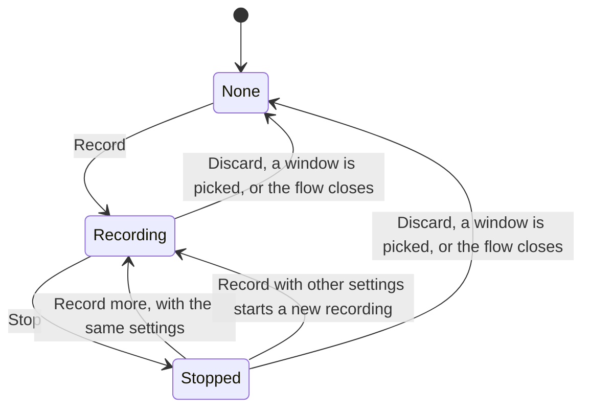

- Each frame is cropped to the region. A crop of another window size sets the
  recording's `problem` and is skipped. A crop with no ink is skipped.
- A crop whose characters are new is kept and sent to the text reader. A
  recording keeps at most 200 readings (`MAX_READINGS`).
- **Record more** needs the same region, ink, tolerance, and window size.
- Saving a value takes the window size from the screenshot it names. A number
  value reads with one of the application's references, and saving a
  reference teaches it from its labeled screenshots and the recording.

Open problems:

- [#98](https://github.com/TheLunchTrae/appy-tappy/issues/98): a capture failure
  leaves the recording in **Recording**, and the UI keeps saying so.
- [#95](https://github.com/TheLunchTrae/appy-tappy/issues/95): a value can be saved
  with a window size that its region, labels, and recording were not drawn at.

### Text reader

The text reader (`apps/setup/src-tauri/src/recording/ocr.rs`) runs on its own thread. It
loads its model on the first reading it gets, then reads each reading and sends
the text back with the recording's ID and the reading's index. The owner drops
text for a recording that is gone. If the thread has stopped, the owner marks
the reading as failed and asks the user to type it.

### Overlays

Each application whose overlay is on has an entry on the owner thread
(`apps/setup/src-tauri/src/overlay.rs`) and a window of the setup app's own
(`apps/setup/src-tauri/src/overlay/window.rs`). The window shows as an overlay
over the application or as a panel.

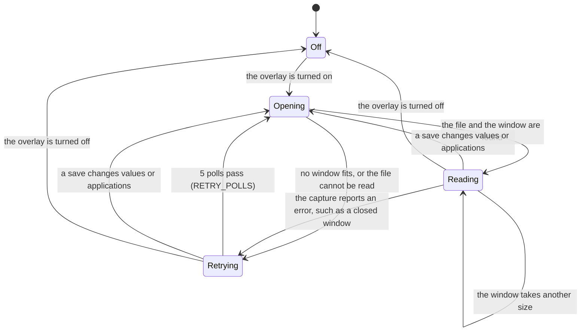

`overlay::window::sync` opens a window for each overlay that is on and closes
each that is not. It runs when the main window mounts and after each overlay
change.

Open problems:

- [#97](https://github.com/TheLunchTrae/appy-tappy/issues/97): removing an
  application does not run `sync`, so its window stays open, and a panel cannot
  be closed.

### Saved files and copies

Every write in `crates/config/src/store.rs` goes to a temporary file, is synced,
and is renamed over the saved file, so a reader sees the old file or the new
one. Each save reads the file, changes it, and writes it back. After a request
that saves values, automations, or applications, the setup app tells the
runtime to read the saved files again. Turning an overlay on or off and moving a
panel write the application's file without telling the runtime.

Open problems:

- [#100](https://github.com/TheLunchTrae/appy-tappy/issues/100): two copies of the
  setup app can overwrite each other's saves, and a crash leaves the temporary
  file behind.

## MCP investigation server

The [MCP investigation server](MCP-investigation-server.md) answers one request
at a time. Its `Session` in `apps/mcp/src/tools.rs` keeps the executables the
user refused, and at most one attached process with its memory scan.

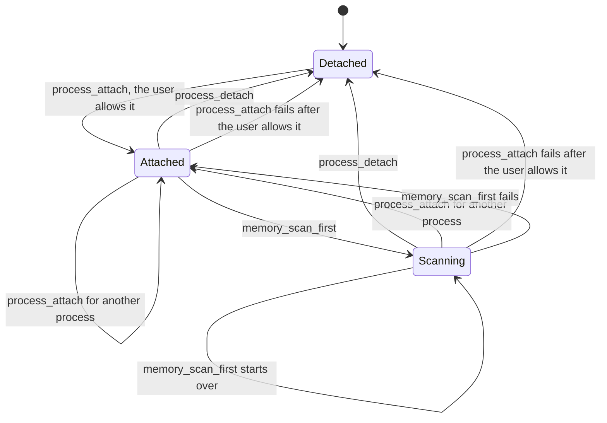

A program the user refuses is refused again without asking for the rest of the
session, whatever its process ID.

Open problems:

- [#102](https://github.com/TheLunchTrae/appy-tappy/issues/102): an attach that fails
  after the user allows it drops the process already attached, and a first scan
  that fails drops the old scan.
